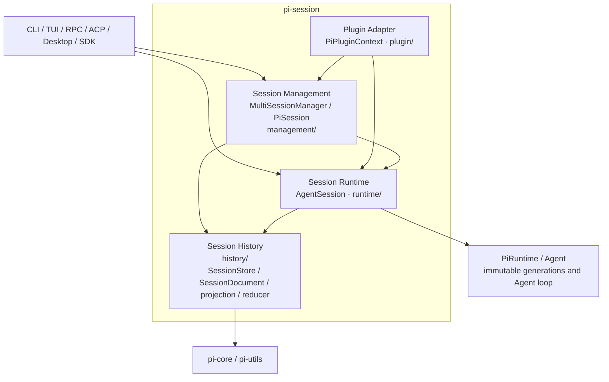

# Pi Rust core architecture

## Scope

`codex/agent` owns the agent runtime, plugins, CLI/TUI, Node host, and evaluation tooling.
`codex/desktop` builds on that branch and adds `apps/orbit` and `apps/pi-desktop`. Desktop-specific
paths and architecture described below refer to the desktop branch. Shared Rust presentation
values and plugin hooks remain runtime contracts; the desktop branch retains those crates as
local dependencies. Runtime updates flow from `codex/agent` into `codex/desktop`.

The current product is a plugin-first Rust coding agent with one `MultiSessionManager` / `PiSession`
Interface behind interactive TUI, print, Pi-compatible NDJSON, and stdin/stdout RPC modes. Both the
standalone binary and the Node extension host delegate interactive terminal ownership to the
Ratatui frontend in `apps/pi-cli`.
Its core implements the deterministic:

```text
prompt -> provider stream -> assistant message -> tool calls -> tool results -> next turn
```

HTTP providers, production tools, model/resource discovery, resumable sessions, compaction,
project trust, native dynamic-library loading, and terminal presentation are outer modules around
that core. A Node/NAPI host adds Pi-compatible JavaScript and TypeScript extensions while Rust owns
session/runtime and terminal presentation. Interrupted operations are reducer-reconciled without
implicitly replaying external side effects. Signed/OCI native-plugin distribution remains an open
product seam.

## Domain composition

The reusable framework and the Coding product share one Agent loop, Plugin/ProviderPlugin contract,
`MultiSessionManager`, and generation transaction. `crates/pi-sdk` exposes `AgentHarness` and
`AgentHarnessBuilder` for explicit model, prompt, tool and provider factory composition. It owns
shared Project definitions and has no dependency on `pi-coding`, settings/resource discovery,
provider implementations, native package discovery, or first-party tool/feature plugins. Creating
an embedded harness does not read `.pi`, AGENTS.md, skills, credentials, or environment model defaults.
The caller chooses plugin factories and session options. Each session binds its own generation
capabilities, preserves its WorkspaceSnapshot, and retains current/restored model and tool selections.

`AgentHarnessBuilder` owns its configuration and implements `SessionGenerationFactory` directly.
`build(self)` moves it into `MultiSessionManager`, which retains it behind the shared factory trait
for session creation, resume, and reload. Applications constructing their own manager can pass the
builder directly to `MultiSessionManager::new`. This is a deliberate Rust composition choice; the
shared generation preparation, activation, rollback, and session-binding contract is unchanged.

For a fresh SDK session, a configured AgentSessionOptions.initial_model request is resolved through
InitialModelRequest before the initial runtime model is recorded. Resume still resolves against the
saved model, isolated sessions retain their supplied initial state, and reload retains the live model.
An absent options-level request preserves the model supplied to AgentHarness::builder. This keeps
domain model/settings selection out of catalog loading and avoids recording a bootstrap fallback.

`domains/coding` is the `pi-coding` crate. It owns `Pi`, `Config`, `Features`,
`ProductSessionFactory`, configured providers/tools, project trust, local discovery, memory and
subagent wiring, and prepared package activation. CLI, Desktop and the Coding eval harness use this
entry point. Rust embedders of the old product SDK migrate `pi_sdk::{Pi, Config}` to
`pi_coding::{Pi, Config}`; the generic SDK does not import the Coding crate as a compatibility facade.
Providers, tools and optional features remain independently reusable under `plugins/`. Coding
prompt assembly and project resource discovery are private modules in
`domains/coding/src/{prompt,resources}.rs`; the former `pi-prompt` and `pi-resources` crates have
been removed. `pi-settings` remains an independent crate under `domains/coding/settings` so the
CLI and JS package manager can share the current settings format without depending on the entire
Coding product. Its package name and public API are unchanged.

`pi-runtime::SystemPrompt` accepts final text or an injected `SystemPromptFactory`. Preparation
runs once per candidate generation and returns a renderer plus diagnostics/inspection metadata.
Rendering receives the immutable workspace and currently active ToolSpecs; tool-selection changes,
including state restoration, rerender those frozen inputs before publication. Restoring the same
selection reuses the prepared prompt and inspection data. Failed preparation/rendering preserves
the previous generation/selection. Final text stays exact while tools can change independently.
`pi-sdk::AgentHarnessBuilder::system_prompt` exposes this same prompt contract for domain-specific
composition. Default tool selection is resolved after registration and before the first render;
explicit selections preserve their order. `SessionGenerationRequest::restored_configuration`
previews the effective tool selection through the same read-only recovery plan later used to
repair the journal. It includes accepted deferred writes and distinguishes an older log without
a selection from an explicitly empty selection. The SDK reconciles removed tools and configured
additions before rendering a resumed or reloaded session; rejected prompts do not apply those
recovery writes. Fresh isolated sessions use their inherited selection. Generic harnesses still
perform no implicit resource discovery.
Coding's private `prompt::CodingSystemPrompt` adapts its resource and prompt builders at this seam.
It follows current Pi's section rendering and serialized options; plugin prompt hooks remain
run-local. `scripts/sync-prompt-conformance.mjs` executes the local TypeScript oracle to capture
10 tool declarations and 16 prompt scenarios. The checked-in fixture is exercised by Coding's
`prompt::oracle_tests` without requiring Node during Cargo tests. Installation-specific documentation
paths are normalized, not pointed at the upstream distribution. An opaque forced prompt bypasses
section validation/rendering; a controller's run-local text replacement also updates the run prompt
state so the next loadout render cannot silently undo it. This is not a new plugin lifecycle or a
claim that optional Rust product extensions or every provider request are identical to Pi.

`crates/pi-sdk/tests/dependency_graph.rs` enforces the production dependency boundary for
`pi-core`, `pi-plugin`, `pi-agent`, `pi-runtime`, `pi-session`, `pi-sdk`, and `pi-eval`. It walks Cargo's
resolved normal/build dependency graph with all features and targets, rejecting direct or
transitive dependencies into repository `domains/`, `apps/`, `plugins/`, `bindings/`, or
`packages/`. A second rule automatically includes every workspace package under `crates/` and
rejects direct or transitive dependencies on `pi-coding` or `pi-coding-eval`, including paths
starting at a crate's own dev dependencies. Downstream packages' dev dependencies are not built
by that crate and are excluded from traversal. Dev-only fixtures are otherwise permitted. The
guard runs in both the workspace suite and `scripts/test-core.sh` and reports the dependency path
when an edge violates either rule.

`pi-session` owns operation admission, cancellation, event ordering and persistence/compaction
cut points; its internal `history` module owns durable mutations and storage.
`EntryAppendOrigin` is transient event provenance: automatic agent persistence and configuration
updates remain visible to native observers/history while the Pi RPC projector omits their redundant
`entry_appended` frames. Explicit custom/context appends keep that notification. Provenance is not
stored in v4 records and is not inferred from command names or entry payload types.
`AgentSessionOptions` selects a shell executor and compaction policy. Defaults have no
shell executor and use `GenericCompactionPolicy`; `domains/coding/src/session` supplies
`CodingShellExecutor` and `CodingCompactionPolicy`, including shell defaults, Coding summary text,
and read/write/edit tracking. The shell request/result types and old `bashExecution` projections
remain readable for Pi wire compatibility. Shell execution still records the submitted command,
respects the session operation gate and does not materialize a new log before an assistant response.
Coding selects `pi_shell::execute_user_shell` for user-shell execution. Its private capture policy
applies Pi's streaming ANSI/control/interlinear and carriage-return sanitization before callbacks,
tail capture, and full-output persistence; rolling user buffers count UTF-16 units. Built-in bash
and PowerShell tools keep raw capture. Both paths settle independent UTF-8 decoders for stdout and
stderr. This selection does not add a mode to the generic shell request or change session wire data.
`FileOperations` remains a compatibility hook value; generic compaction does not interpret coding
tool names. Existing lazy JSONL persistence, recovery, shared mutation sequencing and native plugin
contracts are unchanged.

`examples/order-agent` is a deterministic non-Coding consumer: it registers an order lookup tool
and a scripted provider through the generic SDK. SDK integration tests exercise tool continuation,
capability binding, resume, preserved model/workspace/tool selection, failed reload rollback and
absence of implicit Coding resources. It needs no model credentials or network.

## Session modules

Session behavior has four owners inside the `pi-session` crate. The first three are domain Modules;
the Plugin Adapter binds executable capability contracts to them. The arrows below show the main
call/dependency direction.



| Module | Owns | Does not own |
| --- | --- | --- |
| Session History | v4 JSONL, one mutation sequence, trees/lanes, queries, context projection, isolated provenance, pure recovery reduction | Agent execution, plugin capability contracts, shell execution, frontends |
| Session Runtime | one generation's input, activity, queues, delivery, retry, compaction, context activation, configuration, semantic events | generation replacement, managed child ownership, product discovery/defaults |
| Session Management | stable handles, unique active paths, generation preparation/publication, isolated child lifetime, cross-generation observation | transcript reduction, input delivery policy, terminal/UI rendering |
| Plugin Adapter | generation-bound native/JS capabilities, model/session/UI adaptation, typed/wire conversion | durable state, run admission and timing, a second runtime lifecycle |

`AgentSession` remains the runtime object; no public `SessionRuntime` wrapper is added around
`PiRuntime`. The private `SessionSlot` replaces the old internal `AgentSessionRuntime` name and
owns the current generation plus its factory. `SessionGenerationFactory` remains the injected
product seam, implemented by the generic SDK and Coding composition. Runtime initial/restored
configuration values live in `runtime/options`, so Session Runtime does not import Management or
the concrete Plugin Adapter. It dispatches only `pi-plugin` contracts.

History lives in `crates/pi-session/src/history/`; it uses `pi-core` and `pi-utils` values without
importing Runtime, Management or plugin contracts. Its implementation modules are private, and
`pi-session` re-exports its public values. This is an internal module seam within one crate;
Cargo dependency checks apply to `pi-session` as a whole.
`SessionStore` is the mutable history owner, `SessionHistory` is its read-only view, and
`SessionDocument` is a complete history snapshot. Rust callers use `pi_session::SessionStore` in
place of `SessionLog` and pass prepared stores with `SessionSource::Store`. Direct storage operations
return `HistoryError`; runtime and managed operations use `SessionError` with explicit
variant-preserving conversion. `ForkPosition` is a shared `pi-core` value re-exported through its
existing plugin/session paths. These are Rust Interface changes, with no v4 schema or plugin-wire
change.

Internal historical context queries have typed Session owners: `AgentSession::context_usage`
combines the active model window with default-history checkpoint accounting, while
`SessionHistory::context_entries` selects the default context-bearing records from a shared
journal snapshot. Both retain the built-in history view rather than running generation-specific
transforms or projectors. Historical usage can remain unknown after edits or compaction and is
separate from configured `context_messages` and the latest-request `context_budget`. The Plugin
Adapter delegates these queries and only converts errors and serializes entry values; the internal
queries preserve the original History errors and do not expand the public Rust Interface.

`PiSession::observe()` captures a generation and initial snapshot, then returns `SessionUpdate`:
`Event` carries `(epoch, revision)` and a product event; `Reset` carries the same cursor, a full
snapshot and either `Replacement` or `Lagged`. A replacement increments the epoch even on reload
of the same session ID. Revisions are monotonic within an epoch and can have gaps from direct
snapshot refreshes. Event revision assignment and broadcast publication share one lock.
The observer prefers a published replacement over queued old-generation events and filters
revisions already represented by its subscription/reset snapshot. It uses the existing watch
channel without a forwarding task or another transcript reducer. Closing the managed handle wakes
observers, drains final events and ends the stream even while callers retain a `PiSession`.

Lag recovery restores current state; it cannot replay missed transient notices/errors. TUI and
Desktop rehydrate their presentation. RPC instead installs a generation-bound synchronous
`SessionEventObserver` through the existing pre-start binding seam. It projects into one ordered
writer at publication time and does not forward the lossy broadcast or maintain a replay cache.
Agent execution awaits actual observer/writer acknowledgement; command responses fence prior
synchronous publications, while prompt receipts enqueue at the runtime's preflight callback.
Arbitrary synchronous extension/startup bursts retain legacy-style queuing, not a hard memory
bound. Current-thread runtimes remain supported; no blocking I/O or terminal policy enters Session.
Observer callbacks run outside hub and owning mutation locks. Queue mutations defer observer
dispatch across their state/Agent queue locks while retaining the original snapshot, revision,
persistence and enqueue cut points. Reentrant/concurrent publications retain revision order.
Normal retirement freezes further observer publications and fences accepted synchronous callbacks
before closing leases; it does not await external stdout flush. Forced runtime cancellation/drop
releases leases without pretending dropped publications were delivered. The existing manager's
complete-on-drop replacement transaction remains distinct from cancelling a direct runtime shutdown. Desktop's own message refresh
keeps the observation cursor unchanged: covered message deltas can be skipped while pending
lifecycle, error and notice events are still projected. Run-scoped ACP/print subscriptions remain
pinned to their original generation. Low-level `subscribe()` remains available for those callers.

Plugin message delivery is planned and admitted by Session Runtime. It distinguishes durable-run
acceptance from activity idleness, queues before-settle continuations, carries image attachments
through text preprocessing, and takes the activity gate when an asynchronous custom append must
wait. Background deliveries retain their originating generation and report failures as semantic
plugin notices. The Plugin Adapter only converts capability options and errors.

The decomposition preserves lazy first-assistant materialization, shared in-memory logs across
reload, shutdown-hook checkpoint writes, ordered lifecycle hooks, and assistant/tool-result
pairing before the next provider request. History performs pure interrupted-state reduction;
Session Runtime applies accepted recovery writes. It does not replay external tool side effects.

`SessionStore` distinguishes deferred persistent journals from explicitly in-memory journals.
`AgentSessionOptions::in_memory` and `CreateSessionOptions::in_memory` select the latter; the CLI
exposes it as `--no-session`. Memory journals validate and reduce the same v4 mutations but never
materialize a file. Their internal path remains a routing identity. New-session replacements,
reloads and forks preserve that mode. Explicitly opening saved history selects its persistent
store. A deferred persistent draft still cannot be forked until its first assistant response.

## Workspace

The product execution model is `Project → WorkspaceSpec → Session → Generation`.
`pi-core` owns validated `WorkspaceRootId`, `WorkspaceRoot`, `WorkspaceSpec`, and immutable,
shared `WorkspaceSnapshot` values. A spec contains multiple named roots, a primary-root reference,
and an execution directory within that primary root. Root provenance describes externally managed
directories or managed worktrees; it never grants permission to delete them. Workspace is a value,
with no independent ID, registry, handoff lifecycle, or automatic worktree cleanup. Desktop records
ownership of created worktrees separately from these execution values.

`pi-sdk::projects` owns stable Project identities, root configuration, filesystem resolution, and a
versioned `projects.json` store. An optional `executionDir` retains a working directory below the
primary root; older records still execute at that root. Store transactions reread under a cross-process OS lock and use
atomic replacement; corruption and unsupported versions are errors. Project edits affect newly
created sessions. Standalone cwd entry points remain single-root adapters and need no Project.
Native v4 headers retain `cwd` as a compatibility projection and store the complete versioned spec
in `metadata["pi-rs.workspace"]`; optional `metadata["pi-rs.project"]` records the Project ID.
Only missing workspace metadata falls back to cwd. Invalid metadata or a mismatched execution
directory is rejected. Resume, fork, and native export/import retain the saved environment even
after the Project has been edited or removed. Lazy first-assistant persistence is unchanged.

Generation requests carry a WorkspaceSnapshot and factories must preserve it. Runtime preparation,
plugin capabilities, tool argument preparation/execution, provider callbacks, and session callbacks
share that snapshot through the existing generation context. Their `workspace()` views are read-only
and their `cwd()` accessors derive from the same description. AgentLoop and ToolScheduler propagate
the existing context parts, including this snapshot. Native factories receive the complete workspace
through the existing fallible preparation seam; exact-build fingerprint checks require rebuilding
native plugins after this contract change. Library pinning and manifest/ABI verification policy are
unchanged. JavaScript callbacks and context queries expose the same serialized environment.

Ordinary reload rebuilds resources from the session's saved spec. Managed isolated sessions and
ephemeral Agents inherit it; same-directory new-session replacements retain it, while an explicit
different cwd creates a single-root environment. Schedules save their workspace and only claim work
from a session with that environment. For multi-root sessions, SDK's factory-backed workspace
prompt plugin contributes only the working directory, root names and paths, and the relative-path
rule through `before_agent_start`, without mutating reusable base prompts. Values are quoted;
root identities, ownership, resource-loading policy, and filesystem-permission claims are omitted.
The complete WorkspaceSpec remains available to the runtime and plugins.
Settings, context, skills, MCP, and native plugin discovery still start at the execution directory;
supplemental roots do not merge resources automatically. Relative tool paths resolve only from that
directory. Absolute, home-relative, and parent-relative tool paths remain permitted by existing Pi
path rules and OS permissions; roots are not a filesystem sandbox. Snapshots freeze descriptions,
not file contents.

Desktop migrates legacy one-path records to SDK Projects while preserving IDs and UI settings.
Its Add workspace panel creates one Local Project from a name, one or more directories, and a
primary directory. Native creation validates and canonicalizes every directory, deduplicates aliases,
and persists the complete Project before publishing its UI association; an association write failure
rolls back the unpublished Project. This deliberately extends Pi's cwd-only creation entry point.
The sidebar's Edit workspace panel updates that same Project; existing roots retain their IDs and
provenance, and changing the primary root resets the default execution directory to that root.
UI names are projected from the authoritative Project. The Projects settings editor also
adds/removes directory associations and selects a primary root.
Worktree project adapters replace the actual Git source root, retain all other roots, make the
worktree the child's primary root, and record its provenance. Desktop's existing Git association
continues to select that source repository even when the parent Project's primary root changes.
Removing a Project association preserves directory contents and detaches child UI records; the
explicit worktree-delete operation continues to own physical deletion. Draft sessions are keyed by
Project identity, refreshed transactionally when roots change, and claimed under the same lock.
Composer text is independent of that refresh. Session listings use saved Project associations;
legacy cwd matching requires an exact match to a root of only one Project, including supplemental
roots after a primary-root change. File browsing, terminal startup, and session
inspection resolve existing conversations from their saved environment.

Desktop file listings return that complete environment plus root-relative file references
(`rootId`, `path`). The file panel selects a root, while completion searches all roots and
labels each multi-root result with its directory name. Mentions and snippets use absolute paths
for multi-root sessions or when execution is below the root; single-root cwd-relative mentions
retain their existing form. File previews resolve root IDs against the selected session's saved
spec, and file-list caches discard responses from previous selections. Missing or unreadable
roots report scan errors while available roots remain browsable. Desktop preview containment is
unchanged and does not change agent filesystem-tool permissions. Git status includes its actual
repository directory so modified-file filtering never matches another root by relative path alone.

Desktop Git inventory also resolves the selected conversation's saved spec. Each checkout exposes
its canonical workdir, per-worktree git directory, common directory, and associated root IDs.
Multiple roots in one checkout share an inventory entry; linked worktrees remain distinct even when
they share a common directory. Containing repositories are discovered automatically; nested
repositories require an explicit depth-limited scan. Unavailable roots report individual errors.
Legacy `gitRoot` may seed the initial selection only when it belongs to this environment.

Git selection is view state and never edits Project roots, execution cwd, or `gitRoot`. Git and
GitHub IPC requests carry a session and explicit checkout target; native resolution validates that
target against the saved spec and current Git metadata before passing a fixed workdir to Git
mechanics. Unqualified legacy requests reject ambiguous multi-checkout environments. Initialization
uses a root identity and rejects a root that has since become a checkout until inventory refresh.
Commit-message generation runs in the selected checkout. UI caches include the environment and
checkout, and per-visit tokens discard results after selection changes, including A→B→A. Multi-step
commit/push operations retain their captured target while their UI updates expire on a new visit.
The legacy worktree apply action is exposed only on the legacy child Project's own checkout.

Desktop managed worktree creation prepares a durable native plan before changing Git. The preview
captures the source session's WorkspaceSpec, actual checkout membership, new branches, pinned commit
IDs, destination paths, and resulting roots. Roots within one checkout share one new worktree;
separate linked worktrees remain separate members even when they share a Git common directory.
`pi-sdk::projects::realize_worktrees` preserves root identities and checkout-relative offsets,
including an execution directory below a root. Unselected roots keep their original paths. When
the source cwd is not selected, an explicit execution root is required. Nested repositories must
be explicit Project roots before isolation; lexical containment alone never relocates a root.
The mapped directories must exist in the chosen commits. Source uncommitted changes are not copied.

The Desktop `worktree_groups` module owns a versioned journal in `managed-worktrees/<project-id>.json`.
This is a resource ownership record, not a second Workspace registry. Preparation writes only
metadata. Execution loads that record under a nonblocking OS lock, revalidates the source and
destinations, and journals each member before creating it. The child SDK Project and UI association
are published after all members exist. The source setup script is captured at preparation; optional
AGENTS.md copying does not overwrite tracked destination files. This new creation flow requires
new branches; linked members in the same repository require different branches. Branches survive
worktree cleanup, including failed creation, so commits remain recoverable.
The operation guard explicitly unlocks on drop, so descriptors inherited during concurrent process
launch cannot prolong a finished operation's lock.

Interrupted creation and cleanup remain listed across restarts. Cleanup validates all member
identities, Git registrations, locks, and tracked/untracked/ignored changes before deleting any
member. An explicit discard action may remove changed files, but cannot bypass identity or lock
checks. Deletion uses the recorded Git common directories and works without the parent Project;
it never infers ownership from root provenance, deletes shared roots, or falls back to recursive
directory removal. Progress is persisted so partial cleanup can be retried. Removing a Project
association alone retains the journal and filesystem contents; unresolved delivery attempts must
first be resolved so their recovery entry point remains available. Managed groups do not use legacy
whole-workspace branch rename or apply actions; checkout-scoped Git operations remain available.

Managed worktree delivery has a read-only overview and commit merge preview. Its checkout identities
come from the group's ownership journal and are validated against the selected session's saved
workspace. The original checkout recorded during creation is the destination; editing the parent
Project cannot retarget delivery. Each member exposes its current HEAD, local target branches,
working-directory changes, and availability independently. Shared roots are never merge members.
Preview resolves an explicit local target branch and pins both commit IDs. Incoming commits are
those reachable from the worktree HEAD but not the target, rather than every commit since creation.
The changed-file view compares the merge base to the worktree HEAD.

Commit mergeability and checkout readiness are distinct results. Divergent tree merges use a
private in-memory object database, leaving the real refs, index, object database, and working files
untouched. Conflicts, fast-forwards, already-integrated commits, unrelated histories, and unsupported
merge semantics are explicit outcomes. Custom Git attributes/drivers and multiple merge bases are
reported conservatively; bounded result lists indicate truncation. The preview separately reports
target-branch mismatch, unfinished Git operations, locks, target working changes, and possible
ignored-file collisions. Source uncommitted files are displayed but excluded from the commit
comparison. Branch movement during inspection rejects the snapshot. The UI expires previous
results when the session, repository, or target changes. Preview remains read-only; an explicit
execution request carries a fresh attempt ID, selected checkout and branch, and the displayed
source and target commit IDs. Native execution revalidates the saved session workspace, ownership,
both commits, checkout readiness, and supported Git semantics before saving an attempt.

Delivery executes one checkout per request. Group locks and a lock keyed by the canonical Git
common directory serialize this product's delivery operations, including separate groups sharing
a repository. Unresolved attempts in another group block a new delivery into that repository.
The first attempt upgrades the ownership journal to version 2; version 1 records remain readable,
while older binaries reject version 2 instead of dropping recovery metadata. Attempt IDs are
idempotent: repeating a request observes the saved attempt rather than applying it again.

The in-process Git implementation supports fast-forward and conflict-free two-parent merges.
It saves the prepared result commit before changing files, locks HEAD, the target branch and the
index, rechecks the target under those locks, and uses safe checkout without removing untracked or
ignored files. The index lock spans checkout, atomic publication of the prepared index, and branch
update, so concurrent staging cannot be accepted and then overwritten. It advances the branch only
after the complete index and working directory match the prepared result. Hooks, signing,
attributes, filters, submodules, sparse checkouts and other
unsupported configured semantics are reported as blockers rather than silently bypassed. No Git
subprocess outlives the native operation, and no force reset or automatic abort is used.

Recovery classifies a persisted attempt as completed, unchanged, ready to finish, or needing
inspection. Refreshing this state does not rerun checkout or merge. An explicit finish action may
advance the original branch only when its old commit is unchanged and all planned files are already
present; it revalidates under the same Git reference locks. Partial writes, changed branches,
unavailable objects and leftover Git locks remain visible for manual inspection. Git and filesystem
updates are not an atomic transaction; a journal retained across interruption is the recovery
authority. Unresolved attempts block both physical cleanup (including force discard) and detaching
the managed Project. Physical cleanup holds the same repository locks and also checks other groups'
unresolved attempts, preserving a managed checkout that is another group's delivery destination.
Successful delivery in one repository is never rolled back because another repository fails.

This is a deliberate Rust product extension. The current local TypeScript Pi session manager uses
v3 headers without this metadata extension; the Pi-compatible v3 RPC projection remains unchanged.

```text
crates/pi-core                  messages, models, tool data and shared Pi v4 wire values
crates/pi-plugin                Plugin/ProviderPlugin contracts, prepare factories, capabilities,
                                registries, drivers and ModelRuntime
crates/pi-agent                 Agent façade, AgentLoop, StreamAssembler, ToolScheduler
crates/pi-runtime               plugin registration and Agent construction
crates/pi-provider              vendor-neutral HTTP transport and SSE framing
crates/pi-media                 multimodal byte processing; image detection, conversion and inline limits
crates/pi-utils                 policy-free shared mechanics, namespaced by concept
crates/pi-session               Pi v4 storage/runtime; re-exports shared lifecycle and wire values
crates/pi-sdk                   explicit domain-neutral embedding and shared Project definitions
domains/coding                 headless Coding product composition shared by CLI, desktop, and adapters
domains/coding/src/prompt.rs    private Coding prompt assembly and generation-local rendering
domains/coding/src/resources.rs private system/append prompts and project context discovery
domains/coding/settings        pi-settings: current-format documents, snapshots, and safe writes
domains/coding/eval            pi-coding-eval: Coding eval configuration and isolated product preparation
crates/pi-telemetry             typed Pi AI/harness span schemas and sink adapters
crates/pi-eval                  domain-neutral eval cases, session execution, plugin overlays, graders,
                                artifacts and paired comparison data
crates/pi-bench                 deterministic, test-only performance workloads and provenance-rich JSON reports
crates/pi-rpc                   Pi JSON projector and stdin/stdout RPC adapter
crates/pi-acp                   official stable-v1 ACP adapter and ACP session policy
apps/pi-desktop                experimental Tauri/React shell with a Pi-to-thread event Adapter
apps/pi-cli/src/markdown       TUI-owned Markdown parsing, streaming repair, highlighting, and Ratatui rendering
crates/pi-plugin-macros         static plugin preparation, agent hook-interest derivation, and native exports
crates/pi-plugin-manager        native loading, installation/reconciliation, and optional authoring tools
crates/pi-js-package-manager     Pi-compatible JS discovery and npm/git orchestration
crates/pi-js-plugin             JS wire DTOs plus unified Plugin and independent ProviderPlugin adapters
bindings/pi-napi                NAPI-RS boundary between Node callbacks and the Rust product
packages/pi                     Node launcher, jiti extension loader, and callback host
crates/pi-test-support          deterministic scripted providers and tools for tests
apps/pi-eval                    eval CLI and the first-party eval case catalog
plugins/providers/pi-plugin-openai        OpenAI provider plus reusable Responses wire support
plugins/providers/pi-plugin-anthropic     Anthropic Messages, Claude Code mode, provider, and catalog
plugins/providers/pi-plugin-xai           xAI Responses provider and Grok catalog
plugins/providers/pi-plugin-google        Google Generative AI provider and Gemini catalog
plugins/providers/pi-plugin-models        models.json catalog, routing, and request-time config
plugins/features/pi-plugin-mcp
                                MCP client/transports, tool projection, local config management and /mcp
plugins/features/pi-plugin-{prompts,skills}
                                generation-local prompt-template and skill discovery/commands
plugins/features/pi-plugin-session-transfer
                                first-party export/import/share commands
plugins/features/pi-plugin-subagents
                                profiled delegation and bounded recursive child-session policy
plugins/features/pi-plugin-schedule
                                persistent schedules, claim locks, isolated runs, history, lifecycle cleanup
plugins/features/pi-plugin-memory-hermes
                                default curated USER.md/MEMORY.md provider with frozen prompt snapshots
crates/pi-tool-support           shared path validation, argument, and truncation helpers
plugins/tools/pi-plugin-{read,write,edit,hashline-edit,bash,grep,find,ls}
                                one production tool per plugin crate
e2e/                            in-process runtime acceptance and frontend example resources
domains/coding/src/project_trust.rs product trust policy and persistence
apps/pi-cli/src/tui.rs           terminal project-trust prompt Adapter
```

Dependencies point inward:

```text
pi-plugin            -> pi-core + pi-plugin-macros
pi-agent             -> pi-core + pi-plugin
pi-provider          -> pi-core + pi-plugin
pi-media             -> pi-core + image codecs
pi-utils             -> standard library; serde + YAML decoding behind its `frontmatter` feature
pi-session           -> pi-core + pi-plugin + pi-runtime
pi-settings          -> serde JSON + filesystem persistence only
pi-sdk               -> pi-session + pi-runtime + pi-core + pi-plugin
pi-coding            -> pi-sdk + pi-session + pi-settings + pi-runtime + product providers, tools, resources,
                        memory, skills, subagents, and plugin loaders
pi-rpc               -> pi-agent + pi-core + pi-session
pi-plugin-mcp        -> pi-core + pi-plugin + rmcp + filesystem configuration persistence
pi-acp               -> pi-agent + pi-core + pi-plugin + pi-plugin-mcp + pi-session + official ACP SDK
pi-plugin-openai     -> pi-core + pi-plugin + pi-provider
pi-plugin-anthropic  -> pi-core + pi-plugin + pi-provider
pi-plugin-xai        -> pi-core + pi-plugin + pi-provider + pi-plugin-openai::responses
pi-plugin-google     -> pi-core + pi-plugin + pi-provider
pi-tool-support      -> pi-core + pi-plugin
production tools     -> pi-core + pi-plugin + pi-tool-support
pi-plugin-read       -> pi-media (shared image normalization)
plugins/features/pi-plugin-skills
                     -> pi-core + pi-plugin (skill discovery, prompt contribution, explicit invocation)
plugins/features/pi-plugin-memory-hermes
                     -> pi-plugin + filesystem locking
                        (default bounded, file-backed curated memory provider)
plugins/providers/pi-plugin-models
                     -> pi-core + pi-plugin + pi-plugin-openai (credential-blind catalog and routing)
other plugins/*      -> pi-core + pi-plugin
pi-runtime           -> pi-core + pi-plugin + pi-agent
apps/pi-cli          -> pi-coding + pi-rpc + pi-acp + terminal and Markdown adapters
                        + pi-media (attachments) + pi-tool-support (Pi read-path semantics)
apps/pi-desktop      -> pi-coding + pi-sdk::projects + pi-session + Tauri
pi-plugin-manager    -> pi-plugin (native) + pi-runtime + dynamic loading, HTTP/filesystem installation
                        + optional Cargo/GitHub authoring tools
pi-js-package-manager -> filesystem + npm/git process adapters (no Node dependency)
pi-js-plugin         -> pi-core + pi-plugin (no Node or terminal dependency)
pi-bench             -> pi-agent + pi-runtime + pi-session + pi-core + pi-plugin + pi-test-support (test-only)
pi-eval              -> pi-session + pi-core + pi-plugin + pi-utils
pi-coding-eval       -> pi-eval + pi-coding + pi-js-plugin
apps/pi-eval         -> pi-coding-eval + pi-eval + pi-coding + pi-js-plugin
bindings/pi-napi     -> pi-js-plugin + apps/pi-cli + apps/pi-eval + NAPI-RS
packages/pi          -> Node + jiti + platform pi-napi artifact
```

`apps/pi-cli/src/markdown` is a private frontend module rather than a reusable crate. It owns the
Ratatui-specific Markdown adapter used by `pi-cli`; no crate under `crates/` or plugin may depend on
it. Keeping parsing, streaming repair, highlighting, and rendering behind its small `render`
interface gives the supported TUI locality without moving terminal presentation into the core
layers.

The standalone Rust TUI deliberately adopts the Codex CLI 0.149 interaction shell while retaining
Pi runtime and command semantics. Its composer is persistent application state; command and skill
completion renders directly below it, queued input previews render above it, and focused model or
resume selectors temporarily replace the composer through a bottom-pane view stack. Closing a view
restores the unchanged draft. The frontend follows a tui-realm-style model/message/module split:
`tui.rs` owns the application model and event loop, semantic runtime notifications pass through
`tui/message.rs` and `App::update`, `tui/controller.rs` owns input routing and effects, `tui/view.rs`
owns layout/rendering, and `tui/components` owns stateful input/selector adapters. This is an internal
terminal-presentation seam, not a new core/runtime message protocol. This is a presentation and input-
routing choice, not a claim that Pi implements Codex-only accounts, usage limits, permissions, or
remote services. Terminal styling, view routing, and selector state remain owned by `apps/pi-cli`.
Both editor and startup submissions defer the working indicator for slash commands until agent
events arrive, matching Pi's separation of command handling from agent execution. Ordinary prompts
retain immediate feedback; image-bearing startup input follows the prompt path. Command dispatch
does not clear or restart progress for an already-running agent, and compaction and shell work keep
their own event-driven status.

Fullscreen text selection is a TUI-owned deep Module. `ScreenTextSurface::capture(buffer)` accepts
only the complete final Ratatui buffer, hiding cell-width normalization, wide-character continuation
cells, coordinate clamping, text extraction, and highlight painting behind that Interface. The view
paints selection after every other widget, including focused bottom views and the project-trust
screen, so no caller can accidentally restrict copying to the transcript. The controller routes
fullscreen mouse gestures through this Module and emits a clipboard write when a non-empty drag is
released. This avoids depending on `Cmd+C` / `Ctrl+Shift+C`, which terminal emulators commonly
consume instead of forwarding to fullscreen applications; forwarded shortcuts remain available for
re-copy and stay distinct from `Ctrl+C`. Animation ticks pause while a selection is active.
Main-screen mode never enables mouse capture and leaves visible-text selection to the terminal.
Semantic `/copy` remains independent and copies the last completed assistant message.

`pi-media` owns provider-neutral multimodal byte processing. Its first Module, `image`, owns
magic-byte detection, BMP normalization, PNG/JPEG encoding selection, dimension/base64-size limits,
EXIF orientation and processing hints behind `process_image(bytes, policy)`. At each size it tries
PNG and the configured JPEG quality, then Pi's additional quality steps before shrinking again.
`pi-core::ImageContent` remains the message contract. The read tool and CLI use that Interface on
blocking workers; filesystem paths, settings, clipboard I/O, and terminal state remain with their
owning Adapters. `read` obtains `inputLimits.images.resize` from the current generation's model
capability on each call, falling back to its configured/default policy only when no model resize
profile exists. An empty profile intentionally selects Pi defaults. Decode/conversion/size failures
produce successful text-only omission results, not failed tool calls. Video/audio Modules and message
contracts are future work; Rust and Photon encoder bytes/pixels are not claimed to be identical.

Coding also installs a private, factory-backed tool-result image normalizer after extension
result modifiers. `pi-media::image::normalize_tool_result_images` owns block normalization;
Coding supplies the generation's `images.autoResize` setting and the current model's resize
profile. Successful conversions/resizes preserve surrounding block order and insert their
notes immediately after the image. Failed processing preserves the original image, matching
Pi's generic tool-result policy rather than the read tool's text-only omission policy. Existing
structured output is preserved when normalized display content is patched. The hook awaits
its blocking image work before the scheduler's final event, history, and next provider request.
This is Coding composition using the existing ordered hook/factory seams, not image policy in
the generic Agent/Session runtime or a new session wire format. Generic SDK and private
ephemeral Agents do not acquire implicit Coding hooks.

CLI startup prepares text and image attachments into `SessionInput`, preserved through TUI,
print and NDJSON submission. As in current Pi's `cli/file-processor.ts` and `cli/initial-message.ts`,
stdin precedes file markup and the prompt; image detection uses bytes rather than extensions,
empty files are skipped, and processing failures become inline omission notices. File paths use
Pi's shared read-path resolution. Startup resolves project trust before reading effective
`images.autoResize`; `images.blockImages` remains request-time runtime policy.

The clipboard Module retains its small `ClipboardWriter::set_text` Interface. Its system Adapter
uses the native clipboard first for local sessions, PowerShell as the WSL fallback, and tmux then
bounded OSC 52 for terminal-mediated copying. SSH deliberately skips the remote native clipboard so
copied text reaches the user's local terminal.
Its separate asynchronous read Interface supports local native image/text paste through `Ctrl+V`.

The standard `edit` and `write` tools share a realpath-keyed mutation queue in `pi-tool-support`.
Queued operations stay ordered through caller cancellation and retain their slot until in-flight I/O
settles. Direct writes follow symlinks and preserve hard links, with no undeclared 10 MiB ceiling.
Editing splices only matched ranges back into the original text; fuzzy matching does not normalize
untouched lines, and mixed line endings survive. These are Pi-compatible filesystem semantics, not
an atomic-replacement or sandbox guarantee. Optional hashline editing retains its separate stale
snapshot checks and remains opt-in.
The reviewed [built-in tool conformance inventory](tool-test-conformance.md) ties the current
legacy tool/support test definitions to executable Rust regressions. Cargo checks the frozen
references without a Node or legacy checkout; the optional source-oracle check detects drift,
including shared fixture changes. Definition counts are not a substitute for behavioral assertions
or platform execution. Dedicated macOS/Windows tool jobs complement the full workspace CI gate.

Matching current Pi's interactive mode, RGBA pixels become a temporary PNG and its path is inserted
at the composer cursor; later tool reads process that image through `pi-media`. These files remain
available after exit for saved path references. Pending reads never insert into a replaced session,
changed draft or focused selector. SSH has no native-read Adapter; terminal text/path paste and
startup `@file` remain available. Native clipboard availability is platform/session dependent.

`packages/pi` does not own a terminal frontend. Its product executable creates the JavaScript extension
host and invokes the NAPI `runPi` entry; interactive, print, JSON, RPC, piped-input, and plugin-management
arguments are forwarded unchanged. Its separate `pi-eval` executable reuses that host and invokes
`runPiEval`, so model-backed extension cases exercise the same Jiti loader and callback Adapter rather
than a test-only JavaScript implementation. This keeps extension callbacks in Node without allowing Node
and Rust to compete for raw mode, stdout, editor state, or transcript projection.

Evaluation has three owners. `crates/pi-eval` owns `EvalRunner`, domain-neutral cases and variants,
step execution, timeout/abort cleanup, observations, grading, artifacts and comparisons.
`domains/coding/eval` is the independent `pi-coding-eval` crate, which owns `CodingEvalHarness`,
Coding case options and variants, and isolated Coding product preparation. `apps/pi-eval` owns the
CLI, first-party case catalog and result presentation. `pi-coding` has no dependency on either eval
crate. This is a deliberate Rust architecture choice; it does not introduce a new Pi runtime or
plugin lifecycle.

`EvalRunner::run` creates a temporary workspace and session path, copies a fixture, and invokes a
caller-supplied preparation function once. `PreparedEvalTarget` supplies an existing
`MultiSessionManager`, provider/model report labels, explicit template bindings and an optional
fallible prompt transform. The preparer applies `EvalRunContext::active_tools` before the first
prompt render. The runner owns session creation and shutdown, including cleanup after execution
errors. After preparation, a cleanup task retains the workspace, manager and active operation;
caller cancellation aborts and joins the operation, then completes the same shutdown future
before releasing the workspace. Cancelling while shutdown hooks run does not restart or skip
those hooks. The runner never discovers `.pi` resources or constructs a Coding product. Fixture
and snapshot directory exclusions are explicit runner configuration with no default Coding exclusions.
Case-local Rust `Plugin` factories and prompt capture use `SessionGenerationOverlay`, preserving
factory-backed reload without serializing executable code. Deterministic tests prepare a non-Coding
`pi-sdk::AgentHarness` through this same Interface.

`CodingEvalHarness` prepares `pi-coding::Pi` in print presentation mode. It creates the isolated
home/agent directory, copies credential and model bootstrap files, disables memory and MCP discovery,
configures the shell environment and initial tools, and supplies `workspace`, `agent_dir` and `home`
template bindings. It explicitly excludes `.git`, `node_modules` and `target` from fixture copying
and workspace observations. Its optional `JsPluginHost`, extension discovery, native plugin paths
and Pi-documentation prompt treatment stay in this domain Adapter. Real native plugin evaluation
stays on the product loader path: explicit libraries/manifests flow through `Config::native_plugins`,
while trusted project manifests under `.pi/plugins` are rediscovered on reload. The eval layer does
not load dynamic libraries itself. Existing CLI options and artifact schema version 1 remain intact.
The documentation treatment removes only the built-in documentation section, preserving appended
instructions and project context before and after reload.

Comparative evals pair observations by eval set, case identity, and repetition. Correctness lift is based
only on pairs with completed, scored observations; token, latency, and estimated-cost deltas use the same
eligible pairs. Missing, duplicate, errored, and unscored runs remain explicit diagnostics rather than
being converted to failures or zero-valued telemetry. Native session JSONL and normalized observations
are retained per run, while invocation-level `report.json` and `report.txt` are derived artifacts.
Provider-authoring cases validate the reloaded catalog and make a direct completion against a
case-owned loopback fixture through the ordinary models.json provider route. The probe is a transient
native agent plugin, while protocol selection, request-time authentication, transport, SSE decoding,
and usage accounting remain owned by the production provider generation.
The separate native-provider case builds a test-only version-locked `cdylib`, supplies its artifact
as an explicit product plugin, reloads the generation, and probes its success and failure streams
through `SessionContext::complete`. The fixture implements the ordinary SDK `ProviderPlugin` and
`Provider` interfaces; eval adds no provider lifecycle or streaming protocol of its own.

`scripts/pi-dev` is the source-checkout Adapter for that same Interface; `scripts/pi-eval-dev` selects
the eval entry while reusing its build and binding resolution. The shared script incrementally builds
`pi-napi` for Rust's current host target and passes the resulting absolute library path through
`PI_RS_NATIVE_BINDING` before starting the TypeScript host. It never relies on copied package
artifacts, so an older `packages/pi/pi-napi.*.node` cannot shadow the current Rust generation. The
standalone Rust Adapter remains native-only. Before constructing a session, it asks the
`pi-js-package-manager` Module whether the trusted/discovered configuration can require JavaScript;
an active requirement fails with an actionable launcher message unless the user explicitly disabled
discovery. This probe is read-only and never installs or updates a package.

All frontend adapters enter the product through `pi-coding`, whose `Pi` Module owns the shared
product composition and exposes the session manager. It selects first-party components, adapts
settings into owner-defined options, connects cross-plugin capabilities and coordinates prepared
product activation. Domain parsing and validation belong to their owning crates; inner crates must
not depend on `pi-coding::Config`. In particular, the composition layer retains the complete
package/provider activation transaction rather than splitting commits across domain loaders.
Inside `domains/coding`, private `generation` owns generation preparation, trust-before-discovery,
context binding and `PreparedProductActivation`; `composition` owns first-party selection,
ordered Plugin/ProviderPlugin registrations, cross-plugin wiring and active-tool policy.
Its private borrowed `GenerationComponents` view contains only already-prepared native, JavaScript,
MCP, memory and subagent components. Hermes implements `Plugin::prepare`; the product
prepares it once before Skills wiring and retains that same instance for both callback families.
Every candidate product generation repeats preparation through `ProductSessionFactory`. Runtime context
is required (tests supply an explicitly unavailable context); overlays, dynamic catalog candidates, settings and
activation guards are not component fields. `BuiltinProviderSet` prepares the shared HTTP transport
before reading credentials, retaining error precedence, and supplies it to both built-ins and
`ModelsPlugin`. Codex credential/transport overrides are test-only provider preparation inputs,
not runtime-build options. These helpers do not start or commit another generation lifecycle.
Private `configuration` maps snapshots and explicit selections into owner-defined options;
`runtime_inventory` derives product labels from resolved/loaded metadata without loading code.
Their tests follow those responsibilities, with lifecycle/rollback tests retained at the factory
and frontend-facing handoff tests using the Coding product entry point. These Modules retain
the same generation and registration lifecycle.
`Config::features` is a typed, host-captured ceiling for first-party memory, subagents, scheduling,
skills, prompt templates, and session-transfer plugins. `SettingsValues::features` supplies the
generation-local selection from the deep merge of global and trusted-project `settings.json`.
The host ceiling permits every feature; settings default hashline, memory, subagents and schedule
to disabled, while skills, prompt templates and session transfer remain enabled. Coding configuration
intersects the two without mutating the host ceiling, so settings cannot re-enable a host-disabled
feature and removing a settings override can
re-enable an allowed feature on reload. Generation construction gates complete agent/session
registrations and initialization, so disabled memory never loads its provider and disabled scheduling
never starts its worker. Each managed session replacement/reload rereads settings; existing sessions
retain their generation until explicitly replaced. A failed candidate leaves the previous generation
active. Neither the ceiling nor the resolved selection is serialized into session history or mutated
in live registries; disabling a feature does not delete its persisted data. Providers, core tools,
explicit native/JS/MCP plugins, general context resources, and read-only skill-file management remain
independent. This is deliberate pi-rs composition policy, not Cargo dependency pruning or a plugin
security boundary. In particular disabling skills/templates removes their built-in plugin, unlike
legacy Pi's `noSkills`/`noPromptTemplates` automatic-discovery suppression, which retains explicit paths.
Coding's factory-backed `FeaturesPlugin` always registers `/features [global|project]`, even when
every optional feature is disabled. The command selects a settings scope and edits allowed flags
through ordinary native `UiComponent` / `Select` nodes; the TUI owns rendering and keyboard state.
The editor observes selection changes to target its `Space` shortcut. Space toggles the focused
flag, Enter submits the complete draft, and Escape discards it; no extra save row is needed.
Project scope requires the generation's existing trust decision. The editor shows global defaults
or the project's effective selection, preserves the host ceiling, and submits only changed flags
to `SettingsManager::patch_features`. Cancellation and an unchanged selection do not write or
reload. A successful save uses the existing command-session reload capability and the replacement
context for its notice. If reload fails, the saved selection remains available for a retry while
the old generation stays active. This command is a deliberate pi-rs addition; legacy Pi has no
corresponding feature-selection command.
Reload requests include the previous generation's registered tool names, including inactive tools.
Coding uses this neutral snapshot to activate newly available default tools when a feature is enabled,
through the existing `additional_active_tools` policy. Previously registered built-in tools retain
the user's selection, and managed children do not gain new tool permissions through reload.
Plugin activation may select an already permitted entry point such as codemode. Other restore
paths retain the saved tool selection and existing plugin-tool activation policy.
Beneath that interface, two public session
Modules remain responsible for session behavior. `MultiSessionManager`
owns the runtime factory, manager shutdown, and a private table of active handles. `PiSession` is the
cloneable per-frontend handle for current-session events and new/resume/fork/reload transitions.
There is deliberately no public `SessionRegistry`: duplicate-path checks and handle bookkeeping are
implementation details of `MultiSessionManager`. `SessionSlot` and its storage target are
crate-private implementation details of the lower-level replacement transaction inside each
`PiSession`; frontend adapters cannot bypass the managed Interface, and runtime failures use the
shared public `SessionError` vocabulary.
The internal History module owns shared mutation sequencing, validation, state projection, pure recovery
reduction, JSONL persistence and repositories. The `pi-session` crate root re-exports its values
and `SessionStore` for existing import paths. Legacy import remains in SessionTransferPlugin.
The print, NDJSON and ACP run Adapters pin `PiSession::current()` for one invocation; TUI, RPC and
Desktop use `PiSession::observe()` for managed events. This keeps generation changes behind one
Interface while preventing a single in-flight submission from crossing generations.

`apps/pi-desktop` is an experimental desktop Adapter that provides workspace, thread, Git, file,
terminal, and conversation presentation on top of the in-process `pi-coding` / `MultiSessionManager`
/ `PiSession` Interface. CLI and desktop do not assemble independent provider, tool, skill, or
prompt runtimes; those product defaults belong to `pi-coding`.
`PiRuntimeState` owns native sessions, `SessionStore` owns create/open/fork/archive/unarchive/delete
discovery, and one projection Module translates Pi lifecycle events into the UI's `thread/*`,
`turn/*`, and `item/*` vocabulary. The Adapter emits that vocabulary through its own `pi-event`
channel; there is no external app-server protocol or child-process boundary. Registered
workspaces are immediately usable by path; the Adapter has no per-workspace connection lifecycle.
Tool projections preserve canonical tool identity, arguments, structured result details and
cumulative partial results. Tool-result image blocks are projected as image data URLs in live
updates and restored snapshots, alongside the text output and structured details. The frontend
preserves these images through item normalization, keeps their previews outside collapsed tool
groups, and uses the shared image viewer. Desktop renders native tool results and displayed custom
plugin messages through app-owned components. Subagent controls remain native commands, with ownership checked by
the plugin. Directly opened child sessions show saved history and a separate inherited-context
snapshot; presentation does not own live agent execution state.
Desktop session creation delegates path construction to `JsonlSessionRepo`, so its project-scoped
`<timestamp>_<session-id>.jsonl` filename, v4 header ID, and projected frontend thread ID share one
identity just as they do in Pi.
Desktop separates history inspection from runtime restoration. `pi_read_thread` returns the
existing live snapshot or projects saved native history in a blocking task, without constructing a
generation, invoking plugins, subscribing to events or repairing the journal. ID discovery and
isolated-parent lookup read only JSONL headers. Ordinary saved conversations use native
`SessionStore::read_transcript`: JSON syntax, headers, mutation envelopes, sequence and tree/lane
references pass through the shared reader and validator, while opaque `custom.data` is scanned
without materializing its JSON tree. Native isolated-context/origin data, displayed custom messages,
message wire extensions, context edits and compaction data remain available to the built-in context
projection. `SessionTranscript` carries the main branch, its already-built context, name/header and
all-branch billed usage; it does not expose an operation log or promise complete extension state.
The reader avoids constructing/cloning a full `SessionDocument`, and Desktop reuses the projected
context and branch for token estimates and message identities. Isolated-child presentation retains
the complete-document path for provenance matching. Runtime resume, recovery, plugin projectors and
export still use complete history. This read projection is an additive Rust Interface, not a new
wire format; original JSONL files and extension state remain unchanged.
The frontend requests this preview alongside `pi_resume_thread`, which retains generation preparation
and subscription ownership. Only an untouched preview is automatically replaced by the ready runtime;
live updates, explicit replacements and newer requests invalidate stale hydration. Runtime failures
leave saved history visible with a transient error. This is a deliberate Desktop presentation choice,
not a change to Pi v4 persistence, runtime generation activation or MCP connection ownership.
Archive and unarchive preserve that project-relative path and companion session tree. An unarchive
event includes a freshly projected summary from the restored JSONL so the desktop rebuilds the
title, model, message count, and timestamps instead of publishing an empty thread placeholder.
Session listing batches requested Projects in one blocking task and scans session paths once per
batch. A shared index caches parsed JSONL summaries by path, modification time and file size, pruning
removed paths and refreshing changed files. Stored Project IDs own association; legacy cwd fallback
uses the shared unambiguous Project resolution rule. The frontend does not re-filter those results
against the Project's current directories. Both active and archived listings use keyset cursors bound
to Project, archive state and sort key, with session IDs breaking timestamp ties. Creation order uses
the v4 header timestamp; activity order uses the file modification time. This changes no session wire
format or persistence rule. Superseded frontend requests are discarded, and older pages merge with
current state so concurrent new sessions survive pagination.
The model selector reads the generation-local catalogue from `pi-coding` and sends the exact
provider/model identity back to `AgentSession`; thinking selection is constrained by that model's
declared levels and persisted through the session configuration entries. The Adapter exposes no
synthetic read-only, on-request, or full-access mode because filesystem and shell tools follow Pi's
operating-system permission boundary.
AI commit-message generation runs through a disposable Pi session and removes that session after
collecting the response. The desktop has no account-login, hosted-usage, approval, review,
remote-daemon, or external agent-configuration compatibility layer. Its only application-level
infrastructure integrations are the app-owned updater/release-notes flow and Sentry.
Desktop thread snapshots include `command_specs()` from the selected `PiSession::current()`;
command/skill discovery never constructs a throwaway session. On entering a workspace without a
selected thread, Desktop prepares one managed in-memory draft via `pi_start_thread(prepareOnly)`.
`SessionStore` serializes preparation per workspace and reuses that handle for command, skill,
and model discovery. Preparation returns a snapshot without publishing `thread/started` or
selecting a visible thread. The first normal `pi_start_thread` claims the prepared handle, so
completion and execution use the same generation; background prompt sessions remain separate.
Both the workspace home input and the conversation composer receive its registered commands
and skills. The existing first-assistant-response persistence rule keeps an unused draft out of
resume history. Closing/reopening the app rebuilds drafts through the normal runtime factory;
no new runtime lifecycle or command registry is introduced. The Desktop Adapter retains
case-insensitive exact-name priority for `/compact` and `/reload` and reserves `/prompts:*` for
custom-prompt expansion. Completion and dispatch share that priority, hiding conflicting runtime
names while the composer displays a visible collision warning. The imported Fast toggle and its
unused service-tier state have been removed.
All other runtime commands pass through `AgentSession.prompt` once, including transformation and
input hooks; Tauri returns the real handled/queued/completed receipt rather than fabricating an
in-progress turn. Product events continue streaming while the IPC call awaits completion. Handled
receipts do not require AgentStart/Settled and cannot stall local queue draining. Plugin notices
are transient severity-bearing Desktop transcript entries, not persisted/provider messages.
Long-lived Desktop forwarders use the existing `PiSession::subscribe()` latest-value watch.
After a replacement they subscribe to the latest `AgentSession` and publish `thread/replaced`
with that subscription's snapshot and the same session's command catalog. The frontend refreshes
history, status, commands, and selected identity together, including reloads that preserve the
JSONL ID. Initial create/resume snapshots also carry commands; no separate catalog IPC or
catalog event listener is needed. This is a deliberate Rust Desktop observation policy, not a Pi
wire/schema change: intermediate generations may be coalesced, and transient plugin notices sent
before the new event subscription is installed are not replayed. Displayed notices survive a
same-ID reload. Failed preparation publishes no change and leaves the old subscription intact.
Historical tool calls/results use their persisted names, arguments and result metadata even when the
original plugin is unavailable. Displayed custom plugin messages retain their type label and use a
generic Markdown/image presentation independent of plugin availability; hidden custom messages stay
hidden. These records are never treated as newly submitted user messages or re-executed tools.
The model selector reads the explicitly selected thread's existing generation, or the managed
workspace draft when no thread is selected. It refreshes after `thread/replaced` and explicit draft
reloads; request/context checks discard stale responses after selection or generation changes.
Catalog reads wait for an already requested resume without opening another session.
Model configuration writes require a successfully loaded catalog for the selected workspace and
thread. Selected-session refresh treats the native current model as authoritative, so a previous
thread's preferences or a stale response cannot undo reload's preserved model selection.
Desktop introduces no generation FIFO or activation observer bookkeeping; it consumes the
manager-published replacement exactly like the other frontends. Dropping the managed handle closes its watch and stops the forwarder;
no liveness polling is needed. Snapshot revisions delimit subsequent events so history captured
at subscription time is not displayed twice. When subscription starts during an active response,
the forwarder also refreshes the completed snapshot on settlement so a missed message-start event
cannot hide that response's final content.
Desktop submission receipts only reconcile optimistic status while their synchronous status
revision is still owned; later lifecycle events or submissions win even before React renders.
Submitted attachments are consumed before awaiting IPC, so a completed turn cannot clear the
next draft's images. Store/forwarder keys
identify managed handles separately from replaceable JSONL IDs: an old saved ID can be reopened,
but is never silently routed to a different current session. Failed replacement publishes no swap
and keeps the old subscription/catalog. Only native registered commands are supported; Desktop
keeps legacy Pi JavaScript runtime extension discovery/hosting disabled and does not emulate TUI
widgets, argument completion callbacks, interactive dialogs, or CLI-only frontend commands.
Desktop image attachments are decoded from data URLs by the Adapter and enter the same
`SessionInput` Interface as text; prompt, steer, and follow-up processing preserve those images
through input hooks, durable queue records, and provider projection.

### Desktop presentation

Desktop uses app-owned components for tool results and displayed custom plugin messages.
The React desktop SDK, extension discovery/reload, custom views, widget publisher and dedicated
presentation IPC (including live child-view observation) have been removed. This is a deliberate
Desktop product change; Rust embedding through `pi-sdk`, native plugin execution and Pi's terminal
presentation interfaces remain separate.

Subagent results use the ordinary tool/custom-message transcript. The native plugin still registers
`subagents:interrupt` and `subagents:followup`, validates direct-child ownership and processes those
commands through the existing session prompt pipeline. Opening a child session reads its saved
transcript and read-only inherited context snapshot. No presentation code owns execution state.

Saved `pi.ui.widget` custom records remain opaque journal data and are not rewritten, rendered or
used to authorize commands. Subagents no longer publish those records; their native recovery
checkpoints and ownership restoration continue through the existing runtime.

`pi-rpc` is one external protocol-adapter Module above this session Interface. Its Pi JSON
projector is the single erasure seam for both `--json` and Pi RPC: it emits the coding-agent v3
header, delta-only assistant updates, exact tool metadata/results, committed v4 entry identity, and
optional-field omission without exposing Rust revision envelopes or `Debug` strings. The RPC
adapter owns strict LF-delimited input, command correlation, synchronized stdout, session
replacement subscription, queue/model/thinking/compaction/retry/shell/session commands, and a
narrow injected HTML-export callback. A `toolcall_end` update serializes the tagged tool-call
content block, including `type: "toolCall"` and its optional metadata, rather than erasing the tag
by serializing only the inner `ToolCall` value.

The RPC adapter reports the intended persistent `sessionFile` before lazy materialization so a
client can retain one stable resume path. In-memory sessions omit it. Session Runtime's
`prompt_with_receipt` reports successful preparation as `Started`, `Queued` or `Handled`;
`Started` follows durable-run admission and precedes provider execution. The prompt future still
owns full settlement. RPC returns the corresponding disposition without waiting for that future,
and reports preflight errors as failed command responses. Cancelling a request before its receipt
cancels the pending prompt task; admitted work follows normal session cancellation and shutdown.
RPC input carries `InputSource::Rpc` through commands, input hooks and queue preprocessing.
Extension commands and input hooks run before active-run admission rejects a prompt without a
streaming behavior. Explicit `steer` and `follow_up` requests reject extension commands and can
queue while idle. Idle queue entries retain their live delivery mode and use v4 `nextRun` storage
until the next explicit prompt binds them to its run. Unconsumed live steer/follow-up input keeps
that admission intent across abort/error; settlement itself never restarts the Agent. Reopening
history and explicit `NextRun` input preserve their separate explicit recovery boundary.
`abort` waits for session idleness before its successful response.

Stdio RPC installs its semantic dialog bridge before session startup and keeps reading correlated
UI responses while startup or command hooks await them. `confirm`, `select`, `input`, `editor`
and `notify` use Pi's `extension_ui_request` wire methods. Typed `UiNotification` also carries
status updates, text widgets, titles and editor replacement through `setStatus`, `setWidget`,
`setTitle` and `set_editor_text`. Optional notification levels, dialog placeholders and editor
prefills retain omission separately from empty text. `pi-plugin` owns typed
`UiDialogRequest`/`UiDialogResponse` and notification capabilities, `pi-session` binds them to the frontend, and
`pi-rpc` owns their wire projection. Native helpers preserve their existing return types and TUI
fallback; a cancelled semantic dialog never opens a fallback surface. Unknown or retired response
IDs are ignored. Cancellation, timeout, generation retirement and disconnect release pending
questions; only a live affirmative response grants confirmation. The JS/NAPI capability reserves
cancellable request IDs before async dispatch. Dialog retirement is generation-local, so dropping
the old generation cannot cancel new-generation requests on the shared connection.

Disconnect settlement is an explicit Rust lifecycle guarantee. In the pinned Pi RPC implementation,
a background dialog created without a signal or timeout has no settlement path in process disposal;
process exit alone does not prove its awaiting extension callback resumed. Rust resolves that dialog
as cancelled on connection closure. Extension code after the await can therefore run before exit
in Rust, so callback side-effect equivalence at this boundary is not claimed. The controlled
EOF/HUP/TERM comparisons and their missing legacy observations are recorded in
[RPC conformance](rpc-conformance.md#termination-and-dialog-observation-limits).

Each incoming command starts with one poll in the input loop, matching Pi's eager async dispatch.
Synchronous queries and parse errors enqueue their responses before the loop can reach stdin EOF;
handlers that await output, hooks or other work then continue concurrently. EOF still cancels
pending commands and running work, while the shared output flush preserves responses already
enqueued. A one-shot `get_state` / `get_available_models` probe therefore receives both responses
without keeping stdin open or waiting for unrelated extension commands to finish.
An extension-requested shutdown waits for all outstanding command responses and session
settlement, then drains the event stream before disposing the session. The app owns SIGTERM and
SIGHUP handling: one signal starts disposal, a signal following stdin EOF leaves that disposal
running, and a repeated signal exits immediately. The Node host redirects extension stdout
logging to stderr while Rust retains exclusive ownership of protocol output.

The JSON projection includes the session-authoritative `agent_settled.aborted` flag, cumulative
stream usage and summarization retry progress. Bash updates preserve an optional client request
ID independently of the internal shell execution identity. Command discovery exposes the
registered extension, prompt or skill source metadata. Model cycling uses the session's scoped
models and thinking-selection policy; mutable queue and automatic-operation preferences use the
product-injected settings writer.

RPC notifications go directly through the injected bridge, including during startup and reload.
A bridge that accepts a notification owns its delivery; the session adapter publishes the ordinary
transient notice event only when the bridge does not handle it. One FIFO stdout writer preserves
synchronous notification order relative to subsequent dialogs and command responses. The app drains
it after startup failure, session shutdown and normal RPC loop exit. SIGTERM follows Pi's disposal
policy and skips the final drain; a partially written record may end mid-UTF-8, and its residual
byte prefix has no cross-runtime guarantee. EOF and SIGHUP retain the drain. On Unix the writer
retains partial-write offsets and waits for descriptor writability on the blocking pool. Node's
nonblocking stdout therefore preserves large catalog responses and subsequent events under pipe
backpressure without changing the host's descriptor flags. Notices remain
outside persisted session history. Terminal surfaces stay in the app layer, and the exact-build
native fingerprint requires plugins to be rebuilt for the extended UI capability contract.

`pi-acp` is a sibling external adapter rather than an RPC submodule. It uses the official ACP SDK's
stable-v1 schema and maps ACP connection/session capability negotiation onto
`MultiSessionManager`/`PiSession`. Its multi-session ownership, asynchronous prompt responders,
cancel notifications, transcript replay, and model/thinking configuration stay independent of Pi
RPC commands and wire types. `pi-plugin-mcp` owns MCP as one feature crate. Its private client
module owns stdio process lifetime, Streamable HTTP (JSON/SSE responses), discovery, qualified tool
names, invocation, result projection, and cancellation. ACP uses its explicit-server
`McpToolSet` interface: it converts per-session `mcpServers` into `McpServerConfig` and injects the
resulting tool-only plugin by a
`SessionGenerationOverlay`. The overlay also carries typed `SessionExecutionOrigin` provenance
(`User` or `Subagent`). Both are carried across live new/resume/fork/reload generation replacement
but are never serialized; reopening a session requires the caller to provide its transient
configuration again. This preserves Pi v4 storage and keeps ACP, MCP, and review policy out of
`pi-core` and `pi-session`.

ACP tool authorization is opt-in through `AcpOptions::request_tool_permissions` and the CLI's
`--acp-permissions` / `--acp-permission-timeout`. `pi-acp` adds its permission plugin last in the
session overlay, after MCP and product argument-rewriting hooks. The hook queues the prepared
call and waits for a session-local decision. The ACP prompt task first projects preceding tool
events, then dispatches `session/request_permission` on an independent connection task, keeping
the ordered dispatcher available for replies and cancellation. Only an offered allow-once reply
before the monotonic deadline releases execution; all other outcomes fail closed with ordinary
tool results. Pending/in-progress projection belongs to ACP, not to the generic Agent loop.
Requests and decisions are transient, isolated per live session and never cached in the journal;
reload retains the channel and load/resume creates a fresh one. This is an ACP-specific product
addition using the existing Pi tool-call hook, not an upstream Pi permission-policy change.
It authorizes the attached session's tool calls, not trusted plugin internals or delegated sessions.
Generic plugin UI confirmations and project-resource trust are separate interfaces.

Pi's experimental framed-CBOR server/client protocol is intentionally outside the pi-rs product
surface. Process integrations use the supported Pi stdin/stdout RPC or ACP adapters rather than a
second proprietary multi-session transport with no CLI entry point.

The TUI startup card reads immutable `SessionRuntimeInventory` metadata from the prepared
`AgentSession`. `pi-js-package-manager::Resolution` retains the source identity already attached to
each resolved entry: effective package entries use their original `settings.json` source, while
explicit files and automatic extensions retain their resolved path identity. `ProductSessionFactory`
turns those identities into stable labels only after the Node generation prepares successfully, so
the TUI never guesses package names from install-layout segments such as `dist/index.ts`. The
Rust-plugin list is intentionally narrower: it is the ordered intersection of `plugins.json`
reconciliation results and successfully loaded native descriptors. Built-in Rust plugins and
explicit `--plugin` paths remain active but are not presented as configured Rust plugins. Replacing
a session or running `/reload` rebuilds this inventory with the same transaction as the runtime and
session plugin generations, so the frontend never reconstructs registration state from
configuration files or plugin ID conventions.

## Plugin-first rules

1. Tools and commands are registered through `Plugin`. `ProviderPlugin` contributes provider implementations, routing overlays, model catalog entries, and provider request hooks. Agent code has no provider/tool name switches.
2. Agent plugin hooks, provider plugin registration, and provider request hooks each execute in builder order. There is no numeric priority. Statically linked Rust plugin impls use one lifecycle attribute—`#[pi_plugin::plugin]` or `#[pi_plugin::provider_plugin]`—which expands async callbacks without a companion `#[async_trait]`. The agent attribute also derives hook interests. Native plugins get the corresponding behavior from `#[pi_plugin::native_plugin]` / `#[pi_plugin::native_provider]`. `PluginDriver` snapshots an immutable per-hook route when a generation is built. The generation's JavaScript coordinator advertises the supported adapter routes and obtains the active generation-local callback snapshot at each dispatch, so `pi.on()` can add and remove handlers without mutating the Rust route table. Registration still visits every agent plugin; native runtime hooks visit only their exact route, with no catch-all interest or `ALL` fallback.
3. Duplicate IDs are rejected within each plugin system; duplicate tool, command, provider, or model IDs fail runtime construction. Before that strict registration seam, the JavaScript adapter applies Pi's tool and command collision policy and publishes only unique tool and command invocation names.
4. Registries are mutable only during registration and frozen before Agent construction.
5. `tool_call` runs in order after prepared provider arguments are validated, chains argument patches without revalidation (matching Pi), and lets the first block decision win. It is the intentional fail-closed exception: a hook error fails that tool call. Every typed `Plugin` callback receives the same `Arc<AgentContext>` snapshot for the batch, including the current system prompt, transcript with the requesting assistant message, and active-tool names. The JavaScript extension Adapter projects Pi's narrower extension event and does not serialize this native context into Node.
6. `input` receives text, images, source, and optional streaming behavior. Text/image replacements chain in registration order, `Handled` stops the submission, and a hook error is recorded as a generation-local plugin diagnostic before later hooks continue.
7. `before_agent_start` runs once per prompt/continue invocation in registration order; prompt replacements chain and injected messages are accumulated for that run only. Hook errors are diagnosed and skipped without discarding earlier replacements.
8. `context` runs before every provider request and chains message replacements without mutating the persisted transcript. `ContextEvent.messages` is an `Arc<Vec<Message>>` read snapshot; only an explicit owned replacement changes the next hook's input. Hook errors are diagnosed and later hooks still run. Generation construction groups adjacent context routes sharing the same `ContextHookBatch` object; an unrelated route splits the group. Native callbacks retain their ordinary per-plugin dispatch by default.
9. `tool_result` receives that same batch context and chains content, details, usage, `added_tool_names`, and error patches. Hook errors are diagnosed and skipped; they do not rewrite a successfully executed tool result into a failure. `added_tool_names` then survives the tool-result message and session/provider projection. `ToolResultEvent.interrupted` is set only when the run's abort signal settled an executing call before its tool returned; the result is then the scheduler's `Operation aborted` placeholder. Hooks that react to interruption read this marker, never the placeholder text, which a tool may also return. Calls aborted before execution produce an immediate result and skip `tool_result`, as before. Legacy before/after tool hooks remain compatible.
10. Lifecycle events are delivered through independent plugin methods (`agent_start/end/settled`, `turn_start/end`, `message_start/update/end`, and `tool_execution_start/update/end`) in registration order. `agent_start`/`agent_end` belong to each low-level run, while session orchestration emits `agent_settled` once no automatic retry, compaction, or queued continuation remains and before publishing the product settled event. Turns use a zero-based per-run index and `turn_start` also carries its millisecond timestamp. `message_end` may replace a message while preserving its role; each valid replacement becomes the next hook's input and the final message is used by Agent state, listeners, provider context, tool scheduling, and persistence. A validated plugin context may append extension state while the owning prompt operation still holds its outer gate, including during `agent_settled`; direct idle-time callers retain the ordinary busy exclusion. Observer errors and invalid cross-role replacements are diagnosed and skipped without failing the run.
11. A native plugin is trusted in-process code; the loader and trait interfaces are not a sandbox.
12. Registered slash commands own both their `CommandSpec` and execution. A `TransformInput` result then passes through `input` hooks in registration order before the agent run; `Handled` stops the submission. Text preprocessing retains both the product-facing submitted text and the effective model text rather than requiring a frontend to reverse an expansion.
13. `before_provider_request` runs after a concrete provider has serialized its final wire payload and before transport. Replacements chain in provider-plugin order; hook errors are diagnosed and skipped so later provider hooks still receive the last valid payload.
14. Built-in HTTP providers cross the shared `post_json_with_provider_hooks` Interface after assembling their final headers. `before_provider_headers` chains a header map in provider-plugin order, preserves `null` deletion tombstones until all hooks finish, and only then produces transport-ready strings. `after_provider_response` observes status and decoded response headers before the body stream can be consumed. Both hooks isolate failures as diagnostics and continue in registration order.

Registered commands can supply finite ordered `UiCompletion` argument candidates through
`RegisterContext::register_command_with_completions`. Registries freeze the candidates with the
command and reject duplicates before changing either. `FrozenRegistries::command_completions` and
`SessionCatalog` expose detached generation snapshots; tool-scoped views without commands also
exclude their completion metadata. The generic positional matcher preserves owner order, exact
preceding words, current-word prefixes and trailing continuation spaces. It is not a shell parser
or an executable completion callback. The CLI owns selection/rendering and refreshes this snapshot
on generation replacement; it contains no MCP/server-name completion dispatch. Merely completing a
draft cannot execute a command, connect a server or materialize a session. Failed candidates leave
the old command/completion catalog intact. This additive registration/catalog contract uses the
existing native exact-build fingerprint and requires SDK rebuilds without changing command vtables,
exported descriptors, loader policy or lifecycle ordering.

## Unified plugin ownership and preparation

This is a deliberate Rust API change, preserving Pi hook semantics and Pi v4 storage. `pi-plugin`
owns the single `Plugin` interface for Agent/tool/command and Session callbacks. `ProviderPlugin`
remains independent. A generation rejects duplicate Plugin IDs across both callback families.
Executable Tool/Command/Provider contracts, capability contexts, registries, drivers and ModelRuntime
live with these interfaces. `pi-core` retains foundational values and `session` wire DTOs. Neither
crate depends on Agent, Runtime, Session, SDK or loaders; outward runtimes implement capabilities.

Agent, Session and Provider hooks return `PluginError`; Session has no separate error or diagnostic type.
`PluginDiagnostic.hook` is a typed `PluginHook` covering Agent, Session and Provider hooks, with
custom names retained for plugin-owned background operations. Its wire representation remains a
hook-name string. Optional `generation` metadata is populated for Session and Provider callbacks;
Agent/Input callbacks have no generation number in their dispatch arguments and leave it absent.
Observer dispatch shares small private macros; patch chaining and cancellation remain explicit.
Production `pi-plugin` uses `futures-core::Stream` and Tokio channels only. Test executors/runtime
features are development dependencies; `pi-core` uses `tokio-util` for cancellation and no longer
pulls in the full futures facade. `pi-plugin` explicitly reexports its foundational core API so new
core types do not silently enlarge the plugin surface.

`Plugin` owns `Options` and `prepare(&PrepareContext, Options) -> Result<Option<Self>, PrepareError>`
alongside registration and Agent/Session callbacks. `ProviderPlugin` owns the same construction
members independently; there is no separate construction trait. Both members require `Self: Sized`,
preserving the heterogeneous `Arc<dyn Plugin>` and `Arc<dyn ProviderPlugin>` runtime collections.
`prepare_plugin` requires only `P: Plugin + 'static` and cloneable options, and runs preparation once
per candidate runtime generation. Ordinary closure factories remain available. Static plugin macros
supply unit options when omitted; default preparation reports that host-injected plugins require a
factory instead of silently disabling them. `None` explicitly disables an instance. No `new()` is
required. Native macros invoke the owning trait's `prepare`: `factory` requires its implementation,
while configuration-free exports get a generated implementation using `Default`. Native option
types additionally implement JsonSchema. This is a deliberate Rust author-interface simplification;
native symbols, descriptor layout, generation ordering and Pi wire/storage formats are unchanged.
The existing exact-build fingerprint requires native libraries to be rebuilt against the new SDK.

`PrepareContext` contains an immutable `WorkspaceSnapshot`, the explicitly supplied `agent_dir`,
and the host's resolved `project_trusted` decision; `cwd()` derives from that workspace. The
read-only `project_trusted()` accessor describes permission to enable project-local settings and
resources, matching Pi's `projectTrusted` / `isProjectTrusted()` concept. Trust resolution remains
host policy; it is not a plugin option or a filesystem/tool-execution permission. Coding resolves
it before each candidate generation and passes the same value to preparation and resource discovery.
`prepare_plugin::<P>(agent_dir, project_trusted, options)` constructs the context from the candidate
workspace. The generic runtime neither resolves project trust nor discovers a default profile or
creates plugin data/cache directories. Native loading passes the same host profile root and trust
decision, retains package paths only for manifest/artifact resolution, and no longer exposes load
scope or a per-factory generation counter. Plugins own their file layouts and any explicit resource
path options. This deliberately simplifies the Rust preparation interface; native libraries must
be rebuilt through the existing fingerprint check, and runtime generations remain unchanged.

Plugins own reading and validating their config files. Recommended precedence is explicit optional
overrides, plugin file, then defaults; the framework imposes no product settings schema. `Options`
contains user-configurable plugin inputs, while `PrepareContext` carries host facts. The generic
native loader passes manifest options without knowing plugin fields; product composition does not
synthesize private options from unrelated host state. A factory
may retain caches outside generation instances and reuse expensive resources after comparing all
relevant inputs (effective config, code/resource content, paths and trust). Equal settings alone do
not skip generation validation or justify reusing mutable session state. Preparation must not
activate background work or mutate live registries; activation remains session_start and cleanup
remains session_shutdown/Drop. Failed candidates are dropped without touching the live generation.

Native ABI 35 exports only `Plugin` (kind 1) or `ProviderPlugin` (kind 2), retaining the
`pi_plugin_create_v26` / `pi_provider_plugin_create_v26` constructor symbols. Manifest kinds are
`plugin` / `provider`.
The descriptor rejects older ABI versions before resolving constructors; those libraries must be rebuilt.
`pi-plugin` is the single author-facing crate. Its default API covers static plugins, and its
`native` feature enables `pi_plugin::native` descriptors/options, schema support and native export
macros (`#[pi_plugin::native_plugin]` / `#[pi_plugin::native_provider]`). The feature pins the JSON
map representation crossing the ABI. `pi-plugin` also always enables tokio's `parking_lot`
feature: hosts share tokio synchronization types (inside `AbortSignal`, for example) with native
libraries, the feature changes their layout, and a host dependency can enable it indirectly through
`tokio/full`. Pinning it keeps host and plugin layouts identical regardless of
the host's other dependencies. Ordinary builds avoid schema dependencies and ABI source
fingerprinting. Only the audited native module permits unsafe code; plugin contracts remain safe.
`pi-plugin-macros` remains a separate proc-macro crate and is reexported by `pi-plugin`.

`pi-plugin-manager` owns `loader`, `install`, and `authoring` modules. Default features enable
loading and installation; optional authoring adds scaffold/build/package/publish operations.
Loading depends outward on `pi-runtime` to adapt generation factories, so it cannot live inside
`pi-plugin`. Installation can be built independently of native loading, and loader-only builds
avoid HTTP installation dependencies. These are packaging boundaries, not new lifecycles;
manifest/lock formats, project trust, immutable generations, transactional activation and pinned
library lifetime retain their existing semantics.

## Runtime generations and reload

`PiRuntime` keeps a reusable blueprint and publishes immutable runtime generations. A generation contains the agent and provider plugin drivers, the frozen `ModelRuntime`/registries, and the assembled base prompt that must move together. Agent plugins may contribute tools, commands, input processing, and lifecycle hooks; provider plugins have a narrow surface for provider/catalog registration and provider request lifecycle hooks.

`reload()` prepares the complete next generation off to the side, validates it against the current provider and active-tool selection, waits for the active run to settle, and then swaps one `Arc<AgentRuntime>`. A failed factory, duplicate registration, or incompatible provider/tool selection leaves the prior generation untouched. Each agent run captures one generation before invoking hooks or resolving providers and tools, so a run cannot observe a mixture of old and new plugin state. Hook-interest routes are rebuilt with the candidate generation and never mutated after publication.

Use `plugin_factory` / `try_plugin_factory` for reloadable agent plugins and `provider_plugin_factory` / `try_provider_plugin_factory` for providers, catalogs, routing overlays, and request hooks. Their pinned `plugin` / `provider_plugin` and `*_arc` forms intentionally reuse an instance, primarily for stateless plugins and externally observed fixtures. `pi-plugin-manager::loader` adapts version-locked dynamic libraries through the existing type-erased fallible factory seams and never mutates live registries in place.

Whole-session product reload preserves the current selected model, including explicitly selected
models absent from the catalog, instead of reapplying startup CLI model arguments. Restored tool
selections normally intersect the candidate registry. A product may additionally classify exact
selection candidates through `AgentSessionOptions::tool_selection_availability`: `Denied`,
`TemporarilyUnavailable`, or `UnresolvedUntilInventory`. The convenience
`temporarily_unavailable_tools` allowance is subordinate to an explicit classification. Desired
selection remains in the existing v4 selection entries/header baseline; effective selection is
projected separately. Denied names are pruned, temporary names can resolve on exact registration,
and unresolved names stay withheld until the product resolves their identity. This is selection
policy, not a substitute for registry visibility or the tool capability ceiling. Empty policy keeps
the previous behavior. Passive restore/capture preserves only currently selected withheld names;
explicit deselection, including an empty selection while pending, replaces that intent.

`RestoredSessionConfiguration::historical_selected_tool_names` is a read-only candidate union from
the header, selection records across branches/lanes, and accepted recovery writes. It creates no
wire fields or files and never selects a historical name on the current lane. It lets products
prepare allowances for in-generation tree checkout. Only the selected lane is desired intent.
`AgentSession::desired_active_tools` exposes this live distinction to Rust hosts; plugin
`active_tools` remains effective-only. `pi-coding` supplies non-built-in tools to
activate for user sessions through `AgentSessionOptions::additional_active_tools`; `pi-session`
only merges and deduplicates these names. Managed subagents receive no such additions, preserving
their tool capability ceiling. MCP can reactivate an already permitted entry point on startup.
This follows current Pi's reload extension-tool activation while keeping
native and MCP registration behind the same generic seam. Disabled built-in choices remain intact.
After all loaded-session initialization checks pass, resolved model/thinking overrides and tool
changes are appended together using existing v4 configuration entries. This Rust persistence
adaptation keeps subsequent reload and context replay consistent without materializing an unsaved
session. Ordinary resume still gives an explicit model request priority over the saved model.

Product wiring installs one unified Plugin set and an independent ProviderPlugin set through
the runtime generation builder. AgentSession retains the exact same PluginDriver and supplies
Session identity and generation through `SessionDispatchContext` on each dispatch. It has no separate
driver, plugin registration or construction surface. Each `PiSession` uses `SessionSlot` for cross-system atomicity. The injected
`SessionGenerationFactory` receives only resolved generation context—cwd, journal path, start reason,
reload model, optional fresh-session state, and the transient overlay—and returns a
`PreparedSessionGeneration` containing `PiRuntime`, session options, and staged product activation.
`SessionSlot` alone resolves Create/Open/Reuse targets, opens or reuses the `SessionStore`,
applies fresh-session state, injects parent/session identity, and constructs the `AgentSession`.
Adapters therefore do not duplicate storage and recovery branches. The resulting session carries
registration inventory as generation-local metadata; it is not persisted into Pi v4 session data
and does not introduce another plugin lifecycle. Product state outside the session object, including
prepared package activation and dynamic-provider overlays, remains owned by the prepared generation's
activation transaction. Dropping an unactivated candidate rolls that state back through its RAII
guards; activation commits it immediately before the new generation's `session_start`. Preparation
therefore has no published product-state commit of its own.

`MultiSessionManager` adds the manager-owned activation boundary around that lower-level transaction.
Initial acquisition cancelled while waiting for the lifecycle gate starts no work. Once the gate is
acquired, generation preparation, `session_start`, and manager registration run as one owned operation;
dropping the requester detaches the unfinished operation so committed external state cannot be
stranded without a managed session. `PiSession` uses the same rule for replacement:
`ManagedSessionReplacement` owns the operation and its write guard through preparation, ordered
old-session shutdown, new-session start, and watch publication, detaching that remainder only if the
requester is dropped. Manager shutdown is the stronger lifetime authority: it marks the manager
closed and cancels an in-flight replacement before waiting for the lifecycle write guard. Dropping
that unpublished candidate retires its plugin generation (including active `session_start` callbacks),
then shutdown acquires the guard and drains the registered sessions without a reload/shutdown
cycle. Per-session close uses the same ordering with slot-local cancellation registrations. Before
waiting for the write guard it walks the currently registered isolated ownership tree, marks the root
and every descendant closing, and aborts each unpublished replacement; once it owns the guard it
walks the tree again so a child acquisition that was already in flight is still drained. This avoids
an owner-close/descendant-reload cycle while leaving the manager and unrelated sibling trees open.
Cancellation also covers an activated candidate blocked in `session_start` before publication: the
candidate is retired, the old closed generation is not replaced, and tree shutdown completes under
the same guard. Its unresolved `SessionReplacementRequest` owns manager policy such as active-path
checks, then resolves to one
`ResolvedSessionTransition`. The internal runtime exposes only `transition`; the manager write guard
serializes that call through publication, while `AgentSession::begin_replacement` excludes mutations
of the captured session. The runtime therefore needs no second transition mutex: it captures the
current session once and checks its liveness before dispatching to private lifecycle implementations.
The captured `AgentSession` lifecycle is also the sole source of open/closed state; the runtime does
not maintain a parallel closed flag.
Runtime preparation and lifecycle failures use `SessionError` directly; manager `Closed` and
`UnknownSession` policy is decided before crossing this seam. Dropping the requesting future after
that point discards only its result; it cannot leave a closed old session unpublished or release
target-path ownership early. This is a Rust cancellation-safety guarantee
at the product-session seam, not a Pi wire or lifecycle-order divergence.
`pi-plugin-manager::loader` discovers global manifests and trusted project manifests, resolves explicit
`--plugin` paths, verifies a C-layout descriptor before resolving an exact-build Rust constructor,
and partitions packages into unified plugin factories and independent provider factories. It snapshots
each dynamic library by content hash before loading, so rebuilt artifacts receive a distinct path
while unchanged content reuses one process-pinned handle. Libraries remain pinned for the process
lifetime because plugin code may retain worker threads. Package metadata and artifact lifetime are
loader concerns rather than a fourth lifecycle or cross-lifecycle bundle.

Native ABI 16 adds aggregate usage/provider-call results to ephemeral Agents and
`SessionContext::record_usage` for detached parent-session accounting. Native ABI 15 replaces the
core tool-run state container with `ToolContext::run_id()` and explicit invocation-private
Agent-plugin attachments. ABI 14 added optional detached compaction to
`SessionContext::run_ephemeral`, typed execution origin inspection, and typed tool state (now
removed from core). ABI 13 added inherited effective
prompt/history, optional bounded history replay, per-invocation tool observations, and aggregate
input budgets to the ABI 12 ephemeral entry. `pi-plugin` owns the request/outcome contract, `pi-runtime` executes the
normal Agent loop, and `PiPluginContext` forwards without the multi-session manager or parent
operation/reload gate. The call pins a generation and reuses providers and request-time auth.
Model/thinking default to the parent. All parent-active schemas remain advertised; only the
requested subset may prepare arguments or execute. Tools receive the same run identity as plugin
hooks, but no parent-session/model-control/UI capabilities. Core stores no plugin state or tool
observations. `EphemeralSessionRequest.plugins` explicitly attaches private `Plugin`
instances without a separate hook allowlist. The ordinary Agent driver awaits interested plugins
in registration order, including prompt/context, Agent/turn/message, and tool hooks. Prompt and
context patches affect only the private Agent. Tool blocking, initial argument validation, and result
patching remain intact. Duplicate IDs fail before the provider runs. Private plugin registration
is not invoked, so published generation registries remain immutable. This is reuse of the existing
Plugin driver, without another plugin lifecycle. Parent agent/session hooks do not run. The bare
Agent entry does not run the product `input` pipeline or emit `agent_settled` or Session
lifecycle events. This is a capability boundary, not a sandbox for trusted native code.

The fork has no SessionStore, managed handle, frontend forwarding, or external worker. Completion,
timeout, cancellation, and dropping the future release its private plugin instances and abort its
provider/tool signal. Stateful attachments are fresh per invocation, not shared through request clones.
Cleanup uses plugin-owned RAII, since cancellation or dropping the future can bypass `agent_end`.
Completed tool side effects are not rolled back. It remains usable inside awaited compaction and
shutdown hooks before generation retirement. Ordinary managed subagents still use launch/wait/abort.
Optional compaction runs only between completed tool iterations, after the first full replay. It
reuses the pinned provider path for tool-free summaries, applies caller-supplied retention/token
limits, and replaces only the fork's private context. Summary input/cache usage counts toward the
same aggregate budget; timeout, cancellation, and invalid summaries cannot commit to the parent.
The ephemeral turn controller settles compaction before its stop decision so a failed summary or
exhausted summary budget prevents another request; it applies a successful context replacement
only when `prepare_next_turn` is called for a continuation.

Native ABI 11 added `SessionContext::complete`: a tool-free, transcript-free provider completion
for bounded, tool-free plugin side work. Direct completions pin the immutable
runtime generation and resolved model for their entire retry loop, rather than acquiring the
parent prompt's reload mutex. This lets lifecycle hooks await them without self-deadlock. An
in-flight standalone completion may finish against its pinned old generation after a runtime
reload; that generation's plugin context remains alive until its last owner is released.
Native ABI 10 adds inherited model,
thinking, and active-tool selection to fresh isolated sessions.
Native ABI 9 added fresh isolated-session launch, wait, and abort to the generation-bound
`SessionContext`. Native ABI 8 added asynchronous semantic confirmation to the `UiContext`, allowing
trusted Rust plugins to request a yes/no decision without owning terminal input or rendering.
Native ABI 7 replaced cumulative `message_update` ownership with one shared read-only
`AssistantStream` handle plus the current `StreamEvent` delta. A native hook can clone the handle
in constant time and calls `snapshot()` only when it actually needs the cumulative assistant
message. It also makes command-session reload return the fresh `ReplacedSessionContext` instead of
silently retiring the caller with no continuation handle. ABI 7 retains the generation-bound
`PluginContext` added in ABI 5 for agent, input, tool, command, provider, and session callbacks. The
public Rust interface exposes three explicit domain capabilities on each typed callback context:
`context.session`, `context.models`, and `context.ui`. It has neither a
pass-through `context.pi()` namespace nor a generic `context.runtime` bucket, and it does not use
implicit `Deref` to hide method ownership. Ordinary callbacks receive read-only model/catalogue and
session-inspection capabilities plus the non-replacing `abort`, background `compact`, product
`shutdown`, direct-completion, ephemeral tool-loop controls, and detached usage attribution. A
plugin calls `SessionContext::record_usage` to append a signed adjustment record with typed usage
and optional task details; it does not create a message or alter provider context. The capability
remains valid through an awaited shutdown hook and closes when that generation retires. A direct
completion carries an explicit system
prompt and message list, uses the active model and request-time credentials, has no tools, and does
not mutate the parent transcript or emit agent lifecycle events. Command callbacks additionally receive awaited message delivery and stronger
session/model capabilities for replacement, navigation, reload, and selection. Tool argument
preparation and execution receive the same
generation-bound `ToolContext`, so validation shims cannot escape the product capability lifetime.
The `plugin::capabilities` module in `pi-plugin` owns only dependency-inward domain interfaces,
typed capabilities, and `PluginContextEpoch`. `SessionContextAccess`, `ModelsContextAccess`, and
`UiContextAccess` keep the internal seam aligned with the public capability fields;
`PluginContext` is only their aggregate marker. `PluginContextHandle` enforces generation and
command scope but does not duplicate the domain method surface. `pi-session::PiPluginContext`
implements those interfaces against the actual `AgentSession`, `PiSession`, and generation-local
`PiRuntime`. It hides weak session links, command scope checks, queue policy, replacement
transactions, semantic UI notices, and the injected frontend confirmation bridge. Retained
contexts fail with `Retired` after their generation is replaced. `SessionContext` exposes typed
active-tool, tool-catalogue, and command-catalogue reads in addition to coherent snapshots.
`SessionContext::set_active_tools` uses the existing idle-session configuration transaction and
ordinary v4 persistence. `tool_reaches_tools` queries the registered executable's `Tool::reaches_tools`
capability; scoped denied tools cannot advertise this capability. Both operations honor epoch retirement.
Successful create, fork, switch, and reload operations resolve a fresh
`ReplacedSessionContext` from the newly active runtime generation rather than rebinding the old
capability. ABI 4 added
`ProviderPlugin` header/response lifecycle hooks, ABI 3 added the required `Plugin`
hook-interest contract, and ABI 2 added the `AgentContext`/`added_tool_names` surface. The native
agent export macro derives its contract from the callback methods in the annotated impl, so authors
do not maintain a second hook list. The loader reads the stable C descriptor first and rejects older
ABIs before resolving any v16 Rust constructor symbol, preventing a stale in-process plugin from
crossing the changed trait boundary.

Callback metadata is read-only and exposed through accessors such as `plugin_id()`, `run_id()`,
`cwd()`, and `signal()`; only the typed `session`, `models`, and `ui` capability fields remain public.
Host-created callback contexts have no public `new()` constructor. Explicit `standalone()` tool and
command contexts advertise that product capabilities are unavailable. For coherent history reads,
`SessionContext::snapshot()` captures session identity, current branch, entries, leaf, labels, and
the raw extensible wire values at one revision. `SessionEntryView` types stable metadata while
preserving unknown fields through `raw()`, so native plugin ergonomics do not weaken v4 replay
compatibility.

Native package distribution is a separate deep module at `pi-plugin-manager`. Editable
`plugins.json` contains ordered intent; target-specific `plugins.lock` is the exact resolution and
durable installation record. Its intent digest lets startup and `/reload` avoid remote work when
the editable intent is unchanged, while local package roots are also checked for rebuilt artifacts
or changed manifest defaults. Local packages, direct HTTP/GitHub Release manifests, and a static
HTTP Registry resolve into immutable `plugins/store/sha256/<digest>` blob files. Automatic reconcile
reuses versions already selected by the lock; changing intent does not implicitly upgrade unrelated
packages. The manager verifies artifact SHA-256, selects the exact Rust target triple, preserves the
explicit `plugins.json` array order, and replaces a generated `plugins/installed` activation view.
Native plugin manifests do not declare runtime plugin dependencies: Rust crate dependencies remain
build-time concerns, and hook registration order remains consumer policy rather than a package graph.

`ProductSessionFactory` in `domains/coding/src/generation.rs` is the production Adapter at the
generation-construction Seam. It prepares global package state and, after trust resolution, trusted
project package state before native discovery. The manager holds a package-state guard and retains
the previous lock and activation view until the complete runtime and session generation prepares
successfully. Failed native loading or plugin initialization therefore rolls package activation
back together with the generation; success transfers the prepared package state into the generation
activation transaction and publishes it only when that generation activates. The same factory is used
for initial sessions and `/reload`. The loader consumes only the local activation view and does not
know about networks, semver, registries, install commands, or package transactions. This distribution
layer does not introduce a fourth plugin lifecycle or mutable runtime registries.

The current static Registry is signed-data-ready transport only: SHA-256 proves downloaded content
integrity but not publisher identity. Publisher signatures, Git repository and OCI adapters,
package update/rollback commands, and store garbage collection remain explicit package-manager
milestones.

## Desktop native-plugin management

Settings → Plugins is a deliberate Rust/Desktop management extension, not a port of Pi's
npm/git extension settings. `pi-coding::plugins::PluginLibrary` owns scoped package access and
project-trust policy; the Tauri Adapter delegates package inspection and explicit
install/sync/remove operations to it. `pi-plugin-manager` remains the sole owner of
`plugins.json`, `plugins.lock`, package resolution and activation. Browsing never reconciles,
downloads, constructs a session, loads a dynamic library, or grants trust. Package snapshots
preserve configured-but-not-installed rows and report malformed or busy state as diagnostics
rather than silently presenting an empty successful installation.

Plugin-resource management uses `ProjectTrustService::evaluate_resource_access`, a read-only
policy query that does not treat an empty project's lack of resources as permission to install
its first executable resource. It retains the existing override, remembered decision,
nearest-ancestor store and default-policy precedence. It never prompts, remembers a decision,
or creates a trust lock/file. A resource-free startup's implicit allowance is not cached as
resource authorization, while explicit session-only trust remains authoritative.
Trust writers retain their shared sibling lock and publish through
atomic replacement, allowing this query to read a complete document without writing. Project
operations check this policy on the backend rather than trusting a disabled UI control.

Installation and active-generation state are intentionally different. The package snapshot
reports configured intent and installed lock metadata; a separate read-only query observes an
explicit existing workspace/thread. The generation inventory currently identifies only configured
native plugin IDs, not their loaded scope, artifact hash, options or version. The Desktop therefore
shows those IDs separately and does not label an installed row/version as loaded by joining its ID
to that inventory. It does not claim a complete inventory of built-ins, explicit-path plugins or
JavaScript extensions. Missing or mismatched session context is an observation error, not permission
to open or create a session.

Management changes disk state only. Explicit sync retains satisfying locked versions rather than
acting as update. A user-requested session reload uses the existing replacement transaction and
frontend catalog/event refresh path; failure keeps the current generation intact. Successful
package installation is not native ABI validation, and a later failed reload does not imply that
the earlier explicit package operation was undone. There is no enable switch, settings-form schema,
permission sandbox or publisher-authentication claim. Native code remains trusted in-process code;
SHA-256 establishes content integrity, not publisher identity.

## Native plugin authoring

Native plugin authoring is an outer Module at pi-plugin-manager::authoring, exposed through the CLI's
plugin new/package/verify/merge/publish/registry-entry commands. This is a deliberate Rust product
extension to Pi's npm/git author workflow. Cargo metadata and compiler messages locate the
cdylib, while the existing loader owns descriptor/ABI/fingerprint checks. Packaging generates
both the local manifest and the installer's shared version-one ReleaseManifest; it does not
create another runtime registry or installation record. Outputs never replace an existing
directory, and source files or credentials are not included in release assets.

Each platform builds and validates on a native runner. Merge checks immutable snapshots of all
input files and emits a deterministic multi-target release manifest, with no claim that foreign
binaries have been loaded. Normal verify additionally requires this host's artifact to pass the
loader; integrity-only verification explicitly omits that check. GitHub publication snapshots
the checked files before creating a draft and uploading only the listed manifest/artifacts;
existing releases are not overwritten and publication failures retain their draft.

Scaffolds pin a full SDK Git revision (or use an explicit local checkout), the host's Rust
toolchain and a seeded dependency lock. Independent crates.io publication remains open because
the SDK fingerprint currently consumes the complete workspace source/lock layout. The author
tools preserve the current ABI and the existing exact-build compatibility policy.

## End-to-end validation

The in-process Rust test in `e2e/tests/runtime_agent.rs` covers prompt assembly, plugin hooks,
production filesystem tools, agent loops, and session persistence through a deterministic scripted
provider. It is included in `cargo test --workspace`, but bypasses argument parsing and
`ProductSessionFactory` and is not black-box product coverage.

The dedicated black-box CLI/Node product scenarios and their local SSE/process harness have been
removed to reduce test infrastructure and fixture maintenance. No replacement product-E2E layer
is implied: complete process-to-provider tool-loop coverage is now an explicit gap. The frontend
example retains the project resources used by Rust acceptance and Node extension-host tests, but
not the unrelated copied skill collection; npm is its sole maintained frontend package manager.

Focused Node host and Node/NAPI bridge tests remain in `packages/pi/test`. CI runs the bridge
checks against a freshly built native binding, and release builds retain their native bridge smoke
checks. Bridge smoke cases launch a bounded child process with explicit stdin EOF and isolated
configuration rather than calling the native CLI inside a node:test worker whose input pipe stays
open. This is test-owned process isolation, not a change to the CLI's piped-input contract.
These narrower tests do not prove the removed end-to-end scenarios. Real-provider checks
remain a future opt-in layer, and fullscreen interaction requires a future PTY Adapter.

## Product packaging and release

Product distribution is an outer Release Module and does not add a runtime, session, frontend, or
transport layer. `packages/pi/scripts/release.ts` is its command-line Interface: it validates the
single product version, emits the CI matrix, builds one native target, assembles npm packages, and
publishes already-verified tarballs while validating each successful npm publish result against the
exact package identity and tarball integrity.
`.github/workflows/release.yml` is a thin Adapter that supplies native runners and an npm OIDC
identity to that Interface; target naming, package layout, checksums, publication order, and smoke
tests do not live in workflow YAML.

Release Please is a version/changelog Adapter, not a second Release Module. Its release PR updates
the authoritative Cargo version, the npm manifest and lockfile, and `CHANGELOG.md` as one change.
Cargo's generated lockfile does not have a stable key that Release Please's generic TOML updater can
address, so the Release Module discovers every workspace member that inherits the workspace version
through Cargo metadata and synchronizes only those lock entries before each `--locked` native build;
third-party dependency resolution remains unchanged. CI performs the same normalization
before its locked test and lint gates. Merging the release PR creates a forced `v<version>` tag and
a draft GitHub Release, then `.github/workflows/release-please.yml` explicitly dispatches the native
release workflow. The dispatch derives the version tag from the merged manifest, verifies that the
tag targets the triggering commit, and skips an existing run. This both avoids duplicates and
recovers when Release Please creates a tag but fails before exposing its action outputs. The
explicit dispatch is required because a tag created with `GITHUB_TOKEN` does not recursively start
another workflow. The publish command sends each exact tarball directly through `npm publish
--json`; a successful command means npm accepted the registry write, and the Release Module checks
the returned package identity and integrity before continuing. It does not race a separate
pre-publish version query or wait for registry read-replica propagation. On a rerun, only npm's exact
already-published error activates recovery: one exact registry lookup must match the staged metadata
and tarball integrity. Platform packages publish before the root package, and the draft GitHub
Release becomes public only after the root publish is accepted or exactly recovered. The standalone
verification command remains available for manual post-publication audit and release recovery.

`packages/pi/src/native-target.ts` is the one target vocabulary shared by release tooling and the
Node loader. Supported artifacts currently cover macOS arm64/x64, Linux glibc arm64/x64, and
Windows MSVC arm64/x64. A target is publishable only when the matrix builds it on a matching host
and runs both the standalone binary smoke and the Node -> NAPI -> Rust smoke. Linux musl is a
separate future target rather than an alias for glibc.

One tag produces two delivery adapters from the same Rust product:

- GitHub Release archives contain the standalone `pi` binary. They support TUI, print, NDJSON, RPC,
  native plugins, and restricted QuickJS codemode scripts. General JS/TS extensions require Node.
- The `@pi-rs/cli` npm root contains only JavaScript and declarations. Exact-version optional
  packages such as `@pi-rs/cli-darwin-arm64` and `@pi-rs/cli-linux-x64-gnu` each contain one NAPI
  artifact selected by OS, CPU, and libc. Platform packages publish first and the root package
  publishes last, so an incomplete native matrix is never advertised by a new root version.

`[workspace.package].version` is authoritative for the Rust product; every product crate that
declares `version.workspace = true` inherits it, and the Release Module rejects a mismatching npm
version or `v<version>` tag. Generated
npm staging is distinct from the private source package, preventing a development `npm publish`
from bypassing matrix validation. The protected workflow uses npm Trusted Publishing directly;
there is no long-lived npm token, and npm attaches provenance to the OIDC publication. Application
archives and NAPI artifacts receive SHA-256 files, the assembled sets receive `SHA256SUMS`, and npm
publish results must report the SHA-512 of each locally verified tarball. Conflict recovery and the
standalone registry audit additionally require registry `dist.integrity` to equal that SHA-512.
Linux glibc artifacts use native Ubuntu 24.04 x64 and arm64 runners, but their build steps run in a
Debian 12 container so both architectures share a glibc 2.36 system-library baseline. The Release
Module audits the standalone and NAPI ELF version requirements and rejects references newer than
`GLIBC_2.36` before checksumming or packaging them.
Developer-ID/Authenticode signing and notarization remain release-hardening work rather than
runtime concerns.

## NAPI-hosted Pi extensions

The JavaScript extension path deliberately has one Rust product runtime, not a Node sidecar protocol
and not a fourth plugin lifecycle. Node is the executable launcher and JavaScript VM. It loads one
platform `.node` artifact and invokes `runPi` for Ratatui, print, JSON, RPC, piped-input, and management
modes. Extension callback generations remain in Node; provider, tool, trust, session, and terminal
authority remain in Rust. `crates/pi-js-plugin` contains only semantic wire values and adapters and
therefore has no NAPI, Node, Jiti, or terminal dependency.

`runPi` returns the CLI exit code after generation cleanup. The Node executable uses
`PiNodeHost::runWithExitCode`; the existing void Rust/Node entry points still report a nonzero
command result as an error. For legacy JavaScript compatibility, a command or eval host running in
offline mode temporarily normalizes both `PI_OFFLINE` and `PI_SKIP_VERSION_CHECK` and restores their
previous values after success or failure. Those variables are process-wide rather than
session-scoped, so the Node Adapter rejects overlap between an offline host and any other active
`PiNodeHost` before invoking the native binding. This environment guard does not serialize online
hosts and does not by itself establish arbitrary multi-host safety for other process globals such as
RPC stdout routing. It is a bounded embedding constraint, not a network sandbox: `--offline`
suppresses selected automatic
startup network operations and is independent of configured-MCP suppression through `--no-mcp`.
`pi-coding::check_auth` owns credential readiness with exit codes
0/1/2 for ready/not-ready/invalid. It constructs built-in providers and the local `models.json`
catalog without creating sessions, discovering project plugins or refreshing remote model lists.
API-key checks do not issue a model request; stored OAuth can refresh unless `--no-refresh` is set.
Bare `auth check` checks the configured/default model selection, extending Pi's explicit-selector
requirement for desktop discovery. Credential output requires the explicit `--credentials` option.

`packages/pi` itself is authored in TypeScript, executed directly with `tsx` for development and
compiled by `tsc` into publishable JavaScript plus declarations under `packages/pi/dist`. Zod owns
runtime validation at the untyped Node seams: Rust host operations, generation manifests, dynamic
extension registrations/results, and native binding exports.
TypeScript protocol types are inferred from those schemas so runtime checks and static interfaces
cannot drift independently.

The callback boundary uses nine generation-scoped operations encoded as JSON: `prepareGeneration`,
`snapshotHooks`, `invoke`, `invokeHookBatch`, `invokeContextHookBatch`, `invokeStreamHookBatch`,
`releaseStream`, `cancel`, and `retireGeneration`. Every invocation also receives a NAPI class instance named
`NativeExtensionContext`; it is a direct native capability rather than another process-global
callback broker. Its deliberately small JavaScript Interface has three methods: `query` for
synchronous reads, `notify` for non-blocking commands, and `request` for awaited commands. Those
operation tags live only in `pi-js-plugin` and the NAPI Adapter translates them into typed Rust
context calls. Native Rust plugins never pass through this JSON protocol. The capability object
itself is passed as the second threadsafe-function argument. Before `prepareGeneration`, `ProductSessionFactory`
calls the deep Rust Module `pi-js-package-manager` through its
`resolve(request) -> resolution` Interface. Its side-effect-free
`requires_javascript_host() -> bool` query is also used by the native-only startup Adapter after
construction from the same request.
The Module merges explicit `-e` local/npm/git sources first,
then trusted project settings entries, trusted project auto-discovery, user settings entries, user
auto-discovery, and configured package resources in current Pi precedence. A package may contribute
extensions, skills, and prompt templates from its current manifest/convention layout; the same
`autoload` and per-resource include/exclude filters are applied before each resource is handed to
its owning generation plugin. Package manifests and
filters, ignore files, canonical-path deduplication, managed npm/git installation, custom
`npmCommand`, and `PI_OFFLINE` are hidden behind that Interface. The Node Adapter receives only the
ordered `extensionPaths` load list and loads TS/JS with Jiti `moduleCache: false`; it has no settings,
source, installation, filtering, or precedence policy. JavaScript functions stay in a Node-owned
callback table. `snapshotHooks` returns the active callback IDs and their extension owners for one
hook in extension load order, then subscription order within each extension. The host reserves
every extension's position during generation preparation, including extensions with no initial
hooks. Removing or later adding subscriptions does not change that extension's position or
invalidate a snapshot already in flight. Rust stores only opaque generation and callback IDs.
`invoke` crosses a weak NAPI threadsafe function and awaits the JavaScript Promise without blocking
either the Node event loop or Tokio.
Agent observer hooks cross the same Seam through `invokeHookBatch`: the JavaScript
generation Adapter routes dynamic hooks through its first agent adapter while the remaining
adapters retain their plugin identities and continue to own tools and commands. One batch carries
the shared event once plus a small callback/context list. Transforming hooks retain their individual
Rust calls so validation and chaining occur between callbacks. Node validates and
projects the event once, then awaits callbacks in registration order against the same event object;
a rejected callback becomes a callback-scoped diagnostic and does not suppress later observers.
`context` uses `invokeContextHookBatch` for each contiguous group of adapters sharing one JS
generation. The input history is encoded once for consecutive callbacks that return no replacement.
Node preserves detached mutable inputs and per-callback abort-signal lifetime. A returned replacement
yields to Rust for typed validation and normalization before the remaining callbacks run; invalid
results retain the previous messages and produce a diagnostic for their originating plugin.
This keeps message validation in Rust, preserves native/JS registration order, and avoids a full
history equality scan for callbacks returning no patch. Node still clones each callback's mutable
input so unreturned mutations and retained events cannot affect later callbacks.
High-frequency `message_update` uses the separate typed `invokeStreamHookBatch` wire. Rust sends an
initial message once and thereafter serializes only `streamId` plus the current `StreamEvent`; no
`serde_json::Value` message tree is built per delta. Node retains text, thinking, and tool-argument
chunks as shared immutable prefixes, retains the event's stream version, and exposes lazy `message` plus
`assistantMessageEvent.partial`/`message`/`error` getters. Empty hooks never join the cumulative text;
the first snapshot read materializes once for the whole callback batch, and that detached snapshot
keeps plugin mutation out of canonical stream state. Internal event validation checks object shape
without enumerating getters; an unread retained event still projects its own historical version
when read after later deltas. `releaseStream`, terminal `done`, and generation
retirement bound the accumulator lifetime.
Rust aborts send `cancel`, which aborts the callback's `AbortController`; retirement aborts all
remaining work and drops every callback for that generation. The native context is guarded by the
same generation epoch, so a context retained by extension code fails with a retired-context error
after its generation is gone. `JsPluginGeneration` does not construct or own another context epoch:
every JS invocation receives the handle already attached to its Rust callback.
`PluginContextBinding` connects each prepared generation to its concrete `AgentSession` before
`session_start`, then to the stable outer `PiSession` after initial
startup. Reads therefore remain generation-correct during activation and follow successful
new/resume/fork/reload replacements afterward. Both links are non-owning (`Weak<AgentSession>` and
`WeakPiSession`), because the concrete session owns the plugin generation; a strong context-to-
session edge would form a cycle and prevent generation retirement. The weak TSFN lets Node exit
once the exported `runPi` Promise settles.

Session-replacing requests are an explicit capability transition rather than an exception to
retirement. `newSession`, `fork`, `switchSession`, and `reload` capture the `PiPluginContext`, await
the replacement, and return a `PluginContextHandle` from the newly published runtime. The NAPI
callback object advances to that handle before JavaScript runs `setup` or `withSession`, and before
the `reload` Promise resolves; unrelated retained contexts from the retired generation still fail
with `Retired`.

The callback contract and generation epoch live in `pi-plugin`; the real product implementation lives
in `pi-session`. `PiPluginContext` is constructed by the app composition root for native-only
and JavaScript-enabled runs alike, and invokes `AgentSession`, `PiSession`, and `PiRuntime` directly.
Rust callbacks call its typed interface.
Only the NAPI Adapter projects JavaScript's `query`/`notify`/`request` wire operations onto that
same interface. Both paths therefore observe the same session selection, trust decision, model
state, queues, compaction, replacement ordering, and retirement rule without a parallel context
state machine.

That core contract reuses the owning semantic types instead of maintaining adapter copies:
`CustomMessageContent`/`CustomMessageInput` come from the message Module, `ToolExecutionMode` from
the tool Module, and `PresentationMode` plus `ForkPosition` are the canonical cross-layer contract
types consumed by JavaScript hosting and session storage. Adapter-only JavaScript operation DTOs
remain in `pi-js-plugin`; they are not exported by `pi-plugin` or used by native plugins.

Node builds Pi's lazy `ExtensionContext` and `ExtensionCommandContext` facades over that native
capability. Ordinary hooks and tools receive only base context operations. Registered commands also
receive `getSystemPromptOptions`, `waitForIdle`, and session replacement/navigation operations.
The native side returns typed v4 records; the Node compatibility facade removes journal-only
sequence fields, converts millisecond timestamps to Pi extension timestamps, and projects the
header into the current read-only `SessionManager` shape. Durable storage itself remains v4.
Command dispatch occurs before acquiring the old `AgentSession` operation gate; a command can
therefore await `newSession`, `fork`, `switchSession`, or `reload` without deadlocking on the
submission that invoked it. The native generation context falls back to `PiSession::current()` once
its prepared `AgentSession` closes, which lets Pi-compatible `withSession` callbacks observe the
replacement before the old JavaScript command returns. There is no `JsContextBroker`: lifetime and
authority are explicit in the callback argument, while orchestration remains in
`MultiSessionManager` / `PiSession`.

The top-level JavaScript `pi` object retains a small generation-local `ExtensionRuntime` Adapter.
Each callback rebinds that Adapter to the latest native context handle; the handle remains valid for
the generation but resolves the current `PiSession` after new/resume/fork/reload. Process execution
stays Node-owned because it is a process primitive, while messages, durable custom entries,
metadata, tool/model/thinking selection, and replacement setup flow through typed native
operations into `AgentSession`. Node never edits a session file or reconstructs queue policy.

Configuration-form `pi.registerProvider(name, config)` and `pi.unregisterProvider(name)` cross the
same native capability without mutating a published registry. Load-time registrations are validated
as part of the JavaScript manifest. Runtime calls stage ordered mutations in the generation-external
`DynamicProviderOverlay`; `ProductSessionFactory` combines load-time registrations and staged
mutations and prepares the complete replacement product generation. `SessionSlot` binds
that generation to the session log and commits the overlay only on activation. It is an internal
implementation detail; JavaScript and other frontend Adapters request replacement through
`PiSession`. Failure drops the staged batch and preserves the current generation. Calls made during
an active run take effect at the next whole-run safe point, while a command's immediately following
`setModel` acts as a flush barrier. Extension provider state is
executable runtime state and is never serialized into Pi v4 JSONL.

Tool argument preparation is an asynchronous method on the core `Tool` Interface. This preserves
Pi ordering for JavaScript tools: prepare, validate, `tool_call` hooks, execute. Tool execution gets
an invocation-local update sink on the NAPI context so partial results cross the Adapter directly
into the existing semantic tool-update stream without adding a Node-owned event channel.

Managed npm installation deliberately uses npm's legacy peer-dependency mode, matching current Pi:
Pi extensions commonly declare the Pi SDK and TypeBox as peers, but those modules belong to the
running host rather than each managed package root. Before Jiti imports an extension, the Node host
provides runtime-neutral extension SDK aliases for both the `@earendil-works` and
`@mariozechner` namespaces. `pi-coding-agent`, `pi-agent-core`, `pi-ai`, `pi-ai/compat`,
`pi-ai/oauth`, and `pi-ai/providers/all` use one host API supplied through Jiti virtual modules; `typebox` and
`@sinclair/typebox` roots and subpaths alias to the bundled TypeBox runtime. This is module-resolution
coverage, not a claim that every upstream JavaScript runtime export is reimplemented. It keeps one
host ABI in a generation and prevents npm from installing a second Pi product runtime beside an
extension. Plugin UI uses the shared declarative `pi-plugin` contract. Rust and JavaScript
plugins submit the same component trees to the app-owned Rust renderer. Both `pi-tui` scopes
resolve to a pinned upstream component dependency; `PiComponentAdapter` carries rendered lines
through the shared `Custom` node without starting an upstream terminal loop or maintaining a source copy.
Other missing modules remain fatal.

The same Module exposes one management dispatcher,
`manage(Install | Remove | Update | List) -> ManageResult`. Top-level CLI commands adapt to this
Interface without duplicating npm/git parsing or settings policy. Install performs the physical
operation before persisting intent; remove performs physical cleanup before deleting matching
intent; update skips exact npm versions, batches mutable npm sources per scope, and reconciles git
refs or upstream branches; list reports user entries before trusted project entries. Project-scope
writes require the Rust-owned trust decision. Settings persistence merges the `packages` field into
the latest JSON object and preserves unrelated fields.

`pi-js-package-manager` is intentionally separate from the native `pi-plugin-manager`. JavaScript
packages use mutable npm projects and git checkouts, Pi settings filters, and Jiti entry points;
native packages use version-locked manifests, verified CAS blobs, and an activation view. JavaScript
discovery runs while a candidate session generation is prepared, so resolution or installation
failure preserves the published generation. As in current Pi, successful npm/git filesystem writes
are durable package-manager side effects and are not rolled back if later extension import or
runtime validation fails.

One JavaScript source may contribute Agent, Session and Provider hooks. For wire compatibility
the manifest retains its initial callback lists, but Agent and Session lists with the same identity
become one Rust Plugin instance. The Node host includes every loaded source in the ordered agent and
provider adapter lists so a later `pi.on()` registration already has a generation route. One
generation coordinator dispatches the active callback snapshot and rebinds each callback to its
originating extension identity. Provider adapters remain independent from Agent/Session lifecycle.
No `PluginBundle` is introduced. Manifest
validation rejects unknown hooks, duplicate lifecycle IDs, duplicate callback IDs, invalid tool
schemas, and later ordinary registry collisions before a candidate is published. Tool prompt
metadata and execution mode become ordinary `ToolSpec` fields; hook replacement and cancellation
semantics continue through the existing typed drivers.

Supported JavaScript hooks use the same typed driver semantics as native plugins rather than a
second compatibility path. `input` transports and chains text plus images with Pi's source and
streaming-behavior fields; `turn_start`/`turn_end` expose the per-run turn index and start timestamp;
and `message_end` replacements flow back into the live Agent and persisted session, subject to the
same-role invariant. Callback rejection, malformed results, and invalid replacements become
generation-local diagnostics and do not suppress later callbacks. `tool_call` remains intentionally
fail-closed, matching Pi's tool runner. The immutable Rust adapter route covers supported dynamic
JavaScript hooks; the Node snapshot decides which registered callbacks, if any, run for one event.
Provider payload callbacks use the same isolated chaining rule as the Rust `ProviderPluginDriver`.

`ProductSessionFactory` asks the Node host for a fresh callback generation on initial construction,
new/resumed sessions, and `/reload`, alongside native plugins, resources, models, and session
plugins. The existing whole-session transaction prepares all of them before swap. Except for the
recognized facilities that deliberately register as inactive, a failed import, factory, manifest,
or registry build drops the candidate (retiring its Node callbacks) and keeps the old Rust and
JavaScript generations active.
Executable JavaScript is never serialized into Pi v4 sessions.

This is compatibility by explicit capability, not an unsafe claim that every Pi TUI API is already
portable. The current bridge supports registered tools and commands, the Rust agent lifecycle
hooks, `before_provider_request`, the ten session hooks, session/model inspection, the explicit
non-replacing controls, and the command-safe session operations described above. TUI contexts expose
active dialogs/components; RPC exposes semantic dialogs and notifications. Print/JSON retain
inactive dialog defaults. `notify` crosses the native context through the presentation bridge when
handled, otherwise as a transient `AgentSessionEvent::PluginNotice`. Component frames and notices do not
change the v4 session log. Remaining renderer/resource discovery gaps,
and other recognized-but-inactive facilities do not fail generation construction; they produce an
`inactive` generation diagnostic and contribute no runtime callback. A hook name known to current
Pi but not implemented follows the same inactive policy, while an unknown hook name remains a hard
extension error so typos are not hidden. Unsupported result fields on an otherwise supported hook
are ignored rather than failing the callback. The maintained capability matrix is
[`docs/js-extension-compatibility.md`](js-extension-compatibility.md). JavaScript extensions are
trusted in-process Node code and share the process and OS authority of the product.

`ModelsPlugin` is a provider plugin loaded after the base protocol provider. It loads one immutable,
credential-blind `models.json` snapshot per generation and composes layers in Pi order: built-in
catalog, provider `baseUrl`/`compat`, custom-model upsert, JavaScript provider registration, then one
explicit model override. A JavaScript registration with `models` replaces that provider's complete
catalog; a registration without `models` preserves the lower catalog and may override routing,
credentials, and headers. The registry exposes a construction-only whole-catalog replacement
Interface for this case; frozen generations still have no removal or mutation surface. Its narrow
construction-time provider/model seams reject duplicate overrides, and
missing override targets fail candidate construction instead of mutating a published registry.
Full model overrides preserve partial cost rates, tier replacement, input modalities, context and
output limits, thinking maps, per-key sampling parameters, request headers, and Pi's four special
nested `compat` merges.

`ModelSpec` owns the ordered thinking-level capability and clamp policy shared by product startup,
sessions, TUI, desktop, extensions, and RPC. The order is `off`, `minimal`, `low`, `medium`, `high`,
`xhigh`, `max`; unsupported requests search upward first and then downward, matching current Pi.
New product sessions default to `medium` unless CLI/settings selects another level, while the
lower-level reusable `Agent` remains `off`. Model changes clamp before the next provider request and
persist a thinking entry only when the effective level changes.

Custom routes dispatch by their declared wire API. `openai-completions`, `openai-responses`,
`azure-openai-responses`, `mistral-conversations`, `anthropic-messages`,
`google-generative-ai`, `google-vertex`, and `bedrock-converse-stream` reuse the same protocol
modules as their built-in providers. The effective `ModelSpec` and session id travel with each
semantic `ProviderRequest`, so protocol modules apply merged compat, model limits, thinking
controls, prompt caching, routing, deferred tools, and session affinity at serialization time. The
provider overlay resolves credentials and headers only when sending the request and decorates
terminal usage with Pi-compatible per-million and tiered cost calculation.
Command-backed API keys and headers are resolved afresh for each catalog/inference request,
including within one generation. Neither successful output nor failures are cached. Loading the
configuration and querying configured availability do not execute helpers. This follows current
Pi's `provider-composer` / `resolveConfigValueOrThrow` uncached request path and lets external
credential helpers own login and rotation without a new provider lifecycle. The existing shell,
ten-second timeout and cancellation behavior remain; errors deliberately omit command text and
output to avoid disclosing secrets, unlike upstream diagnostics. There is no background refresh
or automatic 401 replay. See the [command-backed credentials guide](../plugins/providers/pi-plugin-models/README.md).

The OpenAI Responses wire adapter automatically sends a `thread-id` HTTP header derived from
the nonempty `ProviderRequest.session_id`, matching observed Codex client requests. This is a
deliberate default-header difference from current legacy Pi, which sends cache-affinity headers
but not this thread identity. It is independent of prompt-cache retention and credential rotation;
there is no new configuration switch, provider-name/hostname check, authentication flow, or session
persistence rule. Explicit request headers retain their case-insensitive override behavior.
Thread identity must not be a shared static configuration value or a new random ID for each request. Request bodies and other protocol adapters remain unchanged.

Chat protocol serialization remains in the standalone provider modules. Specialized classifier/image
protocol adapters live in `pi-plugin-models::operations`, sharing the existing HTTP transport and
provider wire hooks. `models_json_schema()` exposes the same
strict compat and catalog definitions for editors and tooling. A failed parse, validation, or
active-provider compatibility check prevents publication of the new generation, so `/reload`
retains the complete prior provider/catalog pair.

Rust extends models.json entries with `type: "classifier" | "image"` (omitted means chat),
while preserving existing chat configuration. The plugin registers these per-type catalogs and
supports `typesafe-system-one`, `cloudflare-workers-ai-system-one`, `openai-decisions`,
`llama-cpp-classify` and `openrouter-images`. Its optional built-in specialized catalog contains
all 46 classifier and 63 image records from the pinned legacy revision;
`scripts/sync-specialized-model-catalog.py --check` verifies the checked-in offline fixture. Coding
enables it and injects provider-owned `CredentialSource` adapters, including sources for custom
provider IDs, without changing chat selection. Supported input limits, costs, headers, classifier
context/compat and image output modalities survive typed registration. OpenAI Decisions rejects
OAuth-only credentials. Local llama.cpp can run without a key. Cloudflare account placeholders
resolve per request from stored credential environment metadata or ambient configuration, with
path-segment encoding; scripts cannot override canonical request routes.
Provider errors preserve billed usage even if response parsing fails. The specialized paths retain
Rust's configured HTTP retry policy, rather than Pi's classifier-specific retry defaults and
Decisions 504 exclusion. Classifier maps, including llama.cpp label assignment, preserve insertion
order. The extended file format and shared transport policy remain intentional Rust differences.

Radius is intentionally not projected through this static routing path. `oauth: "radius"` requires
one provider-owned OAuth, persisted remote-catalog, and `pi-messages` lifecycle; until that deep
module exists, generation construction rejects Radius configuration explicitly.

The independent `pi-plugin-anthropic` provider owns Anthropic Messages projection/SSE parsing, credential precedence, standard configurable routing, Claude Code request mode, browser PKCE authorization-code exchange/refresh, and its Claude catalog as one deep vendor Module. `ModelsPlugin` reuses its standard route for Anthropic-compatible custom providers without importing built-in Anthropic credential or OAuth policy. Claude Code mode preserves thinking signatures and applies OAuth identity headers, the required system identity, and bidirectional canonical tool-name mapping. `ANTHROPIC_AUTH_TOKEN`, `ANTHROPIC_OAUTH_TOKEN`, `ANTHROPIC_API_KEY`, and Pi-compatible `<agent-dir>/auth.json` credentials are supported; explicit CLI credentials win, followed by environment credentials and stored credentials. Coding owns the shared credential store used by `pi auth login/logout/status` and provider requests: writes use a sibling lock, atomic replacement, and Unix mode `0600`, while status never emits secrets.

The built-in `openai-codex` plugin is installed in every product generation rather than only when Codex is initially selected. It owns the explicit Pi-compatible model catalog, Codex Device OAuth/refresh, and a Codex Responses Adapter. Reusable OpenAI Responses message/tool projection and SSE adaptation live directly in `pi-plugin-openai::responses`; the separate `pi-plugin-xai` provider depends on that plugin crate while retaining its own lifecycle, credentials, headers, payload policy, OAuth device flow, refresh, and Grok catalog. xAI exposes the current Grok 4.5/4.6 Responses models, resolves `XAI_API_KEY` or Pi-compatible stored credentials when rebuilding a generation, supports explicit xAI Device OAuth through `pi auth login xai --oauth`, and resolves stored xAI OAuth credentials immediately before requests. The built-in `pi-plugin-google` provider owns the Google Generative AI projection and current Gemini catalog, resolves `GEMINI_API_KEY` before Pi-compatible stored credentials, and exposes API-key login as `pi auth login google`; Google OAuth identities are not part of this provider. Anthropic, OpenAI, OpenAI Codex, GitHub Copilot, Kimi Coding, and xAI stored OAuth credentials use the shared request-time refresh transaction. `pi auth login` without a provider builds its selector from built-ins, validated JSONC `models.json` provider IDs, and existing stored credentials; unknown third-party providers receive API-key auth unless a future provider-owned OAuth capability declares otherwise. Device authorization validates xAI HTTPS verification URLs before invoking the platform browser Adapter; token polling and refresh remain provider-owned while locked atomic `auth.json` persistence remains Coding-owned. At generation construction the Codex plugin credential-blindly probes Codex CLI credentials from `~/.codex/auth.json` and `~/.config/codex/auth.json`; a valid access-token JWT with `chatgpt_account_id` makes the provider selectable. Requests use the ChatGPT Codex Responses endpoint and its required bearer, account, beta, originator, and user-agent headers. Its generation-local transport policy supports SSE, WebSocket, cached WebSocket continuation, and Pi's automatic preference: a WebSocket is reused by session/account, `previous_response_id` sends only a verified context suffix, and a transport failure before the first provider event activates SSE fallback for that session. Connect and per-frame idle waits remain abortable. An explicit HTTP proxy forces the proxied SSE path because the Rust WebSocket client has no proxy-tunnelling Adapter and must not bypass product proxy policy. This reuse does not write or refresh Codex CLI credentials and is not Pi's `/login` flow. The catalog supplies context windows, output limits, input modalities, reasoning support, and costs; it is not remote discovery. `ModelRuntime` keeps the complete registered catalog distinct from its credential-blind available view and exposes provider availability diagnostics. Providers report whether the current immutable generation has enough configuration to be selectable without resolving secret values. Initial selection and `/model` consume the available view, while restore and diagnostics can still inspect registered models. `AgentSession` derives compaction limits from the active generation's current `ModelSpec`, so model switches immediately change threshold and overflow decisions. An explicit session context-window option remains an embedding override.

The built-in Codex catalog includes Pi-derived thinking maps. Every current Codex model exposes
`xhigh`; GPT-5.6 maps semantic `minimal` to provider effort `low` and additionally exposes `max`.
GPT-6 Astra maps semantic `minimal` to provider effort `low`; unsupported `off` requests clamp
up to `minimal` before dispatch. GPT-6.1 Sol carries its current 500,000-token context window.
Removed upstream catalog entries use the existing session model-fallback diagnostics on resume.

Dedicated provider crates keep vendor behavior behind the same immutable generation boundary.
Mistral owns its native chat projection and stream parser; Azure OpenAI Responses owns deployment
and `api-version` endpoint construction; Google Vertex owns express API-key and
project/location-based application-default credential routing; Amazon Bedrock owns Converse Stream,
AWS EventStream decoding, bearer authentication, and SigV4 credential resolution. OpenRouter owns
its catalog and browser PKCE key exchange. GitHub Copilot owns device authorization,
short-lived Copilot token mint/refresh, account `/models` filtering, enterprise-domain routing, and
dispatch across Anthropic, OpenAI Completions, and OpenAI Responses projections. These product
plugins are registered in every generation even when unavailable, so diagnostics retain their
catalogs while `/model` exposes only providers with usable credential configuration. Their chat catalogs are checked-in snapshots generated from the current local Pi catalog by
`scripts/sync-provider-catalogs.py`. Image-generation and classifier catalogs remain outside this
Coding provider surface. Catalog regeneration is explicit and requires no network during builds.

`pi-provider::CredentialSource` supplies secret-bearing request data independently of vendor wire
projection. `CredentialProvider` preserves a generation's provider connection state while the
credential remains unchanged, and rebuilds only its internal adapter after rotation. Provider
registries, model metadata and plugin hooks remain immutable. Coding's `StoredCredentialSource`
resolves explicit/environment credentials or reads `auth.json`; stored OAuth refresh holds the same
cross-process file lock as login/logout across re-read, refresh and atomic persistence. It rechecks
expiry under the lock. Cancelling a caller stops waiting immediately; an already-started bounded
refresh still saves any rotated credential. An expired credential for an unrelated provider cannot
block application startup. Explicit credentials win; environment then stored credentials retain the
existing Rust product order. Cloudflare follows Pi's per-field stored-before-environment merge.

The ordinary `openai` provider now owns its full Responses chat catalog. Its direct ChatGPT login
uses dynamic client registration, PKCE, a validated callback on port 1455, the issued `clientId`, and
`chatgpt.tokens.use.direct`; it is independent of `openai-codex` device login. `pi-plugin-gateways`
registers independent catalog-backed provider instances for DeepSeek, Groq, Moonshot, MiniMax,
Qwen Token Plan, ZAI, Cloudflare, OpenCode and the other standard-protocol gateways. Vendor headers, including NVIDIA model polling headers,
Cloudflare account/gateway endpoint substitution and Kimi device OAuth live in that plugin crate;
Coding only supplies credentials and generation factories. Each model chooses its own protocol.

The Responses request adapter matches current Pi's direct ChatGPT grant policy: an `openai`
request to the exact `https://api.openai.com/v1` base using a non-`sk-` credential omits generated
`max_output_tokens`, `prompt_cache_retention`, and `prompt_cache_options`. API keys and other
provider/endpoints retain ordinary payload behavior. Credential classification remains private to
the provider, after request-time resolution and before payload hooks; it is not stored in model
metadata or session history. Rust has no separate named temperature option at this seam:
`samplingParams`, including an explicit temperature or output budget, and provider payload hooks
still override generated fields last, as in Pi.
Responses compat honors `supportsMaxOutputTokens` and `promptCacheKeyMode` (`auto`, `enabled`,
`disabled`), with typed models.json validation before generation publication. Active cache keys
are capped at 64 Unicode code points. Long retention uses `prompt_cache_options.ttl: "30m"` for
explicit-cache models and `prompt_cache_retention: "24h"` otherwise. Cache-disabled requests omit
automatic affinity headers; ordinary Responses affinity uses `session-id`, not the Completions
API's `session_id`, and explicit headers retain precedence. These are provider-request conformance
fixes, not changes to generation lifetime or credential precedence.

The message contract now includes `SystemMessage` instruction text and ordered nullable sections,
and assistant/start metadata include optional `providerThinkingLevel`. These are native ABI 35
changes; old native libraries must be rebuilt. The existing v4 message envelope is unchanged:
older assistant messages omit the effort field, and unknown wire extensions remain preserved.
System messages survive explicit structured submission, context hooks, journal reload and import
rather than being dropped as unknown roles or converted to user messages. Session tool repair
holds system updates until the pending tool-result group finishes, including synthesized missing
results; it does not execute any historical tool. TUI/ACP/Desktop do not render system instructions
as user chat. Existing whole-prompt replacement through `before_agent_start.system_prompt` remains
run-local; they are not automatically recorded as instruction deltas.

`SystemMessage` additionally carries typed `toolsAdded`/`toolsRemoved` declarations. The Agent
replays committed declarations and reconciles the complete prepared executable loadout before
publishing each turn's pending messages. Changed definitions remove then add; unchanged definitions
emit no checkpoint. A pending system message contributes instruction/section intent but its tool
fields are replaced by the actual delta. These are ordinary transcript messages and ordered
message events, persisted without RPC-specific fabrication. Declaration values omit executable
and display metadata. Loadout-hidden declarations remain in history; a request-only projection
filters them with the current hidden set, including earlier transcript updates. JS context
replacement folds the surviving declarations alongside instruction sections. These additive typed
fields/loadout contracts change the exact-build native SDK fingerprint; all native fixtures and
plugins must be rebuilt together. Provider-adapter tool-delta parity beyond this transcript
lifecycle remains a separate boundary.

Responses honors `supportsMidConvoSystemMessages`: explicit updates are rendered in place (after
complete tool groups), or instruction text and section replacements/removals are folded into the
leading prompt. Other built-in wire adapters conservatively fold explicit system instructions;
this is not a claim of their complete current-Pi system/tool-delta parity. For
`supportsMidConvoEffort`, non-off ordinary Responses requests retain `reasoning.effort: "medium"`
and append a `configuration_update` before each same-model stamped reply and for the new reply.
The start event records the mapped native effort, preserved by assembly, storage and JS snapshots.
ChatGPT direct grants, disabled compat and thinking-off requests keep ordinary effort behavior.
Old/foreign-model messages are never assigned a guessed historical effort.

Responses replay retains ordered text/reasoning/tool blocks, same-model encrypted reasoning,
text item IDs/phases, compound call/item IDs and namespaces. Foreign-model reasoning and text
signatures are omitted, tool IDs/results are normalized together, and missing results are repaired
only in the request projection. Images in tool results stay inside their result; non-vision models
receive explicit omission text. Failed/aborted assistant replies are excluded, and each result must
match a pending replayed call after ID normalization. Each call accepts one result; missing results
are synthesized when its batch closes. This deliberately strengthens Pi's replay validation so a
result synthesized during session restore cannot outlive its excluded failed/aborted call. The
saved history remains intact. Codex uses the same model-aware replay; cached WebSocket continuation
compares significant history, including user content, reasoning, phases and namespaces, before
sending only a suffix.

The SSE adapter tracks separate output slots and persists reasoning items and text signatures.
Reasoning closes at the terminal response so Azure's terminal-only encrypted content can be
backfilled without mutating an already-ended semantic block. This is a deliberate timing difference
from Pi's mutable partials. Premature EOF and unfinished tool calls are errors, not successful
responses. Completed content that contradicts streamed deltas is rejected rather than silently
rewritten. Service-tier pricing, grammar tool streams, automatic system/tool-delta production and
complete provider conformance remain separate work.

Responses reasoning summaries defer synthetic paragraph separators until the next non-empty
reasoning delta. Completed items join summary parts without a trailing separator, matching Pi's
final text. This is a deliberate transient-display difference from Pi, which appends separators
immediately and later replaces its mutable partial text; Rust's semantic deltas remain append-only.
Provider-supplied whitespace is preserved, and contradictory final content still fails validation.

Azure exposes canonical `azure` alongside the existing `azure-openai-responses` identity, preserving
old sessions/configuration. Both route chat-completions models with Azure deployment names and
API-version headers/URLs, while keeping catalog model identity in stream metadata. OpenRouter
routes Anthropic models through Messages and other chat models through Completions. Product
preparation refreshes its account allowlist, token limits and prices through `/models/user`, using
validated provider routing and the configured HTTP proxy before publishing the generation.
Rejected/missing catalog endpoints keep the shipped catalog; other refresh failures are visible
resource diagnostics and leave the baseline usable. This is a generation-scoped snapshot rather
than Pi's mutable live catalog. It does not persist an account catalog across processes.

Initial selection is part of the `AgentSessionOptions` interface in `pi-session`.
`InitialModelRequest` resolves an explicit request, a restorable session model, the configured
settings model, the catalog default, or the runtime fallback in that order. Its resolver is a
private implementation detail of `session_options`; it never reads `models.json`, resolves
credentials, or registers providers. This keeps file/routing mechanics inside `ModelsPlugin`,
immutable catalog lookup inside `ModelRuntime`, and new/resumed session policy above both. A removed
session model falls back to the current catalog with a diagnostic instead of silently restoring an
unregistered route. The final selection carries that warning into `AgentSession`; its first frontend
subscription receives a transient product notice, while Pi v4 storage remains unchanged.
The same module owns `validate_initial_model_scope`: product composition supplies an isolated
session's model, selection source, optional configured patterns and available catalog. Inherited
models bypass the scope check; an absent scope is unrestricted, while an explicit empty scope
admits no requested model. No SDK configuration type crosses this seam.

## Settings generations

`pi-settings::SettingsManager` owns only the current `settings.json` shape. It deliberately has no
legacy aliases or migration pass. Global `<agent-dir>/settings.json` is always eligible; project
`<cwd>/.pi/settings.json` is not even read until the product trust service approves that cwd. A
load retains each raw JSON object, recursively merges project objects over global objects while
replacing arrays/scalars, validates the fields consumed by non-UI Rust modules, and publishes one
immutable `SettingsSnapshot` for candidate generation construction. Unknown and UI-only fields
remain in the raw documents so package writes do not erase settings owned by another frontend.
Malformed reloads diagnose the scope and retain its last valid in-process document; field-level
validation failures are localized rather than rejecting unrelated current settings.

Settings persistence is a narrow field patch, not whole-object serialization. The package manager
locks a stable sibling lock file, rereads the latest on-disk object, refuses to overwrite malformed
JSON, replaces only `packages`, and commits through a synced temporary file and atomic rename.
Feature edits use that same locked transaction to merge a typed `FeatureSettingsPatch` into
`features`, retaining unknown feature keys and unedited flags. A non-object `features` value is
rejected on write rather than replaced. An empty patch creates no file.
Project writes require the same trust decision used for reads. This lets the JS package manager,
trust bootstrap, and runtime factory share one settings authority without making `pi-core` depend
on filesystem or product policy.

`ProductSessionFactory` resolves trust first and then maps the snapshot into one complete runtime
candidate. Non-UI mappings include initial provider/model/thinking, thinking budgets, active tools,
steering/follow-up queues, compaction and branch-summary budgets, assistant/standalone-completion
retry, shell configuration, session storage, image blocking/resizing, skills/prompts/packages,
provider timeout/retry, HTTP proxy, Codex transport, and first-party feature switches. The `features`
object accepts boolean `memory`, `subagents`, `schedule`, `skills`, `promptTemplates`, and
`sessionTransfer` fields, defaults omitted fields to true, and follows existing localized validation
and last-valid-document fallback rules. The proxy is bootstrap/global policy and
is intentionally not project-overridable. UI-only theme and selector settings are retained but do
not create a second renderer settings implementation.
Memory provider configuration follows the same generation publication boundary but lives outside
the `settings.json` schema; only its feature gate is selected by `features.memory`.
The global `<agent-dir>/memory.json` document selects one registered memory provider and owns the
host recall limits; project settings never merge into it or redirect durable memory. The bundled
factory id is `local`, and automatic capture remains off.
Built-in provider credential loading, selected-provider overrides, and factory registration sit
behind `BuiltinProviderSet`, which also owns preparation of the shared generation-local transport;
the session-construction Adapter does not contain provider-name construction branches. The set applies explicit credentials only to the
selected provider and delegates vendor-specific stored metadata decoding to that provider
(e.g. Copilot enterprise routing and OAuth account model filters), while `auth.json` envelope
loading remains a product concern.

## Project trust

Project trust is a product-level service in `pi-coding`, not a `pi-core` policy. It follows current Pi
behavior: `<agent-dir>/trust.json` stores canonical absolute paths, the nearest cwd/ancestor entry
wins, and writes are locked and key-sorted. Resolution order is an explicit
`--approve`/`--no-approve` override, the absence of trust-requiring resources, the in-process cwd
decision cache, the persisted nearest-ancestor decision, global `defaultProjectTrust`, then the
interactive selector. Non-interactive `ask` resolves to untrusted.

Trust-requiring resources are the current cwd's `.pi/settings.json`, `mcp.json`, `extensions`, `plugins`,
`plugins.json`, `plugins.lock`, `skills`, `prompts`, `themes`, `SYSTEM.md`, and
`APPEND_SYSTEM.md`, plus `.agents/skills` found from cwd toward
the repository root and `.hermes/skills` at
the repository root. The user-level `~/.agents/skills` root is always trusted. The current runtime
uses the decision to gate project `.pi` prompt files, project skill roots, project JavaScript
settings/packages/extensions, and native plugin manifests. The Rust JavaScript PackageManager is
called only after this decision and does not introduce a second trust store or prompt. As in Pi,
`HERMES.md`, `AGENTS.override.md`, `AGENTS.md`, and `CLAUDE.md` context discovery is not gated by
project trust, and trust is not a tool sandbox. Within one directory `HERMES.md` wins the context
candidate selection, matching the Hermes project-context boundary.

Filesystem tool paths follow Pi's `resolveToCwd` behavior. Relative paths resolve from the active
cwd, while absolute paths, `~` paths, `file://` URLs, and parent-relative paths may address files
outside it. Tool access is bounded by the process and operating-system permissions, not by a
`readable_roots` registry. The read tool additionally preserves Pi's macOS filename fallbacks for
Unicode normalization, screenshot AM/PM spacing, and curly apostrophes.

Startup resolves trust before constructing the first runtime generation. A session switch to a
different cwd sends a semantic trust request to the TUI and waits before constructing that
generation, so no project resource can be loaded before the decision. `/trust` updates persisted
policy for the current cwd; generation rebuild/restart applies the changed resource set.

`pi-utils` contains only shared, policy-free mechanics with concept-named modules. Its always-on
`path`, `text`, and `time` modules own neutral path rendering/resolution, XML escaping, and Unix
timestamp conversion. Its opt-in `frontmatter` feature owns UTF-8 BOM removal, newline
normalization, delimiter extraction, and YAML decoding behind `split_frontmatter` and
`parse_frontmatter`. None of those helpers decide whether metadata is required, which fields are
valid, whether malformed input is fatal, or how a value is used; those policies stay in the owning
product modules. This constraint keeps `pi-utils` from becoming a miscellaneous dependency sink or
making YAML decoding a cost for consumers that do not parse frontmatter.

`SkillsPlugin` is an example of the intended deep-plugin seam: it owns skill root configuration,
discovery, frontmatter field policy, collision policy, catalog formatting, `/skill:name` command
registration/expansion, and its generation-local diagnostics. Default discovery also owns the
always-trusted user `~/.agents/skills` root. It follows explicit/managed roots in the existing
first-root-wins product order and is omitted with other defaults when `include_defaults` is false;
the SDK only supplies configured and cross-plugin roots. The generic sourced loader keeps the
caller's source value attached to both successful skills and diagnostics. A direct root document
that does not declare valid skill metadata is silently ignored, while a declared `SKILL.md` remains
diagnostic on invalid metadata. Each registered `SkillCommand` owns its metadata and execution, so
command discovery, duplicate validation, and dispatch share one source of truth. Generic resource
loading and prompt assembly contain no skill-specific policy. The plugin contributes its catalog
through `before_agent_start`, which makes a separate `PromptContributor` trait unnecessary.

The CLI accepts repeatable `--skill <path>` inputs for Markdown files and skill directories.
Coding configuration resolves these explicit paths from the startup cwd (including `~` expansion)
and retains them separately from settings and package discovery, so settings refresh and session
replacement preserve the requested skills. The Node adapter keeps `--skill` in native CLI arguments;
`SkillsPlugin` handles discovery and command expansion through its existing additional-root seam.

`PromptTemplatesPlugin` owns the parallel prompt-template seam. It discovers trusted project,
user, and explicit Markdown sources non-recursively; preserves visible symlink names and caller
provenance; owns prompt-template frontmatter field policy and deterministic first-name-wins
collision policy; and
registers one slash command per template. Its argument parser and expansion own Pi's quoted tokens,
`$N`, `$@`, `$ARGUMENTS`, `${@:N}`, and `${@:N:L}` forms. The CLI only supplies trusted roots and
registers the plugin factory in each generation.

## MCP configuration and generation ownership

Current `legacy/pi/packages/coding-agent/src/extensions/mcp` provides built-in MCP, with
server instructions attached to tool namespaces and codemode/deferred/direct exposure.
Rust uses Pi's codemode default while retaining generation-based connection ownership. Its shell
add/remove/list subset and interactive inspect, reconnect, enable/disable and server-exposure
operations use typed management and semantic UI seams. These adapt current Pi behaviors, not the
full legacy UI: per-tool editing and a live log viewer are shared non-support in the pinned manager.
The remaining observable gaps are tracked in [the frozen MCP ledger](mcp-post-auth-gap-matrix.md).
Browser/loopback login is a host adapter, while asynchronous connection publication remains a deliberate
generation-based difference.
The complete Rust implementation lives in
`plugins/features/pi-plugin-mcp`, with client, config, library and product-plugin modules rather
than a separate `pi-mcp` crate or an SDK implementation. `pi-plugin-mcp::config` owns document
parsing, static transport validation, environment-reference syntax and connection-time path
resolution behind validated entries and an explicit configuration-directory/default-cwd context.
`pi_plugin_mcp::McpLibrary` owns independent `<agent-dir>/mcp.json` and `<cwd>/.pi/mcp.json` files,
scoped merging, revision-safe management and preparation of tools plus `/mcp` commands. Its public
management Interface owns typed add/remove/policy mutations and independent status probes; frontends
do not parse, merge, validate, or rewrite MCP configuration themselves. It consumes a host-resolved
trust decision and enforces it before project reads/writes; explicit shell authoring constructs a
trusted write view only for the requested `--local` mutation, while list/session discovery still use
the persisted host decision. The crate has no dependency on `pi-coding`, `pi-acp`, `pi-session`, or
terminal/frontend types. Desktop and CLI Adapters resolve project trust and call that library directly.

JavaScript `registerMcpServer` contributions use the existing generation manifest rather than a
process-global registry or a new plugin lifecycle. The Node host owns registration order,
extension ownership and load-time replacement; Rust validates the manifest owner and reparses each
config through `pi-plugin-mcp` before preparing the candidate. These entries retain their extension
path as source provenance, never enter `mcp.json` management views or Pi v4 history, and are rebuilt
on every generation. A disk-configured server with the same normalized namespace takes precedence
and emits an override diagnostic. Reload publishes a lifecycle-only empty MCP candidate when the
last JavaScript registration disappears, so the supervisor retires and cleans up the old connection
without exposing an empty `/mcp` command. Runtime register/unregister calls stage source-owned,
ordered mutations in a generation-external `DynamicMcpRegistry` and request whole-session reload.
Its committed overlay is keyed by the non-persisted live runtime scope, survives ordinary reloads,
does not leak to sibling sessions, and is discarded with the last scope lease. The next Node
generation first reloads extension factories, then replays only mutations whose source path is still
part of that generation; Rust reparses the resulting manifest before preparing MCP. Activation
consumes the staged batch, failure rejects only the candidate-visible batch, and mutations arriving
during preparation remain pending for a later reload. A changed candidate rebinds
`mcp_servers_change` handlers as synthetic `session_start` callbacks, after activation, with a
snapshot of all extension registrations. This intentionally follows the whole-generation boundary
instead of running immediately inside the retiring JavaScript generation; normal reloads do not
emit a false change event.

Legacy Pi's MCP connector is itself a replaceable JavaScript extension, so its extension runner
reports registered servers when no `mcp_servers_change` handler remains to connect them. The Rust
product deliberately has no corresponding connector-less state: whenever the JavaScript host is
present, generation assembly installs the native MCP component (including a lifecycle-only empty
candidate), and every manifest registration is either consumed by that component or rejects the
candidate before publication. An absent `mcp_servers_change` handler therefore means only that no
extension observes the replacement; it does not leave a server unconnected and must not produce the
legacy "no loaded extension connects MCP servers" warning. The configured-MCP-disabled integration
fixture exercises this invariant by connecting an explicit extension registration without a handler.

MCP does not live in `settings.json`.
Documents use `mcpServers`, keyed by server name, with an optional `version: 1` marker. Each entry has
`type: "stdio"` (command, args, env, cwd) or `type: "http"` (url, headers), and optional
`enabled` (default true). HTTP entries may also select `oauth` client settings or global-only
`auth.provider`; stdio entries and project policy overrides cannot carry authentication. Full project
HTTP entries may use OAuth after trust, but cannot select a host provider credential. The version
marker and empty `mcpServers` object are optional; UTF-8 BOM
is accepted. Missing type is inferred from URL before command, and `streamable-http` aliases HTTP.
Unknown fields survive management edits. Full project transport entries replace a complete global
entry by name. Entries without command/url/type may override only enabled/exposure/toolExposure
of an existing global server, preserving that server's credentials without allowing project-defined
credential fields. A standalone disabled global placeholder remains a Rust compatibility extension.
Untrusted project files are neither loaded nor changed during session discovery; the explicit
shell authoring exception above does not persist trust. `mcp.json` itself triggers trust.

Disk reads and saves do not initialize sessions or connect. Full-document saves validate the document, compare
a content revision while holding an advisory lock, and atomically replace a private (0600 on Unix)
file. Typed add/remove and policy edits retain unrelated JSON and wildcard declaration order and
reuse that same atomic transaction. Add validates the new definition; add/remove preserve unrelated
invalid entries to permit repair. Policy edits still validate inherited configuration. `inspect`
probes servers independently and returns status/tools/resources/errors without constructing a
session. Malformed entries yield diagnostics without suppressing valid rows. Product generation
preparation tolerates only typed authorization-required failures, retaining those servers as pending
with actionable startup/manager warnings. Unrelated failures remain strict; explicit tool-only pools
still reject authorization-required connections. Reports inventory hidden tools and retain defining-scope/project-override provenance
without fetching resource contents. Invalid JSON remains readable/editable. Authentication values may use embedded `${VAR}`, `$VAR` or Rust `${env:VAR}` references,
and the explicitly enabled command capability described below. Expansion happens only when a
server connects (including explicit inspection), not when raw configuration is read or saved. Relative explicit stdio cwd now resolves
from the active session cwd, matching Pi; omitted cwd uses that directory too. Existing configurations
that intended a path relative to the configuration file should use an absolute path.
Transport debug/error surfaces omit header, argument, URL and secret values. Static headers retain
precedence. OAuth client secrets keep request-time environment expansion. HTTP OAuth metadata fetches
and protocol requests reject redirects; configured metadata and advertised endpoints must use HTTPS
except for loopback fixtures. Child stderr is continuously drained into a private in-memory tail,
never written outside the frontend renderer. The MCP-owned diagnostics adapter keeps at most 8 KiB
of already-redacted tail bytes plus an incomplete configured-secret match. Display trims to 2,000
UTF-16 units without splitting a Unicode scalar and removes terminal controls. Handshake/discovery
errors and disconnected-tool failures include that tail; manager status observes transport closure
without altering the immutable tool catalog. rmcp still owns the child and its cleanup; drain tasks
are abort-on-drop, with a 100 ms final EOF grace after closure so inherited pipes cannot hang cleanup.

HTTP setup retries belong to the MCP client, not rmcp or generic session policy. The complete
connect-and-tool-discovery operation gets at most three attempts, with cancellable 250/1000 ms
backoffs inside the existing 30-second bound. Typed 408/429/5xx (except 501) and request/network
failures are transient; authentication, deterministic 4xx, protocol/closed/session-expired errors
and stdio startup are not general retry candidates. The extra fresh-transport legacy fallback is
limited to the typed uncorrelated discovery rejection, not arbitrary initialization failure. Request execution is not
replayed by this connection retry loop. Next-idle publication and the lifecycle supervisor remain
separate contracts; bounded retries do not mutate a live generation.

Supervised request admission keeps the original generation lease, run cancellation, transport
epoch and frozen callable grant. Host `session.tools()` is optional inventory evidence, not
the dispatch grant: ephemeral Agents intentionally return typed `Unbound` without access to
parent capabilities, after their `ScopedTool` has admitted the exact callable. MCP treats that
one value as absent inventory, not retired authority. A genuinely retired context, missing
descriptor in an available host inventory, retired generation, or denied scoped tool still
fails before wire dispatch or recovery. No parent capabilities or generic runtime API are added.
On the recorded ephemeral-admission inputs, `f6266d66` passed the complete MCP package
(328 passed, 2 live ignored), focused Coding MCP integration (46 passed, 49 outside the filter),
strict MCP/Coding Clippy, workspace formatting and diff checks. The earlier unfiltered
workspace depth-512 SIGABRT remains a failure; these focused results do not supersede it.

The L3 checkpoint used a checksum-pinned local rmcp 3.3.0 override for typed status/Retry-After
metadata at the non-success POST fallback; valid JSON-RPC error bodies still took the upstream
RPC path. Historical provenance remains in Git commit
`f54ddeb649c93b82bcefdfe445d60f5c1ce022d0`; decision #173 supersedes that delivery design.
The later opt-in SDK prototype must not be integrated or shipped. The bounded decision #188
transition removes the vendor/path override and restores the registry source/checksum together.
Registry inputs were restored by that transition; removal alone established no compilation or
behavioral result. Subsequent stock-adapter validation and remaining failures are recorded in
`docs/mcp-post-auth-gap-matrix.md`.

Decision #204 expands the private `pi-plugin-mcp` boundary to replace the stock HTTP worker,
not wrap it. `http_transport` is the sole HTTP session/stream owner, built on rmcp 3.3.0
public `WorkerTransport` and service contracts. rmcp retains RPC correlation, setup lifecycle,
OAuth protocol types/exchanges and stdio. The private `http_client` remains the bounded
HTTP framing/decoding backend. Its associated error travels through `StreamableHttpError::Client`,
not an I/O error masquerading as an HTTP status. Diagnostics expose only finite categories/statuses;
private getters retain classification and auth-challenge information without forwarding raw URLs,
headers, bodies or request errors through Display/Debug/source. Non-2xx precedes RPC-body semantics
on every HTTP entry point. JSON success bodies have a 16 MiB aggregate limit; successful controls
ignore bodies, whereas request 202/204 is a missing-reply failure. Caller headers are followed by
transport-owned setters, not rejected merely for using a reserved name. Exact JSON caller-header
ordering/folding, successful-response session capture, SSE syntax and exact byte accounting remain
separately open; this private transport delivery is not full parity. Application/setup JSON arrays
now use a private POST envelope rather than the SDK single-message response or a synthetic SSE
bridge. Whole-document parsing remains bounded; real members are validated and forwarded in order,
retaining the valid prefix before a malformed member. Setup batches acknowledge the real document
before bounded-channel backpressure, with only the #205 genuine pre-final Ping exception. At the
correlated reply, remaining JSON members become an SDK-owned-dispatch tail under the original
cancellation-registration lifetime; a bad tail cannot fail an already completed call. Four loopback
tests (`3e7db19d`) cover ordering, malformed prefix/tail, independent success and the setup Ping
boundary. An expanded gate exposed three regressions from treating JSON document end as premature
setup EOF. That added failure was removed: real setup errors remain available to SDK correlation
and the existing outer fallback policy, while empty/unrelated documents retain the caller deadline.
A fifth focused test verifies exact SDK uncorrelated-error handling for single and array documents.
The failed expanded gate and subsequent focused results are retained in the gap matrix. Corrected
full-input run `a3b2f94b` passed MCP **346 / 2 live ignored**, Coding MCP **47** and CLI MCP **7**,
with all targeted static gates 0. This is affected-input evidence, not workspace or full parity.
Explicit repair arrays and remaining tail/control races are still open. Follow-up run `005e5f7d`
is **0/3**: repair JSON arrays and pre-result SSE notifications are unsupported, and a delayed
SDK handler started on an old session positively sends its reply on the replacement session.
Stock rmcp captures `control_generation` at outbound-send creation, not inbound-handler start;
the earlier queued-control fence does not prove full callback ownership. Those failures and the
subsequently extended inputs invalidate any current full-package green claim for that receipt.
The person selected fresh SDK-service ownership in decision #215. Explicit pools now own an exact
slot through the existing supervisor slot/attempt lifecycle; generation views retain their weak
authority pins. Both use the same logical-operation budget, immutable callable grants, admitted-use
leases and draining list. The obsolete private in-place worker repair module, flight/channel,
saved-initialize replay, recovery configuration and transport-local replacement epoch are removed.
Only the exact connection owner can replace the service; raw workers return definitive rejection
unchanged. Explicit pools reconnect only after a definitive expiry recorded against that exact
transport, not an ordinary closed service. Their fresh setup retains the 5 s recovery bound rather
than inheriting supervised opening's 30 s budget. Regression tests move to the connection-owner
seam, retaining bounds, prefix/Ping assertions and positive callback-wire evidence. It must not
be patched with an ID side map, hidden recovery channel, SDK fork or cancelled admitted success. The new
owner fixture has positively verified both old/new callback headers and an unrelated old success,
but exposed stock setup dropping non-logging progress. A response-local, byte/item-bounded queue
now defers those genuine notifications to the ordinary SDK dispatcher after the correlated setup
response, ahead of its tail. Logging retains its existing SDK handshake path. This intentional
timing boundary does not claim pre-handshake callbacks or cross-log ordering; it is not another
RPC dispatcher, ID side map or recovery channel. Run `6b1cf999` passed the prefix/handler cases
and all 23 transport tests but exposed one plain-close reconnect regression among 52 recovery
tests. After its correction, `d1408dae` passed all 52 recovery tests and strict MCP Clippy. Removal
run `774a9752` then passed 59 recovery and 19 transport tests, with all targeted static checks 0.
Explicit shutdown now collects strong current/draining cleanup references atomically with slot
retirement, avoiding a collection/publication race while retaining silent last-owner revision
semantics. A new 2 s integration check requires both admitted old/current calls to retire and both
DELETEs to complete without reopening. Expanded run `36246c6e` passed that regression but recorded
MCP library 323 passed / 1 failed (integration targets not reached); Coding MCP 47, CLI MCP 7 and
all targeted static checks passed. The existing disconnected-stdio status test exposed loss of
its safe stderr tail in the new binding. Typed slot readiness now lets the client render the
current disconnected connection's existing redacted capture, without falling back to an obsolete
frozen transport. Run `1da73945` passed that unchanged regression and all 324 library tests, then
17 integration tests / 2 live ignored before the explicit OAuth integration caught two resource
503 reads instead of one; later integration targets were not reached. Coding MCP 47, CLI MCP 7
and targeted statics passed. Sharing the exact connection owner must not confer Coding's resource
transient-retry policy: that policy is now gated to supervised bindings, while explicit pools
retain definitive-expiry recovery and the combined application allowance. The adjacent needs-auth
handoff also belongs only to supervised Coding views: `fe02fd4a` passed the existing resource
case but a new public integration proved an independent explicit call was incorrectly fenced
after terminal auth. Both policies now use a typed supervised-slot accessor. Explicit auth still
returns typed guidance/cause without retiring its service; its subsequent accepted logical call
uses a new request ID on the same session, with no setup/refresh or frozen-catalog changes.
`c3290bab` passed both integrations with the original resource/replay assertions unchanged.
Final run `e210afe6` passed MCP 324 library + 38 integration tests (362 total, 2 live ignored),
Coding MCP 47 (49 outside filter), CLI MCP 7 and all six targeted gate exits at 0, including
supervised auth retirement, shared budgets, authority, callback isolation and shutdown coverage.
This completes #215 at its tested scope, not goal #124, general candidate/control-tail coverage,
full parity or the known failing unfiltered depth-512 workspace gate. Migrated fresh-setup errors
are asserted as typed owner readiness, with raw HTTP/control evidence retained in lower-seam tests. Cancellation of an incomplete SDK handshake
must produce real candidate DELETE within the bounded fixture; it does not claim synchronous
cleanup at explicit-owner close return.
The SDK adapter itself retains its public single-message contract. Typed SSE overflow is terminal in the sole private worker without impersonating rmcp's private marker.
Three supplemental loopback tests (`2175dc3b`) prove common-stream task completion, complete-prefix
preservation, release of still-open bodies and unrelated/admitted request success, including a
cursor and `retry: 0`. They supplement, rather than rerun or replace, the earlier package evidence.
The private byte adapter now performs nonfatal streaming UTF-8 replacement before the unchanged
public SSE parser, matching frozen Pi's `TextDecoder` for the tested malformed-byte subcase. It
retains at most three incomplete scalar bytes, flushes the decoder on clean EOF, preserves complete
frame-prefix delivery and drops the source/unread suffix on typed overflow. Original raw bounds
remain; normalized bytes also satisfy the same conservative line/event bounds so U+FFFD expansion
cannot bypass the cap. No SDK/control/retry/authority owner changes. Focused run `3209827d` passes
8 parser and 16 private-transport cases, including an actual SDK tool reply and independent success.
Final affected-input run `cf83ba1f` passes MCP 328 library + 42 integration tests (2 live ignored),
Coding MCP 47 (49 outside the filter), CLI MCP management 7 and all targeted static gates. This
is not an unfiltered workspace pass; the previously recorded depth-512 failure remains unresolved.
This does not establish SSE unfinished-line/event EOF dispatch, other field grammar, line-time
ID/retry updates or exact decoded-payload accounting; those ledger rows remain open.
Successful non-request POSTs also retain nonempty session headers in the private Accepted
envelope, before ignoring the body. Existing ordinary-send and cleanup metadata capture consume
them; the public SDK Accepted variant, request missing-reply failures, rejected-response handling
and connection/generation authority remain unchanged. Focused `f2460699` passes the two capture
regressions: actual SDK notification ACKs update subsequent POST/common-GET/DELETE headers,
empty/absent/rejected headers cannot replace the current ID, and backend response acknowledgements
retain metadata without parsing bodies. Final affected-input run `3b724e0f` passes MCP 330 library
+ 42 integration tests (2 live ignored), Coding MCP 47 (49 outside the filter), CLI MCP management
7 and all targeted static gates. This is not an unfiltered workspace pass.
The subsequent private GET envelope carries actual nonempty session headers alongside the body
through the static/provider/OAuth clients; the public SDK still returns only its original stream.
The existing worker captures successful GETs accepted as SSE before consuming their bodies. Each
opening reads this transport's current ID, retaining the originating protocol context and request
control; it does not select a new owner, publish a replacement, or change grants/auth allowances.
Desired-red `481ee67e` observes two exact stale-header failures. Focused `e3395123` passes 24
private transport and 11 backend tests plus targeted static gates, including genuine SDK common
and two-stage response-resume flows with independent success, exact cleanup and no RPC replay.
Affected-input `ef08e296` passes MCP 332 library + 42 integration tests (2 live ignored), Coding
MCP 47 (49 outside the filter), CLI MCP management 7, workspace fmt and diff. Its aggregate result
is **failed**: three-package all-target Clippy reports E0063 in the CLI test initializer at
`apps/pi-cli/src/config.rs:726` (missing new `no_tools`/`offline` fields). That unrelated uncommitted
file was not edited by this step; its current writer is unidentified and gate closure is held
for ownership/resolution. Successful-HTTP response validation failures, repeated IDs, concurrent
rotation/credential-wait timing, remaining resume/candidate
races and bootstrap-Pong active/protocol propagation remain gaps; no additional state or private
control channel is introduced.

One private OAuth reaction coordinator retains rmcp AuthorizationManager/store as the wire/state
owner. Plain 403 is terminal. Insufficient-scope 401/403 observes the challenge and requests sign-in
without refresh/replay. Other 401 can refresh once and replay after successful recovery even when
the token text is unchanged. Failed proactive refresh falls back to the current stored token.
Static/token-provider headers do not reactive-refresh. Host auth readiness uses the immutable effective
dispatch source: raw 401 is actionable only with an actually attached token/OAuth provider; static
Authorization bypasses that provider, so static/anonymous raw 401 is an ordinary safe failure.
Raw 403 is terminal unless the coordinator emits typed step-up guidance. Terminal application
auth uses the same typed classifier as setup. Its safe guidance wraps, rather than replaces,
the original HTTP error. A supervised operation reports the failure through its generation's
weak exact slot and admitted connection identity. The matching slot stops new admission and
records NeedsAuth for the next idle generation; a late failure cannot overwrite a replacement
or its in-progress opening. Detachment preserves unrelated admitted JSON/SSE successes and
cleans up only after their uses drain. This is the existing Rust draining/publication guarantee,
not frozen Pi's eager `dropClient` cancellation. Published registries and journals are not edited.
No browser authentication or eager replacement starts from that transition.

The A3 application handoff and response-stream provenance follow-up `29902372` passed the complete
MCP package (336 passed, 2 live ignored), focused Coding MCP integration (47 passed, 49 outside the
filter), strict MCP/Coding all-target Clippy, workspace fmt and diff checks. Coding coverage proves
that command-only status remains unsaved; ordinary idle submission publishes the new inventory
before the provider request and materializes the journal only with the first parent assistant
response. Separate live sessions and retained registries remain isolated. These results do not
supersede the failed unfiltered workspace or close the other MCP acceptance gaps.

Common-stream errors are different: frozen `McpClient` reports transport errors without failing
pending requests, and Coding installs no `onError` state transition. Its `onChallenge` cache can
change independently. Common errors alone must not be promoted to an application failure or
NeedsAuth; persistent challenge observation remains an open seam. Explicit/ACP uses a bounded
local allowance; supervised application POST/resource requests retain their shared logical allowance
and dispatch/cancellation fences. Each transport-owned common or response-stream GET opening,
including resumption, is a fresh frozen `authorizedFetch` invocation with at most one auth callback
and replay; it neither consumes nor inherits the originating application allowance. Response-stream
recovery must never reexecute the original RPC. This corrects the earlier cross-POST/GET budget
assumption, not the existing application POST/resource policy. Frozen detached resumptions do not
carry the original sender abort signal; stronger Rust request/epoch isolation is a deliberate
guarantee requiring evidence, not an existing Pi behavior. Two supplemental actual-slot provider-wait
tests (`108cc549`) prove cancellation and retirement before a resumed GET dispatches: a newer view
keeps the same connection, the suspended callback future is dropped, and independent/common-stream
work remains usable with no late GET, reexecution, OAuth exchange or cleanup-time token lookup.
They leave deadline and other control/tail races open. The private transport classifies failed
GET openings before scheduling another attempt, including the initial common GET. Its default
backoff is the frozen 1-second exponential delay, 30-second cap and five retries; SSE `retry`
can override the delay. After a correlated response it consumes only the existing body tail,
never reopens that response stream. Application failures before that response settle the original
transport send with its typed error rather than synthesizing a JSON-RPC error. A private
response-stream error wrapper preserves the underlying cause and distinguishes failure after
POST acceptance from rejection of the application POST. In frozen Pi this boundary produces a
local RPC stream error, so it cannot authorize application replay, session expiry or NeedsAuth.
The Rust wrapper preserves that behavior without manufacturing a JSON-RPC result/error; cancellation
and authority-control failures keep their original control types. Setup acknowledges
real SSE response headers before consuming the body: rmcp setup waits for send completion before
receiving pre-reply messages, so waiting for the final reply would deadlock the bounded receive
channel. rmcp 3.3.0 deliberately ignores pre-initialize pings
(`service/client.rs::expect_response`), unlike frozen Pi. Decision #205 permits one narrow
exception: before the initialization/discovery response, or during explicit session repair, the
private owner answers an actual Ping on that response stream with the original request ID and
standard empty-result Pong. It uses the existing authenticated POST backend, stream session,
active-epoch check, control deadline and enclosing task cancellation. It does not synthesize
initialize/tool replies or intercept other requests. After the correlated setup response, even
a Ping on the same body tail goes through the SDK handler; a custom-handler regression proves
that boundary. Failure after setup-header acknowledgement closes the incomplete connection;
it cannot retroactively change the completed send. Generic rmcp request-cancellation registration
stays alive through the body lifetime. There is no nested SDK AuthClient replay loop.

Explicit-client reinitialization is private to this same worker. A bounded repair request queue
joins one epoch-specific result; the worker, not the initiating caller, owns and joins the repair
task. Cancelling a waiter does not abandon the shared initialization; closing the transport aborts
and joins it. Concurrent failed repair waiters receive the original error through `Arc<HttpError>`
using the public worker error contract, preserving typed auth/status/control evidence and redaction.
The current implementation retains the failed result for that epoch until reconnect; failed-repair
readiness and non-Ping recovery-time peer requests remain open acceptance work.
No hidden SDK state, fabricated initialize/tool reply or extra HTTP worker is used. Coding disables this
repair path in favor of its existing supervised replacement owner. A private configuration exposes
only implemented settings, not an ignored SDK retry-policy option. Modern protocol header rules
are validated and cached per transport session; legacy negotiated versions skip those rules.
This implementation is under validation; the frozen ledger preserves prior failures and handoff gaps.

Terminal session cleanup is a narrowly scoped freshness exception matching the frozen transport.
After closing ordinary dispatch, one best-effort DELETE may use that transport's latest **acquired**
bearer token, with a one-second bound and static-header precedence. It does not acquire credentials,
refresh, retry, interpret the response, persist credentials or mutate CAS/session journals. The
private wrapper/backend must not log tokens, headers or DELETE outcomes. Terminal cleanup also
retains the latest acquired JSON/SSE POST session identity, including an uncommitted repair
candidate. This is identity/version metadata only, not dispatch authority: recording it cannot
publish the candidate or advance the active epoch. A close-during-held-Pong regression proves
the candidate is cleaned up rather than the expired published session. Complete header capture
on all response kinds remains separately open. The private worker
does not use the stock HTTP worker's session-ID success trace. Evidence-only native CLI tests
(`f616f695`, 4/4 plus targeted static checks) positively observed DELETE 204/401/500/timeout with
exact session/auth/version, bounded exit and no sensitive stdout/stderr. The native CLI installs
no tracing subscriber; `RUST_LOG=trace` alone does not change that. Generic SDK worker-exit
diagnostics still exist, and this output observation does not capture caller-installed
subscribers or prove absence of emitted tracing events. Approved #219 then added only a locked
tracing dev-dependency and all-events, thread-local observation tests over the actual private
worker, with a separate fixture-server runtime. Run `57bc90c0` passed all four cases and targeted
statics: 38 setup events and 8 shutdown events (6 for timeout), including the real generic SDK
DEBUG `worker quit` positive control, with no session/Authorization/body marker in captured
events or span fields. Thus SDK tracing is not globally silent, but the specific stock HTTP-worker
session-ID trace is absent from this product path. Final run `d47bf1ef` also passed the stronger
bare-token assertion (4/4), all MCP workspace targets (324 library + 42 integration / 2 live
ignored), and native CLI unit/cleanup/management tests (251/4/7). Unfiltered workspace tests
still exited 101 solely at the known Coding depth-512 SIGABRT target; workspace strict Clippy,
fmt and diff exited 0. The aborted Coding integration target supplies no refreshed MCP-case
pass count. The lead accepted #219's existing evidence under original #183, closing
`SDK-CLEANUP-TRACE` only for d47bf1ef's inputs and these four scenarios. The rule is private/backend
cleanup silence about tokens/headers/body/status/error, no DELETE-outcome interpretation and no
credential reacquisition—not global SDK silence. Safe generic events need no suppression.
Source/public-entry/capture anchors are retained in the gap matrix's #219 section. No global
filter/suppression, production logging change or further suite run was made for acceptance.
Logout/new login does not rewrite an old transport's cache, so this DELETE may transmit an old token.
The cache never passes into a replacement transport or any GET/POST/application replay; application
dispatch still observes the ordinary freshness and cancellation fences.

A separate approved Rust compatibility seam permits one fresh Initialize after typed, wire-unattached
Discover HTTP 400/404, retaining the successful-response uncorrelated-error fallback. It does not
widen setup/resource retry classifiers. Frozen `legacy/pi@0ab23c37` initializes directly and has no
Discover step. Its actual client is repository-local `@earendil-works/pi-mcp@1.6.0`, not the official
TypeScript SDK. Neither it nor the Rust product consumes HTTP `Retry-After` for scheduling; the new
adapter does not retain that metadata. SSE `retry` remains a separate reconnection concept.

Local-library policy explicitly supplies `<agent-dir>/mcp.log` to the client handler. Typed stable
`notifications/message` payloads append timestamp/server/level/logger lines and indented continuations.
The private file rotates above 5 MiB before the next append, retaining `mcp.log.1`. A local mutex plus
a nonblocking advisory file lock protects append/rotation; failures (including cross-process lock
contention) are best effort, never request failures. Known configured values and inherited credential-like
environment values are redacted; arbitrary server-derived secrets cannot be inferred. The file is
therefore private server output, not a public transcript. Transport-only/ACP callers never infer paths
or create logs; read/save/disabled/untrusted-project paths do not initialize this sink. This adds no
terminal, session-storage, plugin contract or live-registry mutation seam.

`pi-plugin-mcp` owns OAuth independently of terminal and Coding adapters. The local library persists
OAuth state in private `<agent-dir>/mcp-auth.json` records keyed by the normalized server name plus
canonical URL, under an advisory lock with atomic replacement. A candidate connection may use a stored
access token and makes one reactive refresh-and-retry after a server rejects it; missing or rejected
credentials surface authorization-required rather than launching UI. Hosts explicitly call
`start_oauth_sign_in`, open its authorization URL, and return either a loopback callback URL or a pasted
redirect URL to the same state machine. The flow supports pre-registered clients, Pi's Client ID Metadata
Documents and Dynamic Client Registration; configured authorization-server metadata is fetched only from
a validated URL. `AbortSignal` cancels discovery, registration and token exchange by dropping the in-flight
request. Sign-out removes only the exact name-plus-URL identity.

Provider authentication is a separate request-time `McpProviderTokenResolver` interface on
`McpClientAuth`. It neither imports provider implementations nor depends on `pi-coding`; a host attaches
the resolver to the candidate library/tool set. The token is resolved anew for every POST and GET/SSE so refreshes do not require rebuilding a
generation; terminal deletion uses only the acquired-token cache described above. Resolver failures and all logs are
secret-free. Project MCP files cannot name a provider and therefore cannot borrow a user-level provider
credential merely by gaining project trust. Coding and the CLI inject their shared stored-first
credential resolver at this seam, without borrowing a model's explicit CLI key. Explicit
Authorization headers retain precedence over provider and managed OAuth credentials.

`ProductSessionFactory` reloads files after trust resolution and uses
`McpLibrary::prepare_supervised_generation` to prepare a fresh immutable view over session-scoped
connections. All eligible servers start concurrently, but only effective enabled direct exposure
(base exposure or per-tool overrides) participates in one shared ten-second startup budget.
Indirect-only generations do not wait. Pending, needs-auth and failed servers do not discard healthy
ready siblings; namespace/registry invariants still reject the complete candidate. The legacy
standalone `prepare`/`prepare_generation` APIs retain their strict preparation behavior.

MCP's supervisor stores only unresolved transport definitions, auth dependencies, raw protocol
inventory, epochs and readiness revisions. Resolution, validation and complete connection/discovery
fit inside a thirty-second attempt; superseded workers cannot publish. Equivalent attempts survive
cancelled waiters and candidate rebuilds. Reuse requires matching config, transport options, defining
scope, trust and effective auth identity/revision; policy-only exposure/deadline changes remain
view-local. Stdio/static Authorization ignore unused auth dependencies; provider resolvers and OAuth
stores have explicit source identity. Closure observation advances readiness without a polling task.
Frozen executable views are projected from raw inventories through one shared collision-safe builder.

Ordinary Reload with unchanged connection/trust/auth inputs reuses the transport and its last
immutable tool/metadata/instructions snapshot; it does not run initialize or list tools merely to
refresh them. Explicit `/mcp reconnect` or a changed connection fingerprint replaces the transport
and refreshes both tools and initialize-only instructions. This is an approved Rust divergence from
legacy `AgentSession.reload` plus MCP `session_shutdown`, which close the old connections.

`tools/list_changed` refreshes tools through the existing peer. Stable notifications and modern SDK
subscriptions are established before initial discovery; a monotonic event baseline prevents a race
with that first list. A weak, cancellable slot worker coalesces bursts, performs one list at a time,
and follows up for events arriving during a list. The refresh-only typed SDK pager uses one bounded
deadline and explicit request cancellation, because dropping the SDK convenience-list future does
not cancel its pending request. No HTTP/auth wire implementation or initial-setup retry loop is
added. Exact connection/attempt fencing discards obsolete completions. Initialize-only metadata is
unchanged. Failed refresh retains tools and transport with a bounded connected-with-refresh-error
diagnostic. Inventory or diagnostic transitions advance readiness; equivalent/reordered inventories
and repeated identical errors do not. Publication still happens only as a complete next-idle
replacement. A genuine update of a still-published historical slot may conservatively dirty a newer
candidate once; draining that old source stops subsequent notifications, rather than resetting a
baseline and hiding races.

Coding filters historical/current selection candidates through the live overlay ceiling, and MCP
classifies them against trusted configured servers, exposure and actual qualified-name inventory.
Lossy names, hashes, truncated/overlapping namespaces or mixed exposure can remain unresolved while
relevant inventory is pending or failed; they are never guessed or prematurely forgotten. Exact
visible/granted inventory resolves them; completed inventories with no exact match prune them with
a bounded diagnostic. Any already-named alias whose identity remains ambiguous is quarantined from
the executable projection after naming, without renaming peers or altering raw transport inventory.
A generation-local reader captures only a weak `AgentSession`, bound before startup hooks, so MCP
entrypoint activation merges live desired intent and cannot resurrect an earlier hook's explicit
clear. The supervisor retains none of this executable selection policy.

The sole strong per-generation supervisor lease lives in an opaque MCP readiness source captured
by `GenerationFreshness`, separately from executable runtime/plugin/command snapshots. Those views
and Coding's live-runtime cache hold only weak leases. Unpublished candidates cannot displace a
published cache owner. Each source pins the exact raw slots and epoch captured by its snapshot, not
a later current map. The supervisor keeps only weak published-slot references beside its staged
transport map. Reconciliation releases map ownership rather than cancelling published pins. Dropping
an unpublished current candidate restores live published slots and cleans up candidate-exclusive
transports; an older abandoned source cannot roll back a newer epoch or resurrect an authoritative
remove/logout/reconnect. Equivalent historical pins permit configuration reversion without reopening
the transport. Last-slot-owner cleanup cancels even when executable inventory remains retained and
does not itself stale replacement readiness; genuine readiness changes still notify. A successful
Reload releases the old lease after the new candidate owns the same supervisor.
New/resume/fork/shutdown retire the old owner. Abrupt owner drop cancels retained transports even if
old executable views survive. The immutable local-library MCP plugin owns discovered tools plus the
registered `/mcp` command. Explicit `McpToolSet` callers such as ACP instead receive tools only and
never trigger local-file discovery or command registration. The CLI's `pi mcp add/remove/list` path
runs before product/session construction and preserves command-specific exit codes. Bare `/mcp` uses
semantic state-dependent selectors, including a read-only offered-tool inventory that retains hidden
tools without registering them. Trusted project-only enable/disable creates a policy override without
copying global transports or credentials. Omitted login/logout/reconnect names select the sole eligible
or sole pending OAuth candidate, otherwise prompt; noninteractive ambiguity requires a name. MCP owns
its action/name completion metadata, published through the generic frozen command catalog. Back,
read-only selection and cancellation do not write or reload. Supervised reconnect invalidates the
current attempt/backoff and requests the existing whole-session reload; standalone reconnect still
proves the named connection first. Successful disable/remove/logout fences stale configuration and
attempt epochs. Policy changes save the candidate file, then request whole-session reload.
HTTP add can author typed unresolved OAuth settings without resolving secrets or initiating sign-in;
invalid options leave bytes unchanged. `McpLibrary::with_command_values(true)` is an explicit
local-library capability, enabled by Coding/CLI after resolving trust. Only enabled eligible entries
may resolve `!command` in env/header values immediately before connection, and in OAuth client-secret
values only for explicit sign-in or a needed refresh. A usable stored token never needs its secret.
MCP owns the uncached ten-second limit, separate 1 MiB byte caps, strict UTF-8,
trim/nonempty success and secret-free errors; `pi-shell::capture` owns process execution/cleanup.
Parsing, saving, metadata inspection and credential watches never run helpers; credential watches
and logout resolve only the name/URL identity, not env/header/client-secret values. Static
Authorization still bypasses OAuth helpers. Transport-only/ACP inputs gain no execution capability.
Because rmcp freezes connection-time client settings, a private MCP auth adapter resolves local
settings inside a single-flight refresh and supplies typed `OAuthClientConfig` to rmcp. rmcp remains
the OAuth protocol/exchange owner: no serialized request rewriting or SDK fork. A shared refresh
owns its bounded helper and exchange lifetime; cancelling a caller stops its wait, not another
caller's work or a token save already owed. Overlapping requests share success or failure, and each
request gets at most one 401-triggered retry. Conditional store writes prevent a detached refresh
from overwriting a newer login or resurrecting logout. Explicit transport/ACP clients retain the
SDK auth path without the local settings capability.
Value templates match Pi's embedded `$VAR`/`${VAR}` and `$$`/`$!` escaping, with missing/empty env
references rejected and resolved bytes never rescanned. Existing Rust `${env:VAR}` and transport-field
environment expansion remain documented extensions; URL/command/args/cwd never execute value helpers.
Inspection includes optional provider identity and unknown-name
errors give configured-name/trust guidance without reading ignored project definitions. Shell OAuth
allows non-TTY callbacks/already-authorized probes and positive finite fractional timeout seconds;
only pasted input needs a terminal. Per-server connection/resolution/auth failures in supervised
preparation become frozen readiness diagnostics; document, identity or registration-invariant failures
reject the candidate without swapping the current generation. Configuration already saved on disk
remains pending; errors direct the user to retry reload or revert those edits. Transport ownership is
reference-counted separately from policy views; the final supervisor owner cancels transports and
child processes regardless of retained old views. Explicit client pools retain their existing ownership
and strict connection/discovery contracts. Request cancellation uses the SDK's negotiated
notification/stream-close semantics. Server-returned tool content retains normal tool semantics.
Text, images and embedded text/image resources are projected into normal Pi tool results; the full raw
result remains in result details. Structured-only results fall back to JSON text, empty errors receive
visible text, and binary resources are saved to private temporary files. Model-facing text over 20 KiB
keeps its head and tail with the full text persisted for later read calls. Audio has a bounded text
placeholder. The input adapter fills missing object type/properties without dropping schema keywords.
Tool calls and resource requests have a 60-second idle timeout (configurable in local mcp.json); matched progress resets
that timeout and reaches ToolUpdateSink. Abort/timeout use SDK cancellation. A concrete client handler
also advertises the session cwd as a stable MCP root; it does not mutate registries. Discovery checks
the tools capability before listing so resources-only servers can connect. Negotiated server
instructions are captured as tool namespace metadata. Agent provider-request projection appends each
active namespace once, so a newly discovered tool has instructions on its very next call without
mutating the base or run-local hook prompt. Explicit-client and local-library plugins use the same
metadata; reload replaces it. Shared resource tools carry the visible resource servers’ instructions.
Local policy accepts direct/codemode/deferred/hidden exposure and ordered per-tool exact/wildcard overrides. Exact
remote names win over the first matching pattern. Hidden tools are omitted from registration, since
removing a name only from provider declarations is not an execution restriction. Omitted exposure
defaults to codemode, matching Pi. Configurations that need direct declarations must explicitly set
`exposure: "direct"`. Codemode (including its codemode-deferred alias) maps to generic deferred registration,
matching Pi: scripts can call these tools without activating individual provider declarations.
The coding product supplies codemode as a builtin. The MCP product plugin's `session_start` hook
appends the capable codemode entry point to the restored active selection when enabled server
configuration contains codemode exposure, including unmatched per-tool overrides. Top-level
`autoEnableCodemode` defaults to true; a trusted project's explicit boolean overrides the global
value, while omission inherits it. False only suppresses automatic addition and never removes an
already active entry point. Deferred exposure similarly activates capable tool_search independently
of this flag. A warning reports indirect tools when neither entry point is active. Activation
requires `Tool::reaches_tools`, so same-named unrelated tools are not activated. Policy stays in
MCP; generic runtimes only expose capability queries and ordinary selection mutation.
Startup runs after selection restoration for fresh, reload, resume and fork generations; changes
use the normal `ActiveToolsChange` records without forcing lazy session files to materialize.
Managed child sessions use the same activation rules within their allowed tool catalog; the MCP
plugin does not branch on execution origin. Every publication contains a complete immutable snapshot;
later connection readiness is published only through the existing next-idle generation transaction.
Unlike Pi's tool-call-time selective registration, a server becoming ready during a turn cannot add
tools or hand execution to a new generation in that same turn. Pending diagnostics make this deliberate
Rust timing divergence visible; tool execution is never replayed merely to adopt a newer inventory.
Invalid flag types reject the candidate rather than accumulating per-entry Pi diagnostics. OAuth and
provider-auth values remain connection dependencies rather than registry mutations. Description
contributes a server summary. `McpLibrary::login` validates defining scope, probes first, sends the
challenge through `McpOAuthHost` and verifies the resulting connection. Already-authorized servers
skip interaction. `McpOAuthPrompt` carries only semantic URL/notice/pasted-response interaction.
`apps/pi-cli` owns the native browser opener and loopback callback listener: ephemeral port by default,
configured callback URL/port when present, exact state/path checks using the actual CIMD redirect,
bounded request parsing, and pasted fallback when launching or binding fails. Only HTTP(S) URLs can
reach the OS opener. Its cancellable hidden terminal reader restores terminal state when callback,
paste, cancellation or timeout wins. Semantic `/mcp login` uses the same host with an input surface;
semantic login/logout then request complete replacement rather than mutating the pool. Both default
to a 300-second whole-login timeout; shell `--timeout` accepts positive finite fractional seconds
within the representable duration range. Browser/listener-free
embedding hosts retain manual redirect input. `begin_login` remains the lower-level manual Interface.
`logout` removes only the exact name/URL identity, not provider/header credentials; no token is
fabricated or persisted as authenticated merely because authorization starts.

Coding supplies `McpClientAuth` with the durable OAuth store and a named-provider adapter backed by
its shared stored-first credential resolution/refresh policy. The selected model's explicit CLI key
is not borrowed by MCP, and static Authorization headers bypass provider resolution and managed OAuth.
`McpCredentialWatch` exposes only opaque revisions of enabled HTTP identities and named-provider
requirements. Pending authorization/client registration and unrelated credentials are excluded.
Coding captures revisions before connection preparation so external login racing a probe is not lost;
external login, replacement and logout trigger whole-generation replacement before the next idle
submission, including for already-ready transports that may cache OAuth tokens.

`pi-session::LiveRuntimeScopeId` is a domain-neutral, opaque, process-local identity supplied on
`SessionGenerationRequest` before initial preparation. Reload and freshness refresh preserve it;
initial creation, New, Resume (including the same file), and Fork/Branch allocate a fresh candidate
scope. The scope changes only at successful publication, so failed preparation retains the current
identity. A checked process-wide allocator never wraps. Session path is deliberately not live identity:
independent managers may open the same persisted path through one shared factory. Coding uses the
scope only for its weak MCP lease cache. The ID has no wire, UI or Pi-v4 representation and never
materializes a lazy session file.

`pi-session::GenerationFreshness` is domain-neutral: it names no MCP service or credential policy.
Admission rechecks freshness after waiting for a prior activity. Automatic replacement reserves idle
activity and lifecycle atomically and cannot abort another admitted run; explicit reload retains its
existing interrupting semantics. Concurrent waiters hand already-command-processed input to the
published generation, without replaying commands or consuming queues out of order. A live, shared
abort epoch survives replacement so cancelling a refresh-waiting input cannot submit it afterward.
Owner binding precedes publication. Candidate preparation failure retains the old generation; an
already-started transaction retains the existing complete-on-drop rule, but a cancelled input never
reaches the provider. No freshness-only Pi v4 record is added and drafts retain lazy persistence.
Transport-only public config resolution accepts only plain direct policy instead of silently dropping
codemode (including omitted exposure) or other policy; explicit `McpToolSet::connect` callers such as
ACP request direct tools without local discovery or script-entry activation.
`parse_document` preserves optional document policy, while entry-only `parse_config` rejects explicit
`autoEnableCodemode`. McpLibrary prepares the combined policy and transport. Global document repair does not depend on a
valid project document; project policy overrides are validated against global definitions when saved.

Canonical names match Pi's case-preserving normalization and 64-character limit; long names and all
colliding names get an eight-hex SHA-256 suffix. Names are assigned before exposure filtering. No
legacy aliases are registered: they could collide with another canonical tool. Stored messages remain
unchanged, and old selected names missing from the new catalog follow existing unavailable-tool
resume behavior. Explicit scripts and tool selections must migrate to the canonical names.

MCP tools with `readOnlyHint: true` may run in parallel. All other tools are sequential so a
mutation completes before subsequent calls; annotations affect scheduling, not authorization.

The pinned official Rust SDK handles RPC dispatch, legacy-initialize compatibility and
OAuth discovery/client registration/exchanges. Private MCP modules own HTTP decoding, session
headers, stream reconnects and reactive refresh coordination as described above. Standalone 2024 HTTP+SSE is explicitly rejected. Static/environment-backed
headers remain supported and an explicit static Authorization header bypasses managed OAuth.
`pi-acp` advertises HTTP but not legacy SSE and converts client-supplied
headers without local environment expansion. The CLI ACP host sets `load_mcp_config = false`,
including for empty client server lists; embedded ACP hosts must do the same. ACP never initiates
browser authorization. It returns typed authorization-required errors with external `pi mcp login`
and retry guidance. `AcpOptions::mcp_oauth_store` is explicit opt-in reuse of exact name/URL credentials;
the CLI injects its durable store, while the default remains isolated. ACP overlays remain transient
and never enter Pi v4 storage. This consolidation does not add an MCP feature switch:
`load_mcp_config` still controls only local discovery, and ACP capability negotiation and
client-provided server handling remain unchanged. A shared enable/disable capability policy is a
separate change, not implied by depending on a plugin crate.
Some deployed legacy servers return an uncorrelated error to the modern `server/discover` probe
(DeepWiki uses the fixed id `server-error`). If automatic lifecycle negotiation fails, `pi-plugin-mcp`
opens one fresh transport and attempts the stable `initialize` lifecycle. It never retries on the
same ambiguous transport, and startup remains bounded by the existing connection timeout.
A generation with visible resource-capable servers registers three shared resource tools:
list_mcp_resources, list_mcp_resource_templates and read_mcp_resource. Server-wide hidden exposure
excludes that server's resources even when an individual ordinary tool is direct. Named-server
listings return one page; aggregate listings concurrently read all pages, preserve successful servers
and report individual failures. Both list kinds reject a cursor without a server. Repeated cursors and
Pi's 1000-page limit bound aggregate pagination. A missing resources/templates/list method is an
empty catalog. Resource requests use the same private request/cancellation/progress adapter as
server tool calls; no generic runtime command-name policy is introduced.

Resource lists remove icons and transport _meta, and filter ui:// / profile=mcp-app UI resources.
Explicit URI reads remain server-validated as in Pi, without a local listing allowlist. The result
adapter labels multi-content reads, projects text/images and persists other blobs, retains full
structured payloads in details, and strips per-resource _meta. Resource links point to the reader
only when the calling tool's session exposes it and the server is resource-visible. Resource-only
instructions use the same per-request namespace projection. Catalog registration and resource
visibility remain generation snapshots; list/read data is fetched per call. Hiding the last eligible
server removes these tools on reload, while stored history remains replayable. Aggregate ordering
uses deterministic server names rather than JavaScript's host locale. MCP Apps rendering, prompts
browsing, sampling and elicitation UI remain outside the current product surface.

Desktop Settings exposes global/project scope, compact server forms and enable switches, a direct
JSON editor for advanced fields, revision-safe saves, and explicit connection tests of saved
configuration. No test runs automatically and no runtime registry is mutated by a save.
`/mcp status` describes the generation snapshot and resource availability; `/mcp paths` identifies configuration files;
`/mcp test <name>` probes current saved configuration; `/mcp reload` rebuilds the whole managed
session through the existing replacement transaction. These registered commands work in Desktop
and TUI without transport policy in either frontend.

## Deferred tool discovery

`pi-plugin` owns immutable `ToolDiscovery` metadata beside executable tools: direct/deferred exposure
and optional `ToolNamespace`. Ordinary registration remains direct. `register_tool_with_discovery`
adds metadata during generation construction; publication never mutates the registry. Default tool
selection excludes deferred tools, while explicit and restored selections may include them.
`ToolContext::discoverable_tools` is a run-scoped snapshot of visible, inactive deferred tools supplied
by the scheduler. Restricted/ephemeral registries exclude denied tools from discovery and activation;
search cannot widen an inherited tool ceiling. Standalone contexts have no implicit catalog.

`plugins/features/pi-plugin-tool-search` owns BM25 metadata search, local schema-reference traversal,
NFC/identifier normalization and ICU dictionary segmentation. It has no MCP or Session dependency.
Search returns ordinary `ToolResult.added_tool_names`; the final successful message hook determines
the additions. Agent filters them through the immutable scope, deduplicates and updates the next
request and live selection. Sequential calls refresh their discovery snapshot while retaining the
shared hook context. Session appends the tool result and ordinary v4 `ActiveToolsChange` together;
resume and tree navigation restore that selection rather than unioning historical result metadata.
The session wire schema is unchanged. Native plugins must rebuild against the changed context layout
through the existing exact-build fingerprint checks.

Coding registers the generic search plugin in every generation, initially inactive unless explicitly
selected or required by MCP deferred exposure, including unmatched per-tool overrides. A standalone
MCP library still registers its helper when needed; Coding disables that fallback explicitly with
`McpLibrary::with_tool_search_registration(false)` to avoid duplicate identities. MCP's prompt hook
lists configured enabled indirect servers regardless of active entry points, using only the reach
hints present in the directory. Namespace instructions are projected from actually active tools on
every provider request; no duplicate active-server summary is appended. Shared resource tools are
direct if any visible resource server is direct, otherwise deferred. Their input and output schemas
match Pi, so codemode advertises the same structured values it returns. Ordinary MCP tools also
declare the complete CallToolResult envelope; embedded remote schemas relocate local references
without rewriting JSON data examples. Content-only native/JS tool-result patches invalidate stale
structured output; explicit `structured_content`/`structuredContent` replacements chain with them.
Hidden resources remain
unreachable. Duplicate registry identities still fail construction.

Deliberate Rust differences remain: stable Rust catalog ordering replaces locale-sensitive tie ordering. Compiled ICU dictionaries can differ
from the Node host's ICU version. New schemas and namespace instructions are available in the next
request; generic base-prompt snippets are rerendered after the run, preserving the existing run-local
hook prompt. A failed render prevents a subsequent run from using a stale base prompt.
Asynchronous catalog registration remains future work. The script executor is described below.

## Codemode execution

`plugins/features/pi-plugin-codemode` provides the independent `CodemodePlugin`. The coding product
registers it through a generation factory as a default builtin, and explicit `defaultTools` selections
can omit it; MCP's configured auto-activation may append it at session startup as described above.
The tool accepts `{ "code": "..." }` (additional fields are ignored), or raw JavaScript through
its provider grammar. Scripts run in a globally evaluated async arrow with `tools` and `console`
parameters, top-level `await`/`return`, and ordinary non-strict JavaScript unless the script opts
into strict mode. Both standalone and Node delivery adapters use the same Rust host and embedded
QuickJS engine. General JS/TS extensions still use the separate Node host.

`pi-plugin::ToolContext` exposes a scoped nested catalog and `execute_tool` capability. The Agent
scheduler supplies active direct tools and visible deferred tools from the captured immutable
generation, excluding `Tool::model_only` tools. Scoped registries remain authoritative. Each nested
call uses ordinary preparation, validation, `tool_call` and `tool_result` hooks; hooks carry the
parent call ID. Invocation lifetime guards retire retained contexts and cancel descendants on
settlement or drop. Each invocation owns its started nested tasks: cancelled calls receive a
one-second result-hook cleanup window, then unfinished tasks are aborted and joined. On parent
interruption, completed child usage is attached to its abort result; successful codemode results
already aggregate that usage. No cancelled invocation starts queued work or detaches child tasks.
The first version supports one nested level. A shared bounded gate permits
parallel tools and gives sequential tools exclusive execution. Catalog and assistant snapshots are
shared within the batch so ordinary tools do not each clone the full schema catalog.

Nested calls emit parent tool updates, without adding standalone tool-result messages to history.
Codemode retains call summaries in the outer result's details and sums nested usage there. Unlike
Pi's JavaScript Session, which accounts for nested tools separately and returns only model usage,
the Rust host charges nested work exactly once through the outer result or interruption ledger;
it does not add standalone nested transcript messages. Only explicit script output enters
model-visible content. The `Tool::structured_output` method
opts into a structured script result after hooks; the default joins text content. MCP opts in with
the complete `CallToolResult` minus top-level `_meta`, including remote error objects. Transport,
validation and blocked-call failures reject the script promise. Resource tools opt in with their
listing/read payloads. This preserves existing private details and the Pi v4 session wire format.

The feature owns `tools`, `ALL_TOOLS`, `searchTools`, `describeTool`, `describeNamespace`,
`text`, `image`, `console`, `exit`, `store` and `load`. Coding enables the optional `models` facade;
the plain plugin leaves it absent. Tool identifiers use first-registration-wins collisions, and
namespace lookup normalizes names and registered aliases. Search reuses the generic BM25
implementation; namespace descriptions expose negotiated instructions. The frozen JavaScript
prelude owns observable helper semantics and protects shared intrinsics from script mutation.
Successful store changes append ordinary
`codemode-store` custom entries (`set` and `delete`), reconstructed only from the selected branch.
Failed or cancelled scripts keep partial output and do not commit their store changes. Reload
rebuilds executable state; a fresh VM is used for every script.

`models.getModelsOfType`, `getAvailableOfType` and `getModelOfType` query typed chat, classifier
and image catalogs through generation-bound `ModelsContext`. The existing chat-only `ModelSpec`,
selectors and session model values remain unchanged. `ClassifierModelSpec`, `ImageModelSpec` and
`AnyModelSpec` are core values, registered through the existing `ProviderRegisterContext` and
frozen in the same `ModelRuntime`. Typed catalog replacements validate before publication; there
is no additional plugin lifecycle. Provider implementations may support `classify` and
`generate_images` independently of chat streaming. Default implementations report unsupported
operations. Credentials and headers remain inside provider adapters. Typed catalog queries and
nested-tool inventories retain registration order; existing sorted chat/catalog presentation APIs
remain sorted. Classifier questions, choice criteria, answers and probability maps preserve insertion
order through typed native interfaces. These public-layout changes require the existing exact-build
native-plugin fingerprint check and rebuilding native plugins. Optional tool namespace metadata,
including aliases, crosses the JavaScript extension manifest without changing tool exposure policy.

The model facade delegates availability and inference to the native host.
`ModelRuntime::query_available_models_of_type` concurrently checks each selected provider's complete
catalog through `Provider::filter_available_models`, then projects approved identities back onto
canonical registered metadata in registration order. Queries are cancellable and never mutate the
immutable generation catalog. Synchronous availability APIs remain generation-time snapshots for
existing selection callers. Coding credential checks reread local configuration without OAuth
refresh, auth locks, credential-command execution or remote requests; refresh-capable custom
`CredentialSource` implementations must override the read-only `check` seam. Credential addition,
removal and account-filter changes take effect on the next query. Copilot availability filters no
longer destructively narrow registration; OpenAI Decisions excludes OAuth-only credentials.
Typed contexts preserve supported fields, including image text signatures, but reject malformed
known metadata and do not forward arbitrary JavaScript properties. Catalog fixtures and fake-auth/
transport regressions supplement the executable codemode facade oracle; none require real credentials.

Codemode's `models.classify` and `models.generateImages` validate structured input, resolve only
the supplied provider/id against canonical host metadata, and call those provider capabilities.
They do not register synthetic tools or trigger tool hooks. Provider wire hooks still run at the
adapter's final-payload seam. Invalid arguments reject, whereas provider failures resolve typed
error/aborted results. Four inference slots per script constrain parallel requests; queries do not
use them. Call rows contain only model references, status/error and cost. Successful, failed and
interrupted scripts retain completed inference usage through the ordinary outer ToolResult; the
invocation-scoped `ToolContext::record_usage` ledger supplies completed usage when the scheduler
replaces the parent with an abort result, without duplicating normal accounting. Generated image
blocks require explicit `image(block)` output; otherwise the script result includes a reminder.

The native QuickJS runtime uses a 256 MiB heap, a 1 MiB engine stack guard and an explicit 8 MiB
OS worker-thread stack, with an interrupt handler for cancellation and deadlines. The existing
blocking task joins that native thread; the worker permit stays in the thread until VM cleanup,
so cancellation cannot detach it or admit replacement work prematurely. It exposes no Node, filesystem, network,
timer or module loader globals. The process-wide worker limit defaults to two and reads
`PI_CODEMODE_MAX_WORKERS` dynamically on admission/release; waiters are FIFO and cancellable.
Admission waits at most 60 seconds, or the script's explicit deadline when shorter. Scripts have
no default execution deadline; an explicit first-line `timeout_ms` includes admission and nested
calls. Worker permits remain held until native cleanup finishes. Unawaited calls are started,
then cancelled when the script settles, retaining the existing result-hook cleanup boundary.

The previous Rust-only source, call-count, argument, reply and catalog quotas are removed.
The prelude enforces the oracle's 16 Mi UTF-16 output-character and 100,000-item production limits,
plus 256 Ki JSON characters per stored value and 1 Mi total including keys. Output formatting
happens after settlement: adjacent text joins, console output follows text/images, failures include
script stacks and call summaries, and headers report wall time. The token budget counts UTF-16
units at four per estimated token, preserves text head/tail and writes complete formatted text to
a temporary file exposed through `details.fullOutputPath`. Images do not consume the text budget;
image signatures determine MIME type and saved-path labels are added after truncation. On/Only
loadout modes and TypeScript declarations share the same rendering policy as discovery.

The executable oracle is fixed at legacy Pi `0ab23c37b074252d04e31f5cfb99491f0613fb80`, covering
coding-agent codemode and `packages/codemode`. Native session-store persistence, disk reopen/resume
and selected-branch replay are tested separately; the standalone JavaScript durable sandbox API
is not reproduced. Native QuickJS rather
than QuickJS-WASM remains a deliberate architecture difference: engine versions, intrinsics,
engine-generated diagnostics/stack formatting and host timezone are not promised identical.
Interrupt-unaware native engine operations may delay cleanup, and the heap guard is not an RSS
or OS-isolation boundary. Rust JSON bridge values require Unicode scalar strings. Tool arguments,
structured replies and store values support 512 object/array levels (root container depth one);
shallow bridge wrappers get independent headroom. `pi-core::json` checks structural depth before
disabling serde's default recursion guard, then uses stack-growing decoding/encoding. Session
JSONL decode, validation, encode and snapshots opt into a separate 1024-level document bound,
retaining the v4 wire format and branch/lazy-persistence semantics. Other JSON boundaries retain
serde's default guard. Over-limit arguments/store writes and bridge decode failures are terminal
sandbox outcomes, including after the prelude reports done. Serialized object/array return output
avoids a redundant host decode. Exact V8 diagnostic wording and lossless lone-surrogate transport
are accepted non-goals; invalid `@options` JSON keeps the Rust parser's diagnostic suffix. These
representation/diagnostic differences are explicit, not an engine-parity claim.
Generic runtimes contain no codemode/MCP name policy.

## Core contracts

- `Provider`: accepts semantic chat, classifier or image requests plus a generation-local `ProviderCallContext`, invokes wire hooks when its final payload exists, and returns a chat event stream or typed classifier/image result. Unsupported operations have default errors.
- `Tool`: publishes `ToolSpec` and executes validated JSON arguments with an `AbortSignal` and `ToolUpdateSink`.
- `Plugin`: registers tools/commands and participates in input, lifecycle, context, and tool hooks; its required hook-interest value is macro- or manifest-derived rather than author-maintained.
- `ProviderPlugin`: registers providers, routing overlays, and model metadata and may implement `before_provider_request` without implementing a provider.
- `PluginDriver`: owns the unified plugin set, invokes Agent and Session hooks, and retains their diagnostics.
- `ProviderPluginDriver`: validates, registers, and invokes the ordered provider plugin set for one runtime generation.
- `SessionDispatchContext`: carries Session identity and generation into a hook dispatch; capabilities come from the PluginDriver's context epoch.
- `ModelRuntime`: is the immutable, generation-local model catalog and provider resolver.
  `ModelSpec.input_limits` preserves typed optional input/resize metadata through catalog generation,
  models.json overrides and plugin serialization. Image resize policy consumes its resize profile;
  request byte/count metadata alone does not imply provider-side enforcement.
  `ModelSpec.prompt_cache` and `sampling_params_by_thinking_level` retain optional typed cache
  lifetimes and per-level JSON parameter maps for RPC/catalog consumers, including explicitly empty
  metadata objects. The models.json owner validates positive cache lifetimes and merges overrides
  per retention tier / per thinking-level parameter. This metadata does not create a cache-warming
  service or change v4 persistence. The native exact-build fingerprint requires rebuilding plugins
  for the extended ModelSpec layout.
- `TelemetryContext`: starts schema-typed spans through an injected sink; the no-op and in-memory
  sinks are adapters, not alternate event systems.
- `AbortHandle` / `AbortSignal`: provide cooperative cancellation without exposing Tokio types in public signatures.

## Context request accounting

`pi-core::ContextRequestUsage` and `ContextBudget` are presentation-neutral estimates, separate
from provider-reported usage and cumulative session billing. `pi-agent` records the most recent
semantic `ProviderRequest` after context hooks, conversion, image filtering, active-tool selection,
and namespace instructions. It estimates UTF-8 text/schema bytes at four bytes per token and uses
a fixed image allowance; provider wire formatting and tokenizer differences are not billed counts.
Categories sum to the estimated request total. Assistant output and later unsent input are excluded.

Prepared prompt factories and `before_agent_start` patches may attach `PromptContribution` source
fragments. Accounting attributes only non-overlapping occurrences in the final prompt, so replaced
or omitted text is not counted and the remaining prompt is counted once. Coding tags injected
project-context files; Skills tags each visible injected catalog entry by skill name (name,
description and location only), while shared catalog instructions and delimiters remain in System
prompt; Hermes tags its frozen visible memory blocks. Unannotated extension contributions remain
system prompt. Skill bodies read through tools are ordinary messages. The reusable runtime remains
independent of those source formats.
`ToolDiscovery::origin` distinguishes MCP schemas without tool-name or plugin-name heuristics.
Only declared schemas contribute tokens; undeclared MCP names are a separate permitted inventory.
MCP directories and namespace instructions are counted only when included in the effective prompt.
Accounting reads metadata without cloning the entire undeclared schema catalog or making requests.

Snapshots live in Agent state and are never written to Pi v4 journals. New runs, explicit model/tool
configuration, context replacement, reset, restore and generation replacement clear the old snapshot.
`AgentSession::context_budget` adds the active session window and the model-resolved enabled
compaction reserve with saturating free-space subtraction. Missing windows remain unknown; disabled
auto-compaction reserves zero. Invalid selected-model settings leave this optional budget unavailable;
actual compaction preparation reports the settings error instead of silently using a fallback. Desktop exposes a localized expandable panel from the composer context indicator; CLI `/session`
shows the same breakdown. Both label it as the last request estimate, distinct from cumulative tokens.
This breakdown is an intentional pi-rs addition; legacy Pi's `getContextUsage` semantics, including
unknown usage immediately after compaction, and existing compaction decisions remain unchanged.

## Session context edits and actionable boundaries

`pi-core::session` owns append-only `ContextEditEntry`, `ContextEditReplacement` and typed
`ProjectedSessionEntry` values. `pi-session` validates targets against the selected ancestor path
and applies the latest content edit only in model-context projection. Original messages, usage
and unknown wire fields remain durable. Compaction snapshots have an optional `retainedEntryIds`
field so edits after compaction resolve original message identities without changing plugin
`details`. An optional `firstKeptEntryId` separately preserves the exact source cut, including
invisible metadata or an omitted recovery attempt; it is validated against the selected ancestor
path. Imported retain-none checkpoints may use their own ID, as Pi does. RPC/export prefers this
explicit boundary while older snapshots retain the ordered message-match fallback. When an explicit
boundary and ordered, resolvable source IDs prove the retained range, projection also preserves its
zero-message source records for later cut decisions without changing the authoritative snapshot
messages or re-running custom projectors. Unproven/reordered hook tails keep the prior fallback. The v1-v3 import bridge
converts edits and compactions once in journal order, including retain-none checkpoints.

`pi-plugin` owns `BoundaryResult`, draft and preview contracts plus ordered callback dispatch.
The session supplies preview validation and one atomic journal commit. Each native or JavaScript
handler sees prior proposals and the last valid preview; a later handler can repair invalid drafts.
A final invalid batch is rejected without partial writes. JavaScript handlers cross the adapter
individually at actionable boundaries so previews are refreshed even between callbacks in one source.
Pi wire conversion stays in the JavaScript adapter; native previews retain strongly typed entries.
The preview's entry/message vectors are shared immutable snapshots. Session owns a dispatch-local
cache for the default projection with no pending drafts, keyed by the selected leaf of the immutable
parent chain. One projection supplies entries and messages; journal appends or branch movement
invalidate reuse, while queues and continuation eligibility are read again after every handler,
including failed handlers. Draft previews and custom transforms/projectors retain their existing
rebuild behavior and callback ordering. Final draft validation still occurs against the current
journal before committing. Native ABI 34 adds these shared vectors and context batching; Pi v4 and
the JavaScript boundary-event wire fields are unchanged.

The session's composed turn controller dispatches `turn_end` after assistant/tool-result persistence,
then the previous controller's stop decision wins over extension continuation. Context replacements
are installed before the next provider request. `agent_before_settle` runs after recovery, retries,
compaction and queued continuations and may request another run. Cancellation reaches an active
boundary callback; `agent_settled` remains the final product event. All prompt entry points establish
session activity so messages queued by these hooks use the existing durable queue lifecycle.
Activity continuation preserves the last effective prompt and does not repeat `before_agent_start`;
the standalone `continue_run` API retains its per-run preparation semantics.
Retry and overflow recovery record omission edits for the failed attempt and its associated projected
tool results before waiting or summarizing, so later projection cannot restore either half of the pair.
Edits invalidate older context-usage checkpoints. Automatic compaction uses the current Pi cut-point
policy, including closed recovery-omission suffixes, rather than separately retaining all unsent input. Native ABI 25 carries these contracts. See [the session boundary guide](../crates/pi-session/README.md)
for examples and the standalone-Agent boundary.

## Agent layering

`Agent` is the stateful façade. It owns transcript state, active-run cancellation, steering/follow-up queues, subscriptions, and low-level run idleness. It is an `Arc`-backed cloneable handle so another task can call `abort`, `steer`, or `follow_up` while a prompt is running. Continuing from an assistant tail first consumes one steering batch as the new prompt and suppresses only the loop's initial duplicate steering poll; later steering remains queued until the first response completes. Follow-up is consumed only when no steering is available.

`AgentSession` owns the complete product activity in a private Activity Module: operation admission,
phase, durable run identity, pending delivery, cancellation handles, and idle notification. Its
Open/Transitioning/Closed lifecycle remains independent. `prompt` accepts user text and images,
returning `PromptOutcome::Agent`, `Handled`, or `Queued`; it uses steering when a durable run is
accepting live messages. `run_messages` accepts structured messages and waits for a complete
`AgentLoopOutcome`. Both share preparation, run records, retry/compaction, settlement, and telemetry.
Text commands execute once before activity admission because a command may replace the session;
structured messages skip
text preprocessing. Admitted input preparation, provider runs, retry waits, compaction, and
`agent_before_settle` all remain busy. Finishing the durable run closes live delivery, while the
activity stays Settling through the generation's `agent_settled` callbacks and publication of
`AgentSessionEvent::AgentSettled`.

Session `is_idle()` and `wait_for_idle()` read this same activity state. Plugin delivery planning
uses the distinct `accepts_live_messages()` condition: a durable run can receive input during
`agent_before_settle` even though the low-level Agent is already idle. Replacement first blocks
new admissions, cancels the complete activity (including stage-specific and shell cancellation),
and waits for settlement. The Manager continues to own the replacement transaction. Arbitrary
dropped prompt futures are not automatically taken over by a background executor.

The private `runtime/` implementation gives orchestration and stateful rules distinct owners.
`run` owns the product run loop, while `delivery` owns plugin message admission and timing. `activity` owns durable run creation/closure, queue persistence and
acknowledgement as well as admission and cancellation; neither the orchestration nor the event
bridge can mutate its state directly. `context` owns activation and snapshot publication
for edits, retry omissions, custom messages, isolated context, compaction and tree navigation.
It uses the journal's existing projection and the Agent's existing transcript, with no second
message reducer. In-turn writes remain pending until the next turn and are reconciled after the
Agent returns; before-settle writes activate immediately. Both paths finish reconciliation before
settled callbacks. Boundary hooks only prepare and validate proposals. `lifecycle` binds and activates
sessions, `recovery` prepares interrupted journal repair, and `bridge` translates ordered Agent
observations into persistence acknowledgements and product events. These are private Modules,
not additional runtime layers or plugin lifecycles.

Managed frontend callers use `PiSession::observe()`; generation-pinned callers query
`AgentSession::snapshot()/subscribe()`, `catalog()`, and `history()`. The concrete catalog
and history views expose immutable queries without `Deref`, mutable owners, or a raw runtime/log
escape. Configuration, execution, and history changes go through Session; whole-session reload
goes through `PiSession`. Current tool selection comes from `snapshot().agent.active_tools`;
`catalog().tool_specs()` describes registered tools. Callers use `set_name()` and `shutdown()`;
the synchronous name adapter and manager-selected shutdown reasons stay crate-private. The Manager
reuses in-memory logs with its prepared recovery plan. Adapters obtain generation-scoped plugin
capabilities explicitly through `plugin_context(scope)`. Independent `Agent`, `PiRuntime`, and
`SessionStore` embeddings remain supported. This is a Rust Interface change; native plugin contracts
and JS/RPC wire formats are unchanged.

Agent and runtime configuration use prepared values. Preparation validates the whole patch,
resolves tools and provider selection, and renders any dynamic prompt before publishing changes.
A prepared runtime change retains its generation lease and configuration admission guard until
commit or drop, excluding execution, reload, and competing configuration changes. Session holds
its operation guard across `prepare -> journal batch -> infallible memory commit -> snapshot and
events`. Model changes and a necessary thinking clamp share one batch in that order; unchanged
thinking adds no record. Tool deduplication retains first-occurrence order. Validation or a
deterministic journal write failure leaves configuration, journal memory, and product events
unchanged. This uses the existing JSONL recovery protocol, not a new multi-line power-loss
atomicity guarantee.

`AgentLoop` is a stateless single-run engine over an `AgentContext` snapshot. It emits lifecycle
events, invokes a provider, delegates stream assembly and tool execution, polls steering after each
turn, polls follow-up before settlement, and returns the final context plus messages added by that
invocation. `AgentTurnControl` owns Pi's between-turn callbacks. After `turn_end`,
`should_stop_after_turn` runs before `should_continue_after_turn` and queue polling. Only when another turn will run does
`prepare_next_turn` receive that completed turn and optionally replace the run-local
context/provider/model/thinking values, before the next `turn_start`. If no steering was already
drained, the loop polls again after preparation to include messages queued during it. Settled runs
and runs stopped by `should_stop_after_turn` do not invoke preparation. During construction, an
owning product may permanently compose exactly one controller over the configured controller; the
Agent keeps that composition alive for its lifetime. Controllers that refer back to their owner use
a weak reference so session/runtime ownership cannot form a reference cycle. These replacements
never mutate the reusable Agent configuration. `FnTurnControl` is the closure Adapter for this
single Interface; it hides async future boxing rather than introducing a second callback lifecycle.
Turn callbacks receive `Arc`-backed immutable snapshots, while the live
loop mutates its context and per-run transcript with copy-on-write. The normal sequential callback
path therefore shares the same snapshot without cloning the transcript; retaining a snapshot
beyond its callback is safe but may make a later mutation clone the retained data.

`AgentOptions` and `AgentLoopConfig` expose `TransformContext`, `ConvertToLlm`, and `StreamFn`
closure adapters. Every provider request applies the generation's ordered `context` plugin hooks,
then the optional run-local context transform, then message conversion, then image filtering.
Transform and conversion operate on owned message snapshots without rewriting the transcript;
conversion is awaited exactly once per request, including tool continuations. As in Pi's base
Agent, the default converter retains only user, assistant and tool-result messages. Custom messages
remain in agent state and events but are omitted from provider input unless a caller supplies a
converter. Conversion can be configured between runs through `AgentConfigurationPatch` and is
captured once for each run.

Session History owns the pure session-to-context projection. Session Runtime installs the
Agent-specific runtime-message converter during creation, open and reuse when the caller has not supplied one. It maps typed custom messages to
user content at the provider boundary, while session context construction handles summaries, bash
output and unknown wire roles. Explicit caller converters take precedence. Ephemeral agents inherit
the parent's converter so inherited session context has the same provider meaning. Configuration
and runtime-generation changes preserve the converter without changing stored messages.

An explicit `stream_fn` overrides `AgentLoopServices::default_stream_fn`. The loop resolves this
fallback once per run. `AgentRuntime` supplies a registry-backed default and can be built with a
different default stream callback. The default moves with its immutable runtime generation and
survives system-prompt configuration. This is the scoped Rust equivalent of Pi's configured
fallback; there is no mutable process-global stream registry. The callback receives the same
request and generation-bound `ProviderCallContext` as a registered provider, and can return either
a provider event stream or `AssistantResponse::Complete` for a terminal response without deltas.
Complete responses preserve assistant metadata, usage, tool calls, and message-end hook processing,
and emit only `message_start` and `message_end` for the assistant message.

Each assistant stream owns one mutable assembler state behind a read-only `AssistantStream` view.
`message_update` carries that constant-size shared handle and exactly one `StreamEvent`; the Agent
reducer, ordered native hooks, and listeners therefore do not clone cumulative content. Consumers
that require a full message call `snapshot()` explicitly, while `message_end` and `turn_end` share
the completed immutable assistant message.

The Agent loop cooperatively polls the provider while delivering a start/update event, keeping at
most 32 parsed deltas pending in FIFO order, in addition to the event being delivered. This is a
delta-count bound, not a byte bound. Response metadata becomes visible when parsed, so a queued
update can expose usage already received while delivery awaited a hook or frontend. Content is
merged by the single assembler at delivery, preserving the first snapshot plus incremental-delta
contract used by the JS bridge. Queued Done/error events do not finalize that content early.
An update does not wait for unavailable future usage. The start message is
captured before this progress begins. A stalled sink bounds further source polling; cancellation
stops reading, drains accepted updates before closing partial blocks, and preserves one terminal
lifecycle. The stream stays owned by the run future, so dropping or finishing the run retires it
without an independent task. This matches Pi's live partial-response observation while retaining a
bounded Rust delivery queue.

These hook fields were introduced in native ABI 7;
ABI 21 adds bounded recent-turn inheritance to isolated-session forks. ABI 20 adds persistent
isolated-session turns, messages and follow-ups. ABI 19 adds typed fork
points for deferred isolated-session forks. ABI 18 adds aggregate managed-isolated-session usage
outcomes. ABI 17 adds fresh/fork isolated-context initialization. ABI 16 adds detached usage
attribution and ephemeral usage/call outcomes. ABI 8 adds UI
confirmation, ABI 9 adds isolated-session control, ABI 10 adds isolated-session
initial runtime selection, ABI 11 adds direct tool-free completion, ABI 12 adds ephemeral tool loops,
ABI 13 adds inherited prompt/history, guarded dispatch and invocation observations, and ABI 14 adds
detached compaction, execution origin and typed run-local state. Older native artifacts are rejected
before constructor resolution.

`AgentStateSnapshot.messages` shares an `Arc<Vec<Message>>` through the Agent-to-Session bridge and
the product EventHub. The Agent remains the only transcript reducer. Stream chunks update the
stream handle and revision without copying historical messages; append and message-end hook
replacement use copy-on-write, while reset and context replacement install a new history. Holding
an old snapshot therefore preserves its completed history, with copying paid at mutation points.
AgentContext, provider input, and run outcomes retain their owning contracts through explicit
conversion. Initial subscription and lag recovery retain the revision protocol; navigation and
compaction refresh the public context snapshot as well as the underlying Agent. The
`pi-bench/session_stream` workload measures this bridge at 64/1,024/4,096 history messages and
16/256 deltas; pointer-sharing regressions establish the absence of per-chunk history copying.

Cancellation and exceptional termination close the same terminal lifecycle shape as Pi. A
cancellation that races with turn entry first commits the prompt and already-drained steering,
then emits an aborted assistant `message_start`/`message_end`, `turn_end`, and `agent_end`.
Before a provider request has begun, this local response uses the current turn's model catalog
API, provider/model identity, requested thinking level and real response-settlement timing; it
must not copy a previous assistant's metadata or start a provider solely to obtain it. An unknown
catalog API stays unknown. This early-abort path is distinct from cancellation while waiting for
response headers and from interruption of a partially observed stream. Errors escaping the loop
trigger the error assistant sequence on a best-effort basis while the Rust API still returns the
originating `Err`; recovery emission continues past listener failures so state reducers can observe
as much of the terminal sequence as possible.

Provider streaming starts a typed `pi.ai.request` span and records normalized response metadata,
usage, chunk count, first-chunk latency, error status, and terminal reason. The shared Session
submission flow owns the outer `pi.harness.run` span for all three input entry points.
`pi-telemetry` also exposes the complete exact harness span vocabulary
for compaction, navigation, checkpoints, turns, steps, tools, hooks, sleeps, event handlers, and
session writes so new orchestration can remain compile-time constrained instead of emitting
unstructured maps.

`StreamAssembler` is the sole owner of provider-stream assembly:

```text
StreamEvent -> shared live stream state -> final AssistantMessage
```

It validates Start/Delta/End/Done transitions, preserves content-index order, and parses tool argument JSON only after the tool-call block ends. Separate response/content metadata events preserve resolved response model and ID, diagnostics, deferred handles, raw stop reason, `end_turn`, redacted-thinking markers, and tool namespaces as providers discover them. Stream errors and aborts finalize the accumulated partial blocks and observed metadata instead of replacing them with an empty assistant message.

As in Pi, `Done` finalizes usage and stop reason without emitting a `message_update`; consumers
observe terminal metadata through `message_end`. Content events continue to emit stream updates.

`ToolScheduler` selects sequential execution when requested globally or when any resolved call is
declared sequential. Its two observable schedules are:

1. **Sequential:** each call completes `start -> prepare/validate -> tool_call -> execute -> tool_result -> end -> result message` before the next call starts. Cancellation after a result leaves later calls unstarted.
2. **Parallel:** start and preparation remain source ordered, ready executions are bounded by `max_parallel_tools`, end events use completion order, and result messages use assistant source order.

Unknown, invalid, blocked, and truncated tool calls produce error tool-result messages rather than disappearing from provider history. Final result messages preserve non-empty `added_tool_names`; tool-call and tool-result hooks share one immutable `AgentContext` batch snapshot.

Scheduler-owned missing-tool, argument, blocked, thrown and cancellation errors carry an explicit
empty `details` object, matching Pi's error-result constructor. This is not a default on the
reusable `ToolResult` type: results returned by tools retain their absent, explicit null or empty
object details, including tool-returned errors whose text happens to say `Operation aborted`.
The same result reaches the tool-end event and the committed tool-result message.

`ToolScheduler` measures rounded execution-only `duration_ms` after preparation and before result
hooks / post-settlement update draining. Actual success and execution failure carry the same
optional value in tool-end events, plugin callbacks and tool-result messages. Immediate preparation,
unknown-tool, blocked and pre-aborted results omit it rather than inventing zero. Replay accepts
older messages without the optional field; synthesized repair results remain untimed. This is
additive message metadata, not a v4 mutation/schema change. Native plugins must rebuild against the
extended value layout under the existing exact-build fingerprint.

## Session persistence and restore

Session History preserves the existing Rust v4 storage contract. The current local behavior
oracle, `legacy/pi/packages/coding-agent/src/core/session-manager.ts`, uses schema version 3;
it is a reference for product behavior and legacy import, not evidence of a current upstream v4
implementation. A Rust v4 JSONL file starts with its versioned header and is followed by four
mutation kinds: tree entries, lane records, lane pointers, and global facts. Every
mutation consumes one shared, consecutive `seq`. Entry and record IDs share one namespace.
New sessions preserve their initial tool selection in the optional header metadata
`pi-rs.initialToolSelection` (`schemaVersion: 1`, `activeToolNames: string[]`). An explicit empty
array grants/selects no tools; an absent field keeps the existing v4 interpretation. Initialization
appends only model and thinking selections, matching Pi's visible initial tree. Later actual
`ActiveToolsChange` entries remain durable and override this baseline on their branch. Context,
transcript and recovery projections apply the same fallback. Branch and tree forks carry the
baseline with the copied history, including when supplied a fresh destination header. Malformed
metadata fails validation; reading older logs does not rewrite them. This uses v4's existing header
metadata extension and leaves mutation sequencing and lazy materialization unchanged.
Top-level entry and lane-record timestamps serialize as Pi-compatible ISO 8601 strings. The decoder
also accepts the millisecond-number representation emitted by earlier pi-rs v4 builds; nested agent
message timestamps keep their millisecond wire shape.

Parent-session ancestry is represented only by `parentSessionId`. The optional
`legacyParentSessionPath` header field has been removed; older v4 files remain readable because
unknown header fields are ignored, and new headers never serialize it. Pi-compatible new-session
APIs still accept a parent file path, but the manager resolves it to an active session's ID (including
an unsaved session) or reads the saved v4 parent without modifying its file before generation
preparation. An unreadable or invalid parent fails the replacement. `AgentSessionOptions` carries
only `parent_session_id`. Pi v3 JSON/JS header projections omit the path-based `parentSession`
property. This is a deliberate Rust storage/API divergence from the upstream v3 path representation;
ordinary forks continue to record their source session ID.

Compaction and branch-summary entries retain optional `fromHook` provenance. A compaction may
also hold a validated, lossless `SystemMessageSnapshot`: its complete system message, including
section and tool-declaration extensions, projects before the summary and retained tail. Old v4
entries without either field keep their prior interpretation. New append operations bind the
snapshot's timestamp to the authoritative checkpoint entry timestamp; replay never rewrites old
records. Retained-message provenance accounts for both leading snapshot and summary, so later
context edits still target the original retained entries.
Session Runtime captures `estimatedTokensAfter` from the committed context before completion hooks.
`compact_with_result` returns that estimate together with its exact committed record; JSON/RPC does
not search for a later "latest compaction" or recompute from subsequent mutable context. Estimates
use the Pi UTF-16 character heuristic, including system sections and serialized tool declarations.
These additions keep the v4 mutation sequence/schema version and lazy persistence unchanged.

Entries form an immutable parent-linked tree. Named lanes are durable pointers into that tree and
remain available after moving away from their prior leaves. Lane records hold operation starts and
finishes, abort requests, step/tool attempts, queues, deferred writes, and attributed usage. Global
latest-value facts hold the session name and entry labels. Statistics are reconstructed from message
entries and the signed usage ledger across all lanes.

Product-facing billed totals deliberately aggregate every usage-bearing tree entry, including
assistant messages, metered tool results, compactions, and branch summaries. The scope is the whole
session tree rather than only the selected branch, so resume and navigation do not erase work that
was already billed. The signed v4 usage ledger remains the storage-level statistics contract for
operation-attributed usage and adjustments.

`SessionStore` is the concrete durable storage Adapter. It owns validated, durable mutation batches,
branch/tree fork semantics, and shares `SessionState` projection and payload/query validation inside
the private `journal` Module. A branch fork copies only the selected message path and applicable
facts; a tree fork copies all entries, lanes, and applicable facts. Neither copies operation
records. There is deliberately no public generic `SessionStorage` / `SessionView` seam: no product
caller varies by backend.

Fork publication builds and validates its destination state once, encodes the same v4 mutations
through a 64 KiB `BufWriter`, explicitly flushes and `sync_all`s the temporary file, closes it and
renames it before returning a store backed by that validated state. It does not reread or replay the
new file. Selected replay-backed messages retain only their own raw message bytes, so a short fork
does not keep the parent's complete JSONL buffer alive; unknown wire extensions remain intact.
Failures before publication remove the temporary file and leave the parent usable.

Persisted mutations decode directly from each JSONL byte slice into the strongly typed v4 mutation
union, then pass through the same sequence, timestamp, payload, and state validation. Fields where
Serde would otherwise collapse an omitted value and explicit `null` retain Pi's stricter shape
rules through typed required-nullable adapters or a narrow fallback check. This is a replay
optimization, not a weaker storage format: complete schema-invalid tails remain errors and only a
syntactically torn final append is repairable. Replayed standard messages retain byte ranges into
one immutable shared file buffer while decoding their typed message directly, so nested unknown
wire fields survive replay without allocating and copying a second raw JSON value for every entry.
Document/context snapshots clone the shared message handle rather than deep-copying user content;
serialization re-emits the retained raw range. Canonical UTC entry timestamps use an
allocation-free parser while non-canonical RFC3339 offsets and legacy numeric timestamps retain the
compatibility fallback. Journals above both a mutation-count and byte-size threshold decode
independent lines in bounded worker chunks, then validate and apply those results strictly in source
order. Small sessions stay serial, and large-session errors, sequence checks, and torn-tail repair
therefore keep the same first-line-wins semantics. Canonical mutation prefixes also route
non-entry records directly to their generic decoder and size replay indexes by observed entry and
record counts; alternate valid JSON ordering keeps the compatibility decoder and balanced capacity
fallback.

Live journal commits use a prepare/validate/persist/apply boundary. Validation reads the current
state plus a transaction-local overlay of new IDs and lane tips; it does not clone the materialized
session. After the complete encoded batch is durably appended, the already-validated mutations are
applied in place through an infallible path. This preserves the rule that a rejected or failed
append cannot advance live state while keeping incremental commit work independent of accumulated
message payload size. The read model also retains open-operation indexes by lane, so admission and
recovery queries scale with currently open operations rather than rescanning the complete record
history. These are internal JSONL implementation details and do not change the existing v4 wire
shape.

The private journal persistence owner shares one lazy append writer through the existing store
mutex. On Unix, `create` and first materialization retain their append descriptor; read-only open
does not acquire write access, and the first later commit opens it once. Store clones and generation
reloads reuse that owner, and the last owner drops the descriptor. Non-Unix builds keep reopening
on each append until an equivalent inexpensive file-identity check is available there.
Each commit still writes the encoded batch and calls `sync_data` before applying live mutations.
Path metadata is checked before the write and against descriptor metadata after synchronization:
identity, length, modification time, permissions and Unix ownership must remain consistent. These
checks reject replaced, truncated or ordinarily edited files; they are not a cross-process lock.
Unix ctime is excluded because restoring an unchanged file to its original path can change ctime.
Any write/sync/check failure discards the writer without retrying a possibly partial batch or
advancing live state. Changed contents require reopening and replay; restoring an unchanged original
file after a path/access failure permits the next operation to reacquire the writer.

`clear_queue` is one runtime persistence cut point: it collects ordered cancellation records for
recovered and active queued input, then commits them through History's internal lane-record batch
Interface. Payloads, lanes, shared IDs, sequence and operation admission rules are checked before
the single write/sync. Runtime and Agent queues clear and one product update is published only after
success. The wire format remains multiple ordinary v4 records; a failed or interrupted write can
leave a valid prefix, which recovery applies individually. This is not a filesystem transaction.
Run start, message ends, tool/results and run finish keep their existing separate durable cut points.

Native queue snapshots additionally expose `QueuedMessageSnapshot { entry_id, kind, text }`;
Pi-compatible JSON continues exposing only `steering` and `followUp`. IDs identify input even
when two items have identical text and timestamps. `cancel_queued` and `move_queued` belong to
Session activity. Live Agent queues retain these IDs and exclude consumption while the owner
commits a queue edit; a stale/consumed identity rejects the edit before persistence. Clear uses
the same exclusion for both live queues. No frontend clears and reconstructs queues itself.
Internal park/bind operations publish full native snapshots with transient
`QueueUpdateOrigin::Retimed`, preserving new editable identities. RPC omits a wire frame for this
scheduling-only operation while still acknowledging the observer/writer fence. Explicit enqueue,
edit, consumption and even empty clear use `Mutation`; classification follows the owning operation,
never equality or deduplication of user text. Neither origin is persisted in v4 records.
Consumption removes the item from the live queue before publishing its user `message_start`.
The provisional identity remains pending until the hook-patched `message_end` is durably committed;
there is no second consumption event then. If delivery fails before commit, parking restores the
item visibly with `Mutation`, not `Retimed`. Recovery still uses the existing durable records and
conservatively restores uncommitted delivery as `NextRun`.

Ordering edits use one validated batch of existing v4 `QueueCancelled`/`QueueEnqueued` records,
with new provisioned IDs for the reordered group. They retain the ordinary record-prefix recovery
rule described above rather than claiming filesystem atomicity. A successful edit changes the
Agent queue and publishes the native snapshot only after synchronization; preflight/write failure
publishes no success event. Resumed inputs report native delivery `NextRun`, while legacy text
queue projections retain their established shape.

`queue_next_run` preprocesses input once with the queued follow-up input-hook contract, then
durably parks it without injecting it into the active agent loop. `run_next_queued` explicitly
admits the first parked item under the session operation gate, retaining its provisioned identity
through `message_end`. Preparing a run reuses the stored processed content and images. Open,
resume and reload never call it. Live follow-up input continues to use the agent's automatic
continuation. Per-item queue editing and explicit
next-run controls are deliberate native product additions to Pi's steer/follow-up/clear controls.

Materialized session documents are revision-scoped immutable read views. The first document read
after a successful mutation projects the current journal state; all later readers of the same
revision share that `Arc<SessionDocument>`. The store keeps one cached view, which can lag behind
the append-only journal until another document read. If no strong or weak readers retain that
view, the next read extends its entries, records, and log from the new suffix and refreshes current
metadata. Otherwise it materializes a new document, leaving every retained snapshot unchanged.
Writers neither copy nor refresh the document. The cached view lives until replacement or store
drop, so a read followed by writes can retain one previous revision's document in memory.
This is an internal Rust read-cache optimization; v4 persistence, mutation validation, and Pi's
append-only tree behavior are unchanged. The owning `SessionStore::load` API remains as a
compatibility adapter for callers that require an independently owned document; runtime and plugin
read paths should use the shared view so repeated context, usage, and branch queries do not clone
the full session.

Hot branch and provider-context reads are query-first: they walk the selected parent chain through
the journal state's entry index and project only that branch. They do not materialize the complete
document, record ledger, facts, or mutation log. Default context projection can borrow indexed
records while holding the state read boundary; extension transforms and projectors receive an
owned branch after the lock is released so plugin callbacks cannot re-enter a held journal mutex.
Full shared documents remain the explicit seam for tree snapshots, export, and other operations
that genuinely consume multiple read-model collections. Startup recovery first queries the
open-operation index and the record ledger. A settled session restores queue state and closes no
operations without projecting a document; only an actually interrupted operation materializes the
full tree/record view required by the reducer.
Newest-first branch queries traverse ancestors lazily and stop at the requested limit or bound.
Cycle/missing-node checks still cover every visited ancestor. Filters may require a longer scan;
oldest-first queries and complete context projection still traverse the full selected path.

`JsonlSessionRepo::resolve_exact_id` owns the CLI's project-scoped session identity lookup and Pi
directory/filename layout. Resolution is read-only: an existing ID yields its metadata, while a
missing ID yields a timestamped `..._<id>.jsonl` target without creating a directory. The chosen ID
then enters `MultiSessionManager::create_session` through `CreateSessionOptions::session_id`;
its internal runtime target injects the ID into the new session header after generation preparation.
The product factory never sees the
storage target, keeping the adapter thin and deferred persistence intact.
`allocate_new(cwd)` separately generates a fresh UUID v7 and a `NewSessionTarget { id, cwd, path }`
without enumerating history or writing files. `Pi::create_project_session` uses that allocation
Interface, while explicit user IDs retain full header-based lookup, including renamed files and
duplicate-ID selection by newest modification time. Lookup keeps only matching candidates and reads
their modification metadata. Directories with at least 128 JSONL candidates use up to four available
CPU workers for header reads; results merge in directory order to preserve stable timestamp ties.
Small directories remain serial, and no persistent index or cache-invalidation policy is introduced.

`SessionDocument::context()` derives model, thinking level, and active tools from the entire selected
path. Its default transform starts at the latest compaction; that compaction contributes its summary
and persisted `retainedTail`, followed by later entries. Deferred assistant handles are omitted.
Callers may apply additional entry transforms and register projectors keyed by `customType`. Because
Pi's agent-level message union is extensible, `SessionContext` preserves both standard and custom
roles losslessly, including unknown wire fields. `provider_messages()` applies the same projection as
Pi's `convertToLlm`, including branch/compaction wrappers and bash/custom messages.
The common default projection walks borrowed branch records and materializes only its output
messages. Custom transforms/projectors retain the owned-entry path required by their public
contract; this keeps plugin semantics unchanged while avoiding repeated full-record copies for the
ordinary resume path.
Interactive bash execution keeps the last 2,000 lines or 50KB in the session message. When that
tail is truncated, `pi-shell` streams the complete combined output to a temporary file and persists
its `fullOutputPath`, so restored context and NDJSON frontends can expose the same continuation
handle without placing the complete output in provider context.

Programmatic secret-bearing helpers use the separate `pi-shell::capture` primitive, not interactive
shell output capture. `ShellCaptureRequest` requires a timeout, abort signal and independent stdout /
stderr byte caps. It keeps raw streams separate, creates no output files, emits no transcript/log
chunks and returns exit status, stop reason and per-stream truncation structurally. Its Debug view
shows lengths only. Timeout, cancellation, overflow, I/O failure and dropped futures reuse the existing
process-tree guard; a descendant holding inherited pipes is still bounded after its parent exits.
The caller owns UTF-8 decoding, trimming and domain-specific error policy. This public, domain-neutral
seam does not alter ordinary shell-tool persistence or shell lifecycle contracts.

`validate_record_log()` and `reduce_lane_state()` mirror the newest Harness recovery reducer. They
reject contradictory operation, attempt, queue, tool, provisioned-entry, and deferred-handle logs,
then reconstruct pending input, deferred writes, unfinished steps, tool batches, effective
configuration, structural targets, overflow state, and terminal-failure provenance without mutating
storage. Opening a product session feeds the main lane through that reducer before restoring the
runtime. Accepted but unapplied deferred writes are committed, an initial user message that never
reached `message_end` and undelivered run queues become durable `next_run` items, and the interrupted
operation is closed as aborted. This reconciliation is idempotent across repeated opens.

Opening a session never performs provider I/O or blindly re-executes a tool. The current TypeScript
Harness scaffold rejects every recorded-session restore, while pi-rs deliberately provides the
stronger fail-closed reconciliation above. Automatic replay would be unsafe for a tool whose
external side effect completed before its result was persisted; a future opt-in replay adapter must
therefore require both a provider deferred-redemption capability and an explicit safe tool replay
policy rather than weakening open semantics.

JSONL loading repairs only a syntactically torn final append, using a sibling temporary file and
atomic rename. A complete schema-invalid final line and every malformed middle line are hard errors.
A valid final line missing its newline receives the newline before further appends.

New agent sessions use a deferred `SessionStore`: the header and exact encoded mutations accumulate
in memory until the first assistant `message_end`, then are written together as one JSONL file.
Startup followed by quit, interruption before that event, and shell-only use therefore leave no
empty session in the resume list. Existing/opened logs remain immediately durable, and an unsaved
log cannot be forked. Whole-session reload reuses the in-memory log so reloading plugins and
resources does not accidentally create or discard an unsaved session.
The same shared `SessionStore` is reused for already-materialized sessions: candidate preparation and
old-plugin shutdown must share one mutation sequence. Final shutdown checkpoints and usage records
therefore remain visible to the next generation instead of being overwritten by an independently
opened journal with an older sequence. Resuming the already-active file, including a canonical path
alias, follows the same ownership rule.
The CLI also retains the fully validated `SessionStore` used to recover the persisted cwd and hands
that handle to `MultiSessionManager`; generation construction does not replay the same JSONL file a
second time. Settled sessions keep recovery query-first: the header is read directly, queue and
operation state come from indexed entries plus the record ledger, and runtime context walks only
the active branch. Interrupted-operation reduction may materialize a revision-scoped document, but
subsequent repairs advance the journal revision and context restoration still reads current indexed
state.

Command and input-hook transformations preserve two text views. The effective text remains the
standard user-message content used by Agent, provider projection, replay, and recovery. When it
differs, the submitted product-facing text is stored in the user message's namespaced
`piRs.displayText` extension and projected into product events, transcript history, and queue
snapshots. Pi v4 readers that ignore unknown fields continue to see the effective message, while
pi-rs resume and queue recovery do not expose private expanded prompts. Frontends do not parse or
reverse plugin-specific prompt formats; messages written before this metadata existed display their
persisted content as-is.

A prepared text submission fixes its user-message timestamp after input preprocessing. Session
admission persists `PreparedRuntimePrompt::user_message()` and the Agent receives that same prepared
value, even when durable run-start I/O delays execution. This removes independent Session/Agent
clock reads that could make otherwise identical live and recovered messages differ by a millisecond.
Text and image inputs retain the same rule without adding a journal mutation.

`before_agent_start` custom messages remain agent-level messages through lifecycle dispatch and
runtime state. For a normal prompt the submitted user message is emitted first, followed by custom
messages accumulated in hook registration order. The session Adapter persists them as Pi v4
`custom_message` entries, retaining `customType`, string-or-block content, `display`, and `details`;
only the provider-request seam projects them to ordinary user messages. Resuming a session restores
the custom role before the same request-time projection, so extension context and lifecycle events
do not silently turn injected messages into user submissions.

A role-preserving `message_end` replacement is the completed message for both live state and Pi v4
persistence. If the replaced message was provisioned before the run, the session journal records a
same-ID deferred-target correction before appending it. Recovery validation resolves that latest
target, so resume reconstructs the transformed user, assistant, or tool-result message rather than
the pre-hook value while ordinary display-text metadata remains intact.

`AgentSession::create(runtime, path, options)` and `AgentSession::open(runtime, path, options)`
adapt the v4 tree to `PiRuntime` and return the activated session's stable `Arc<AgentSession>`
identity. Configuration changes are v4 entries and completed
messages are persisted on `message_end`; generation-local prompts and resource diagnostics are not
duplicated into session storage. Opening restores data state only; executable plugins and resources
always come from the supplied runtime. Checkout, branch summaries, and compaction rebuild runtime
context immediately.
Preparation and `PreparedAgentSession` are crate-private. The Manager binds capabilities during
preparation and activates the new session after old-session shutdown. Generation factories provide
bindings through `PreparedSessionGeneration::bind_session`; callers do not activate sessions.

The internal `pi-session` compaction Module separates computation from its two Adapters.
`runtime/compaction/algorithm.rs` owns deterministic token estimates, cuts over already-projected
entries, normalized-message formatting, summary prompts, validation, and the existing policy and
completer contracts. Its production code depends on core values rather than Session History or
`PiRuntime`. `session_adapter.rs` projects history once, establishes source-aware usage, delegates
cut computation, and enriches the completed preparation through the selected policy. It also
normalizes each summary message through the existing history converter and sequences normal or
split-turn summaries through the injected completer. Normalization does not use provider-context
repair, so serialization never synthesizes missing tool results. `runtime_adapter.rs` binds the
completer to `PiRuntime` and converts requests and responses. `AgentSession` retains model pinning,
retry progress, cancellation, hooks, checkpoint persistence, and context activation. The crate-root
Interface, Coding policy, branch-summary reuse, and separate ephemeral retention policy are unchanged.

Session compaction follows current Pi preparation while preserving Rust's durable `retainedTail`
and source-entry provenance. Cuts operate on projected entries, not a flattened role list: user,
custom, bash and branch-summary messages start turns; results never start retained tool turns;
branch-summary adjacency and closed recovery-omission suffixes participate in cuts. Oversized turns
receive a separate prefix summary and previous summaries update incrementally. Preparation estimates
use provider usage plus trailing heuristics; edits and compactions invalidate usage by projected
source identity, not by arbitrary ordering of message timestamps. Heuristic fallback counts only the
effective system prompt. Product usage remains unknown until a new applicable assistant checkpoint.

`AgentSession::compact` aborts and awaits an active run before manual compaction. Automatic compaction
runs before/after requests and between a completed tool result and the next request in the same run.
Text input interception and resource expansion precede the pre-prompt check, so handled input does
not compact or edit the previous turn. The prepared input keeps its generation lease through both.
The session composes this policy over any existing `AgentTurnControl`; successful in-run compaction
persists its checkpoint and replaces the run-local context, then reconciles Agent state after the run.
Summary failures are best effort; invalid token settings and failed recovery-omission writes are not.
Automatic checks use a valid final assistant's measured usage directly, falling back to estimation
for errors or zero usage and to edit-aware projection when needed. Stale pre-compaction messages do
not retrigger checks. Aborted runs and terminating tool results do not start post-run compaction.
Cancellation is registered before `compaction_start`, remains active through hooks, and is checked
again before persistence. Cancelling a summary does not erase queued input or already durable edits.

Overflow classification follows current Pi's provider patterns, including HTTP 413, provider-specific
bodyless errors, non-overflow exclusions, successful input overflow, and zero-output near-window
length stops. Rust's typed provider-error wrapper is removed before matching anchored error text.
An early length stop below the selected model's original output limit can recover independently of
the context threshold. Only the selected model's applicable response can trigger recovery. Failed
attempts and associated tool results are durably omitted with ordinary v4 `context_edit` entries
before summarization; raw history remains intact even if a summary fails or is cancelled. Recovery
makes at most one compact-and-retry attempt and publishes a terminal recovery failure on repetition.
The budget resets on a delivered user message (including queued input) or an assistant response
ending with neither error nor length, not merely when an outer activity or pre-prompt check starts.
A successful overflow response is compacted without retrying it. Pre-prompt recovery also never
continues the old turn: the caller sends the new explicit input instead.

Coding injects a generation-local `CompactionSettingsResolver`; generic Session does not discover or
parse Coding settings. `compaction.modelOverrides["provider/model"]` uses exact case-sensitive keys
and independently falls back for `reserveTokens` and `keepRecentTokens`. Global/project merge and
trust remain settings-layer policy. Token settings are non-negative JavaScript-safe integers;
ordinary invalid fields fail even with valid overrides, while invalid unselected overrides stay
latent. Resolution is fallible against the captured active model on each compaction; toggles remain
global/ordinary and model switching/resume select the appropriate override without reconstructing
live registries.

Compaction and branch summaries use `PiRuntime::prepare_summarization_request` followed by isolated,
tool-free completion/retry. The helper pins the model and supported thinking, fits the model output
limit using current Pi input estimation and its fixed 4096-token/15% margin (32768-token fallback),
forces request-level `CacheRetention::None`, and creates a fresh routing identity unless explicitly
supplied. Prepared identity is reused across retries. Retention reserve settings do not cap summary
output. Ordinary provider-request defaults are unchanged; explicit tiny-output thinking budgets also
follow the legacy Bedrock ceiling-minus-1024 and Anthropic zero-to-1024 fallback. Native providers
must rebuild for the `ProviderRequest` layout change; the existing exact source fingerprint rejects
old artifacts before constructor lookup, without changing descriptor symbols or loader policy.

Length-limited responses and tool calls are rejected as incomplete summaries. Conversation
serialization omits assistant thinking and system prompt state, preserves Pi's text-block joining
and UTF-16 truncation, and is shared by branch summaries. Branch preparation traverses the entire
abandoned raw branch (including older checkpoints), budgets message text rather than billed usage,
and preserves Pi's important-summary allowance. `SessionCompactionPolicy::prepare_branch` defaults
to `prepare`; Coding accumulates file operations, including the first over-budget inspected entry,
but does not interpret extension-owned `fromHook` metadata as Coding metadata. File/tool-name policy
remains in Coding. `scripts/compaction-current-oracle.mjs` executes the pinned current TypeScript
source to generate preparation, serialization, overflow and branch evidence; its fixture records
source hashes and the catalog-only shim for a missing unrelated legacy model data file.

Normal assistant turns classify provider failures with the same current Pi transient/terminal
rules. Numeric statuses and socket codes retain identifier boundaries, and subscription/plan quota
failures take precedence over HTTP 429. Connection-closed and current upstream stream failures are
transient. An enabled retry persists the failed assistant for audit, removes only that terminal failure
from the next live provider context, publishes retry start/end product events, and waits with an
abortable exponential backoff. Context overflow takes the one compaction-recovery path before
ordinary retries, so it cannot consume both policies or create a compaction loop. Standalone
compaction and branch-summary completions reuse the generation's retry policy without mutating the
agent transcript. Shared HTTP transport retries configured transport failures and retryable status
codes independently at the wire boundary, honors server retry delays up to the configured cap, and
keeps header/body timeouts abortable. It also owns the thin provider-neutral failure boundary:
transport errors retain their original source chain while exposing only a query-free request
origin, and non-success responses prepend the HTTP status before passing through the complete,
unmodified raw response body. The shared layer does not infer vendor JSON schemas, cap response
body length, or discard unknown response fields, and Provider Adapters do not independently
flatten HTTP failures.

The unified `Plugin` interface includes Pi's ten `session_*` extension hooks: start, info
change, before switch/fork/compact/tree, compact success or failure, shutdown, and tree completion.
Agent hooks and Session hooks run on one instance with one ID, prepared and registered once per
generation. Callback contexts remain domain-specific. Session observer failures are isolated into
`PluginDiagnostic`; before-hook results chain in registration order, the last non-empty
result wins, and the first cancellation short-circuits, matching Pi's extension runner.

`AgentSession` retains the runtime's `Arc<PluginDriver>` and directly invokes its `session_*`
methods. Session identity and generation are immutable data supplied through `SessionDispatchContext`;
the driver builds callback contexts from that metadata and its generation-bound capability epoch.
Agent and Session failures share one ordered `PluginDiagnostic` sink, exposed through
`diagnostics` and `take_diagnostics`. `PiRuntime::plugin_diagnostics` includes that sink together
with the independent Provider driver's diagnostics. Generation-local subscriptions observe the same
records outside the diagnostic mutex; sessions bind before startup and release subscriptions on shutdown.
Typed callback failures retain their actual adapter source path and raw error message separately from
the contextual diagnostic display string. RPC projects the raw message, not nested `Display` wrappers.
This does not change hook classification: Pi's `tool_call` propagates without an extra diagnostic,
whereas `user_bash` reports once and fails closed; ordinary observer failures allow later hooks to run.
There is no separate Session driver or dispatch wrapper.
`AgentSessionOptions` configures session policy, not plugin sources.
The complete replacement generation is prepared before the old generation receives
`session_shutdown(reload)`. Preparation failure leaves the old generation running; successful
activation emits shutdown on the old instances, start on the new instances, then publishes the
replacement. Registries remain immutable and there is no in-place Session-only reload.

During shutdown, ordinary session mutations are blocked while still-valid plugin contexts may
append their final custom state entries and usage. Context retirement happens after shutdown hooks,
including on cancellation; repeated shutdown cannot run those hooks again. This matches current
Pi's shutdown-before-extension-invalidation order while retaining Rust's transactional preparation.

Plugin-context scalar and point queries use narrow reads owned by `Agent`, `AgentSession`, and
`SessionStore`: current model/thinking/running state does not clone the transcript, activity checks do
not clone the frontend snapshot, and session id/name/label/entry/header reads do not reconstruct a
`SessionDocument`. Coherent multi-entry inspection remains the explicit `SessionSnapshot` path.

`MultiSessionManager` is the multi-session product Module above `AgentSession`. It owns the injected
`SessionGenerationFactory` and keeps its active-session map private. Its public acquisition Interface
is `create_session(CreateSessionOptions)` and `open_session(source, OpenSessionOptions)`.
Creation options combine workspace, path, optional ID/header metadata, and generation overlay;
opening accepts a path or `SessionSource::Store` without replaying an already-loaded journal.
Open options apply only to a newly acquired handle, preserving reuse of already-active paths.
Ordinary acquisition,
replacement, close, and shutdown operations remain exclusive. UUID-addressed isolated-session
preparations share the read side of that lifecycle gate, so parallel tool calls can build children
concurrently while still excluding replacement, close, and shutdown. Opening an already-active
path reuses its `PiSession`; creating or switching to a path owned by another handle fails before
any session lifecycle transition starts. Acquisition and replacement operations retain their
lifecycle guard through registration or replacement publication even if their original caller is
cancelled, so a competing operation cannot claim a candidate path mid-transition. Manager shutdown
waits behind that guard, then drains and closes every managed handle.

## Memory systems

pi-rs has two deliberately separate persistent-memory mechanisms. The default provider,
`pi-plugin-memory-hermes`, now targets **NousResearch/hermes-agent**, pinned to
[`e629c900`](https://github.com/NousResearch/hermes-agent/tree/e629c900a87622ddcc31f67a4b4a756b239fbaf0).
It no longer uses the Pi-Hermes extension's policy-only prompt, correction regex, or
direct-completion/CLI review protocol.

Global `MEMORY.md` and `USER.md` remain canonical under
`<agent-dir>/pi-hermes-memory/`. Their contents are frozen at session start and appended to the
effective prompt; writes update files but not that session's frozen prompt. The unified `memory`
tool supports add/replace/remove and atomic operation batches, targeting memory (default) or user.
It never selects a project target from cwd: repository-owned instructions belong in `HERMES.md` or
`AGENTS.md`, while repository procedures belong in trusted repo-local skills.
Defaults are 2,200/1,375 Unicode characters. Capacity errors return the current entries so the
calling Agent can consolidate and retry without launching another Agent. Following Hermes's
[memory tool](https://github.com/NousResearch/hermes-agent/blob/e629c900a87622ddcc31f67a4b4a756b239fbaf0/tools/memory_tool.py),
capacity, missing-match, and atomic-batch consolidation failures share one invocation-local budget
across targets. The first three failures may return entries/retry guidance; the fourth and later
return only `success: false`, `done: true`, and a stop-retrying message. This is a terminal memory
response, not an Agent-loop termination. A successful write (including duplicate/no-op success)
resets the counter; a new foreground or detached invocation starts at zero. Ordinary standalone
validation, ambiguous standalone matches, and content-safety failures do not consume this budget.
Per-file locks, conflict checks, atomic replacement, content scanning, and the derived SQLite FTS
index remain in the store.

Memory writes and session-start snapshots use Hermes's strict threat-pattern set from the pinned
revision. Scanning is bounded to 65,536 Unicode characters, checks invisible/bidirectional
carriers before NFKC normalization, and then checks normalized text for injection, promptware,
exfiltration, persistence, and hard-coded-secret shapes. The existing provider-specific credential
detectors remain an additive Pi safety check. At session start, a risky on-disk entry is replaced
only in the frozen prompt snapshot with a `[BLOCKED: ...]` marker naming the matched patterns. Its
original text remains in the canonical file and live store so it can be inspected or removed;
already-blocked markers are not wrapped again.

Read-modify-write mutations derive parsing and drift checks from one checked UTF-8 snapshot under
the per-file lock. A leading UTF-8 BOM is ignored and removed by the next successful write. Invalid
UTF-8 or another read failure returns a normal failed memory result and leaves the original bytes
unchanged. `replace`, `remove`, and atomic batches refuse files that cannot round-trip through the
entry format or contain an impossible over-limit entry, save the exact bytes to a
`MEMORY.md.bak.*`/`USER.md.bak.*` recovery file, and return remediation details. `add` reloads the
same checked snapshot while allowing mild external formatting drift, preserving that content when
it appends the new entry. Fingerprint checks around publication still catch writers that race after
the checked read.

Review scheduling is plugin-owned and session-local. User messages increment the memory counter
(default 10; resumed user count is hydrated from the active branch). Model iterations separately
increment the skill counter (default 10), reset by skill_manage use. A successful final response
at `agent_settled` combines due flags into one detached review. There is at most one review per
parent. A new foreground request, compaction, reload, or shutdown cancels it; foreground waits at
most two seconds for acknowledgment. `/refine [focus]` starts the same review explicitly and
bypasses `reviewEnabled`, interval counters, and deferred scheduling. A focus string is appended to
the private request as the user's priority; an empty conversation or already-running review does
not start another fork.

`agent_settled` remains the Pi-compatible notification that session orchestration is idle; it is
only an asynchronous review scheduling point, not a memory commit barrier. The hook returns after
the review has been admitted. No memory-specific completion fields or assistant-message lifecycle
events are added to the Pi contract.

Managed children have `SessionExecutionOrigin::Subagent`, preserved across reload and nested
delegation. They receive the configured frozen memory snapshot as inherited reference context and
may use read-only search surfaces such as `memory_search`, but they cannot mutate durable memory.
The subagent launch policy removes `memory` from inherited and explicit child tool sets; the Hermes
tool-call hook independently blocks it for any managed child that reaches the registry through a
custom or stale generation. Hermes also skips child review counters, autonomous reviews, startup
backfill, and opt-in lifecycle flushes. The parent session is the sole owner of ordinary durable
memory writes. This policy belongs to the two feature plugins; generic session orchestration only
supplies provenance.

Hermes background-review Agents are not ordinary managed children. They are bounded private
ephemeral forks with a freshly constructed `HermesReviewPlugin`, a parent-owned mutation allowlist,
and no session/review-scheduling hooks, so they may commit reviewed memory receipts without gaining
delegation authority or recursively scheduling another review.

Live transcript indexing and startup backfill are derived, cancellable background jobs owned by
the memory provider instance. A new foreground run cancels both before model work starts;
compaction and shutdown cancel and boundedly join them before final indexing/checkpoint work.
Managed children retain live transcript indexing but never launch startup backfill. Blocking index
work receives the originating run/provider cancellation signal and checks it before database work,
between backfill files, within message insertion loops, and before transaction commit, so dropping
an interrupted transaction rolls it back. All provider instances targeting the same canonical
SQLite path share an in-process write coordinator. Schema setup, memory mirroring, session writes,
metadata updates, and checkpoints therefore serialize instead of racing into `database is locked`;
transactions remain scoped to one mirror sync or one session replacement rather than the complete
backfill scan.

Hermes remains one package with two internal responsibilities. `HermesMemoryPlugin` owns tools,
commands, prompt injection, foreground invocation budgets, review scheduling and cancellation.
For each automatic review, explicit consolidation, or lifecycle flush, it constructs a fresh
`HermesReviewPlugin` and attaches it to the private Agent's tool hooks. That plugin has no prompt,
session, or review-scheduling hooks. Each instance owns its consolidation budget and successful
skill-read witnesses. The generation's tools locate this typed state by `RunId` through a
Hermes-private weak directory; RAII leases remove entries on completion, error, timeout,
cancellation, dropped futures, and eventual generation release. Foreground state is bounded by
`agent_start`/`agent_end` with session-specific shutdown cleanup. Shared storage and rule code do
not imply shared execution state. `origin` is only a diagnostic label, never the authority to enable
autonomous skill rules. Missing or mismatched invocation ownership rejects Hermes mutation-tool
execution rather than silently falling back to unrestricted writes. Standalone tool calls have no
Agent invocation and retain their explicit standalone behavior. This is a deliberate Rust plugin
execution design, not an additional installable plugin or a change to Hermes review thresholds.

The sole review transport is a bounded, in-process Agent fork. It pins the current generation,
inherits the effective system prompt, provider authentication, and, by default, the current model
and thinking settings, then replays structured parent history. A configured model that resolves to
a different model starts with thinking off and without the parent's token-budget overrides unless
the review configuration explicitly selects a thinking level. A missing or ambiguous optional
review model falls back to the current model instead of suppressing review. A successfully selected
different model uses an older-text digest plus at least 24 recent messages, keeping tool-call/result
groups together. It shares advertised tool definitions
for cache parity but checks an execution allowlist before argument preparation and execution.
The default allowlist is memory, skill_manage, skill_view, skills_list and the available Pi file
read/search tools. `reviewExtraTools` can opt in other tools only within the parent's active-tool
ceiling. Shell and general file writes are not executable by default. Tools receive no mutable
parent-session, model-control, UI, or child-launch capabilities. This is an invocation boundary,
not a sandbox for trusted native code.

Review uses 16 model/tool iterations, a default aggregate 600,000 input-token budget, and a
120-second timeout. It creates no managed child session or review JSONL file, emits no parent
agent/session hooks, and cannot recursively schedule a review. Its completed assistant, metered
tool, and private compaction calls are aggregated and appended to the parent ledger as one
`background_review` usage adjustment, without adding any parent message or context entry. Session
totals exposed by the TUI, `/session`, and RPC include that adjustment. Cancellation and timeout return the completed,
tool-balanced review-message prefix, so successful writes from earlier complete tool groups remain
available for receipt-based reporting; an interrupted partial group is omitted. Only successful
mutation receipts are reported, not assistant claims. `memoryNotifications` accepts `off`, `on`
(default), or `verbose` (and legacy booleans): `off` suppresses successful action notices, `on`
uses compact generic/tool messages, and `verbose` includes bounded argument previews. Review
failures remain visible independently of this action-notification setting. The reusable
direct-completion API remains available to other plugins; it is
not an alternative review transport, and there is no subprocess fallback.

Long review contexts use detached, in-place LLM compaction after the first provider response and
its complete tool-result group, preserving the initial cache replay. The plugin supplies Hermes's
default model-window profile: 75% of effective input capacity below a 512,000-token window, 50%
otherwise, with the 64,000-token floor capped at 85% of effective capacity when binding. The
runtime retains the protected prefix, a token-bounded recent tail with complete tool groups, and
the newest user request verbatim. Summary calls contain no executable tools, image data, or
reasoning traces. Transcript estimates and output caps use model limits; actual input/cache usage is
charged to the review's existing budget. Invalid, empty, or truncated summaries stop only that
review without replacing its context. Two ineffective summaries disable further compaction.
No private session database, compaction entry, rotation, or lifecycle hook participates. The
summary call contributes only to the parent review's aggregate usage adjustment. If model-window
metadata is unavailable, compaction stays off and the review retains its iteration/input/time bounds.

Automatic review selects memory-only, skill-only, or combined learning instructions. The
plugin-owned prompt assets preserve Hermes e629c900's learning rules; skill-only and combined
reviews use the same complete skill policy. User corrections to style, format, or workflow belong
in the relevant skill body as well as memory when appropriate. Review prefers a relevant skill
loaded in this conversation, then an existing class-level umbrella, then a supporting file, and
creates a new umbrella only when none fits. References, templates, and runnable scripts have
distinct roles and need a pointer from SKILL.md. Fresh reads precede changes to existing files;
a read-guard refusal permits one fresh read and one retry. Verified fixes and successful retry
patterns are reusable; unresolved attempts, transient setup failures, blanket negative tool
claims, and one-off task narratives must not become durable procedures. With no learning signal,
review may save nothing. In combined mode, protected skills do not prevent independent memory
updates. These instructions are appended only to the private review request, preserving the
parent system prompt and tool definitions.

Skills are active procedural memory: review may create class-level skills and improve existing
ones using verified procedures, corrections, and pitfalls. Global creations live below
`<agent-dir>/pi-hermes-memory/skills`; project creations (including background review) live below the active Git
checkout's `.hermes/skills` and require the same project-trust decision used for discovery.
Trusted `.agents/skills` remains the cross-tool repository root. New skill-tool creations receive
versioned `curator.json` provenance. Foreground creations are user-managed; background review
creations are curator-managed. `/curator adopt <name>` explicitly grants management of a global
skill; `project:<project-name>:<skill-name>` or `--scope project` targets the current trusted
checkout. There is no migration, compatibility reader or automatic adoption of old metadata.
Background edits require managed provenance, unchanged whole-package hashes, an unpinned skill,
and a successful read of the exact existing file during that review. User-owned and externally
changed skills fail closed. Supporting files use relative, non-symlink paths. Autonomous deletion
requires an existing `absorbed_into` skill and moves the complete source into its root's hidden
`.archive` directory, excluded from ordinary skill discovery.
Pi-native skill roots and immutable catalog ownership stay with `SkillsPlugin`; reload is required
before newly created skills appear as `/skill:` commands.
The learning prompts use Pi's `/skill:<name>` syntax and skill tools' `content` field. They leave
protected-skill corrections to foreground user action. Memory instructions retain the Pi
policy against storing temporary task progress or secrets.

Hermes owns a separate library-wide Curator module, adapted from the same pinned upstream
`agent/curator.py` and `tools/skill_usage.py`. This is a deliberate Rust product addition, not
Pi conformance. It processes immediate skill packages in the global Hermes root and the current
trusted Git checkout's `.hermes/skills`. These are independent libraries with identical ownership
checks; no historical project registry is scanned. Supporting autonomous project skills is a
deliberate extension of upstream Hermes, which excludes repository-owned skills from curation.
The project `.agents/skills` root, bundled/hub installs, external roots, missing/invalid provenance, pins and externally edited
packages are excluded. In particular, no bundled/hub ownership manifest or bundled pruning is
introduced. Provenance records creation, activity, usage/view/patch counts, active/stale state,
ownership, pinning, and a hash of every package file except the provenance itself.
`SkillsPlugin` exposes an optional semantic invocation observer; Coding composition connects Hermes
usage persistence without putting storage policy in the catalog or session.
Invocation and foreground activity observers cover both managed roots and identify packages by
path, so same-named skills in different scopes do not share activity. Successful foreground
`read`/`skill_view` calls also record activity. Maintenance reads do not
refresh inactivity age. Catalogs remain generation-local and immutable: `/reload` is required
after creations, archive, restore or rollback.

The generation-owned Curator worker is enabled by default, checks every 30 seconds, and runs
only in idle user sessions with no queued input: default interval 168 hours, minimum idle time
2 hours, stale after 30 days and archive after 90 days. Its first eligibility check seeds the
clock without doing maintenance. Durable timestamps, pause state and last-report identity are
independent per skill root. Pausing the global library does not pause the project library.
The worker checks both roots independently and skips absent project roots. Process-held
foreground activity leases cover both existing roots and protect long requests across sessions;
OS file locks serialize maintenance and package publication. Foreground work/compaction cancels
an in-flight private run; shutdown/reload cancels and joins the worker.

Optional model consolidation defaults off. It uses the existing bounded ephemeral Agent with
a dedicated prompt, no parent history, no inherited Agent/session hooks, at most eight model
iterations, a default 200,000 input-token budget and 120-second timeout. Only skill tools may
execute; advertised schemas retain the normal ephemeral-session contract. Dry-run denies all
mutations, including usage/provenance/scheduler/report writes inside the skill library. Model
usage is still attributed once to the parent as `task=curator`, without transcript messages or
a new resume entry. Actual changes are reported from successful tool receipts. Consolidation
pins its scope and root in private invocation state. Each library runs separately: listing,
viewing, creation, edits and consolidation targets must stay inside that bound scope, and omitted
create scope defaults to it. Ordinary background-review consolidation also stays within one scope.
Consolidation checks ownership again at publication, requires fresh exact-file reads, and refuses source
retirement until all supporting-file content is preserved in the destination.

`/curator` and the standalone `pi curator` adapter share the same command/policy implementation.
Status, adoption, pinning, local pruning, pause/resume, archive/restore and backup/rollback need
no provider. The standalone adapter resolves the existing project trust policy before passing
cwd and trust into the same scope selector. `status`, `run`, `pause/resume`, backup and listing
commands default to global plus the current trusted project. `--scope global|project|all` narrows
that selection; single-object mutations and rollback require one scope. Bare names/IDs and a
bare rollback retain global semantics; project skill, archive and backup IDs carry the
`project:<project-name>:` prefix. Multi-scope output is keyed by library identity.
Model-backed CLI runs use the normal session/provider construction path. Every
maintenance pass that changes packages first snapshots all eligible packages under that root's `.backups`;
archives retain complete packages, and restore never overwrites an existing destination.
Rollback validates targets before mutation, takes a safeguard snapshot, and archives replaced
versions. It refuses externally edited/pinned targets and never removes unrelated newly created
skills. Partial snapshots without a completion marker are not selectable. Archives, backups and
reports are retained without automatic deletion; exact storage format and retention are Rust
adaptations, not full Hermes CLI/storage compatibility.

Legacy project-memory Markdown remains indexed read-only so existing data is not deleted, but the
project-memory mutation/switch surface is retired. Failure notes, FTS/session search, manual
memory-management commands, and optional standing instructions are retained as Rust product
extensions, not claims of Hermes Agent command/storage parity. No existing user memory or skill
files are deleted by the change.
`/memory-preview-context` shows the actual frozen prompt. `/refine [focus]` is the Hermes-compatible
manual entry to the shared background review path. Explicit
`flushOnCompact`/`flushOnShutdown` enable extra best-effort review at lifecycle boundaries
(minimum six user requests; 30/10-second bounds); both default off. These lifecycle flushes add an
urgency preface to the same complete combined memory-and-skill policy used by automatic review.
The old correction regex and
automatic capacity-consolidation Agent are removed.

Detached review compaction, managed-child review suppression, and per-invocation consolidation
failure limits have deterministic regressions, including the complete review/read/summary/
memory-write handoff, an unchanged parent message tree, and one parent usage adjustment. Private plugin tests cover shared hook/tool run
identity, no parent hooks or registration, fail-closed validation, concurrent review isolation,
fresh read witnesses, and state release across completion/error/cancel/timeout/drop/reload.
Provider-request regressions check the learning rules and action priority in all three automatic
review modes. They verify policy delivery, not a scripted provider's ability to learn. Prompt
wording, JSON configuration, Pi-native skill metadata/catalogs, and filesystem conflict protection
remain Rust adaptations. The compressor
implements the default window/retention profile and detached lifecycle, not every upstream
compressor tuning option or recovery heuristic. This is not byte-for-byte or complete Hermes parity.

Hermes is the first-party memory plugin registered by `pi-coding`. It implements the ordinary
`Plugin` Interface, including `Options` and `prepare`; there is no memory-specific factory, marker trait,
prepared-provider wrapper or loader crate. Its construction is synchronous; background work still
starts through Session hooks and is cleaned up on shutdown. Embedders can register it through
`PiRuntimeBuilder::prepare_plugin::<HermesMemoryPlugin>` without a memory-specific host.

`HermesMemoryOptions` contains optional user overrides for additional historical-session scan roots.
Coding passes default options; it no longer derives scan roots from configured or active session
paths. Hermes reads `sessionRoots` from `memory.json`'s `providers.hermes` object or the existing
`hermes-memory-config.json` document. Explicit options override the selected document, and an
explicit empty list clears extra roots. The dedicated document retains its existing precedence
over the profile object. Roots are deduplicated; relative paths resolve from `agent_dir`, absolute
paths stay absolute, and empty paths or malformed lists fail preparation before storage creation.
These roots supplement `<agent_dir>/sessions`; they are not an authoritative inventory of all
session locations. Custom historical directories must now be configured explicitly. This is a
deliberate Rust/Hermes discovery policy change; live session indexing still consumes session
snapshots through the existing lifecycle callbacks.
`PrepareContext` supplies the workspace/cwd, agent profile directory through `agent_dir()`, and
resolved project trust through `project_trusted()`.
The plugin adds that profile's default `sessions` root, reads its configuration, and constructs
unpublished storage and plugin state. Coding prepares it once before cross-plugin wiring so tool
activation and Hermes-managed Skills use the same enablement decision. It shares the resulting
ordinary Plugin instance between Agent and Session callbacks, and repeats preparation for every
candidate product generation. Failed preparation leaves the previous generation published.

Hermes owns the existing `<agent-dir>/memory.json` document, including validation of its outer
shape. Generic `settings.json` parsing neither decodes nor merges memory policy, and project
settings cannot redirect durable memory. The versioned document retains `enabled`, `provider`,
`providers.<id>` and `recall`. Missing configuration defaults to Hermes; `enabled: false` skips
storage initialization. An enabled unknown provider, including the retired `"local"` id, rejects
preparation instead of falling back or migrating data. Unselected provider subtrees remain opaque
and ignored. Legacy recall budgets are still parsed and validated for configuration compatibility;
Hermes did not consume them, and they no longer have a public runtime options type.
`hermes-memory-config.json` retains precedence over `providers.hermes`. This is a Rust product
configuration contract, not a Pi upstream behavior.

`HermesMemoryPlugin::configured_enabled` exposes read-only selection for Desktop skill management;
it validates the same document but never opens stores, migrates files or starts workers. An unknown
provider remains unselected in this read-only view. The product feature ceiling skips preparation
entirely when memory is disabled, including when `memory.json` is invalid. Existing memory files
are preserved. Provider-neutral storage, retrieval and record contracts remain absent; additional
memory implementations can use ordinary plugin factories without adding a new lifecycle.

The plugin-facing custom-entry capability permits an atomic extension-state append while the Agent
itself owns the prompt operation. `SessionStore` still assigns the shared mutation sequence; busy
compaction, switch, fork, and tree operations remain rejected. This preserves Pi extension-state
semantics without weakening other session mutation gates. The ordinary capability continues to
return only success, while the concrete first-party `AgentSession::append_custom_record` Interface
returns the committed `SessionRecord` when a product feature needs its assigned id and sequence for
a durable cursor.

`SessionContext::launch_isolated_session` is a deliberate Rust product extension seam rather than
Pi core workflow policy. It creates a fresh `PiSession` through the same
`SessionGenerationFactory`, starts one user-message run, and returns a generation-bound opaque
handle with `wait` and `abort`. Optional initial active tools, model, and thinking level inherit
from the caller when omitted. `MultiSessionManager` resolves those values into one complete
`AgentSessionInitialState`, rejects any tool selection outside the caller's active-tool ceiling,
and passes it through the generation request for product-policy validation. `SessionSlot`
applies that state before session construction, so the first provider request, initial model/thinking
records and header tool selection agree. The generation
overlay also marks the child as `SessionExecutionOrigin::Subagent` before any hook runs. That
transient origin survives live generation replacement and nested children. The overlay also carries
an independent tool allowlist into `PiRuntimeBuilder::allowed_tools`: generation construction filters
tool definitions, executable lookup, and discovery metadata while preserving commands and providers.
Ordinary selection changes cannot widen that catalog. The child grant contains its selected tools
plus the parent's currently visible deferred tools for a nonempty selection; an empty selection grants
none. This lets codemode/tool_search reach deferred tools without enabling ungranted entry points.
Live reload retains the grant even when the entry point is deselected. Isolated restore validates
parent provenance before activation, reconstructs selected permissions from the initial header tool
selection (or the first `ActiveToolsChange` in older v4 logs), and admits deferred tools from the
current parent's visible catalog. Later selection changes do not replace that original grant.
Plugin activation, including MCP auto-enabling, then follows the
same policy for user and child sessions within these catalogs. The caller's
`PiSession` is never replaced. The manager registers
the isolated handle like every other active session so path ownership, plugin-context binding, and
shutdown remain centralized; frontends retain their explicitly returned primary `PiSession` rather
than deriving presentation ownership from the manager inventory. An owner-scoped
`IsolatedSessionObservation` exposes only the child's id, cwd, snapshot, ordered event subscription,
and observation of its own isolated descendants. This lets product frontends display live child
activity without exposing prompt, abort, replacement, or other control operations and without
promoting the child to a frontend-owned `PiSession`. Isolated files live below the
owning session's sibling directory and therefore do not enter the top-level resume listing. Closing
an owner closes its registered isolated descendants. Completed child logs remain outside top-level
resume discovery; a frontend may resolve one through its parent link as a read-only snapshot without
registering or resuming it as a primary session. For an explicit Desktop stop action, the Adapter
uses its observed child-to-parent metadata to resolve the directly owning managed `PiSession` and
invoke that owner's isolated-session abort; the observation capability itself remains read-only,
and the child is not promoted into frontend ownership. This also preserves immediate ownership for
nested children instead of routing every cancellation through the root. Persistent turn handles,
agent-tree ownership and message routing are feature-owned layers over this interface. Persisted
direct-child reattachment is the same manager-owned operation described below. Parallel isolated
launches prepare their complete runtime generations concurrently;
the manager's lifecycle gate prevents an owner replacement, close, or shutdown from racing those
preparations, and the UUID-derived paths avoid active-path collisions.

Isolated turn tasks have manager-owned, abort-on-drop supervisor handles. A prompt panic becomes
an explicit retained terminal failure rather than an unobserved task exit. Launch cancellation and
normal abort keep polling the same prompt to preserve its persistence and settlement cleanup;
shutdown/close signal all relevant turns before joining any. A cancelled registry-drain future
retains the handles and tree membership for another drain. Waiters capture only a result channel,
not the manager or task owner, so waiting cannot prevent owner-drop cancellation. Explicit shutdown
is the awaited cleanup contract; dropping the manager requests task cancellation only. Cooperative
cleanup has no new hard deadline, and a non-cooperative hook may still block it. A completed child
session remains registered and may accept another follow-up turn. Idle messages stay in its
manager-owned mailbox until that next turn; active messages use the durable session queue. Each
turn outcome reports a usage delta rather than the child's lifetime aggregate. This does not make
all session lifecycle hooks cancellation-safe or repair an Agent's state after arbitrary native
plugin panics.

`IsolatedSessionOptions.context` defaults to `Fresh`; `Fork` initializes the child from the
caller's active branch after its existing compaction/context projection. An optional positive
`fork_turns` limit retains only that many recent complete user-originated turns; it is invalid with
fresh context, and `None` retains the complete effective fork. Truncation begins at a user, shell,
or typed custom-message boundary so it cannot detach an assistant tool call from its result.
During a running tool
batch, the cutoff precedes the requesting assistant message, including the triggering user input
but excluding the entire active tool batch even when a sibling has already returned. MessageEnd
persistence is awaited before tool dispatch; the cutoff matches the active assistant against the
durable/in-memory branch rather than waiting for sibling tools. No pending-tool failures are
invented for that excluded batch. Histories then evolve independently; cwd/files remain shared.

`SessionContext::isolated_fork_point()` captures the last entry in that safe prefix as an
`IsolatedForkPoint { parent_session_id, parent_entry_id }`, returning `None` for an unsaved or empty
parent branch. `IsolatedSessionOptions.fork_point`
pins later forks to that entry in the calling session's immutable tree. Later parent messages,
branch navigation and compaction do not change the selected prefix. Foreign session IDs, missing
entries, and fork points paired with fresh context fail before child preparation. The host owns
cutoff and projection; plugins carry only typed session/entry identities, not JSONL reconstruction.
The fork point is not session-resume authority or a new persisted entry type. ABI 21 adds the
turn-limit field; the fork-point capability itself was added in ABI 19. Existing descriptor checks
and process-pinned library lifetime remain unchanged.

The host seeds a prepared child before lifecycle activation using a v4 custom entry
`pi.isolated_context` containing the parent session id and effective `AgentMessage` history.
This is a deliberate Rust divergence from pi-subagents' branch-file copy: the host snapshots the
session log instead of copying its file. Both ordinary and isolated forks reject unsaved parents;
normal tool dispatch follows assistant persistence, so first-turn delegation can still fork.
Seed messages preserve images, retained compaction summaries and unknown
wire extensions. They do not replace child model/thinking/tools, contribute ancestor usage to child
billing, or trigger first-response materialization. Reload/replay projects the seed back into context;
child compaction expands its messages and treats ancestor usage as an obsolete context checkpoint.
An estimated seed at or above the child's known context window fails before launch, with instructions
to compact the parent or choose fresh context; initialization never silently truncates the seed.
The seed remains separate from child-authored message entries and returned run outcomes. Native ABI
17 includes the context-mode field; ABI 18 adds aggregate usage to managed isolated-session
outcomes. Exact-build plugin compatibility and pinned-library lifetime are otherwise unchanged.

The same host seam can reattach a persisted direct child as an idle managed isolated session. The
reattachment path must be directly inside the owner's generated `isolated/` directory, and the
child's durable isolated-context provenance must name that owner. Reattachment rebuilds the child
generation with `SessionExecutionOrigin::Subagent`, registers control under the current owner, and
does not start or replay a model turn. This is product-internal session orchestration rather than a
new native-plugin capability or Pi v4 record variant.

`pi-plugin-subagents` is the first policy module over that seam. This is a deliberate
Rust product design, not a compatibility port of legacy Pi or `nicobailon/pi-subagents`. It exposes
six parallel-safe tools: `spawn_agent`, `send_message`, `followup_task`, `wait_agent`,
`interrupt_agent`, and `list_agents`. The old `subagent` direct/workflow shape, static DAG
schema, supervisor RPC tools, background receipts, and workflow persistence entries are not
registered or interpreted.

The model is the dynamic orchestrator. Conditions and loops are ordinary model decisions after a
tool result; parallelism is multiple `spawn_agent` calls in one assistant tool batch;
`wait_agent({ mode: "any" })` is the equivalent of `Promise.race`, and `mode: "all"` is a
barrier. A wait timeout is a normal snapshot and never cancels work. This keeps the runtime
language small and prevents JSON workflow structure from becoming a second, less capable
programming language.

An agent identity names one reusable managed isolated session. A turn identity names one active or
completed prompt within that session. `spawn_agent` always returns asynchronously with an exact
agent id and the admission state; an immediately admitted launch also returns its initial turn id,
while a queued launch acquires that identity only after admission. `followup_task` starts a new turn
when the child is idle and joins the active turn's durable follow-up queue when it is running.
`send_message` never starts a turn:
an active child receives durable steering, an idle child retains the message in its next-turn
mailbox, and a child may address its immediate parent as `parent`. `interrupt_agent` cancels only
the current turn, or cancels a queued launch before session creation, leaving an already-created
agent session available for another follow-up. `list_agents`
returns a read-only descendant-tree snapshot.

Each terminal turn produces one typed `TaskReport` with outcome, nullable turn id, bounded summary,
truncation marker, and turn usage. Summary text is capped at 16 KiB before it can enter the parent
context. Unless `spawn_agent(detached: true)` opted out, the report is delivered as a semantic
`agent_settled` message and triggers or joins the parent's next run. A concurrent explicit
`wait_agent` consumes the same snapshot as its synchronization result and suppresses duplicate
automatic delivery. Parent-only `agent_settled` and `agent_message` records are excluded from forked
child prefixes.

Control operations require exact ids and direct ownership; prefixes and model-supplied arbitrary
session ids are rejected. The runtime maps child session ids to launch records before the first
provider request, so nested permissions come from host state rather than inherited prompt text.
A caller may control its direct children and inspect its descendant tree. Every parent/child
`send_message` first appends one `pi.subagents.event` custom entry to the root session. The existing
`SessionRecord` is the event envelope: its `id` is the stable event identity, its shared `seq` is the
durable order/cursor, and its timestamp and parent link retain ordinary branch semantics. The typed
payload contains the root, recipient session, sender, and message; no parallel `AgentEvent` storage
type or subagent-specific revision exists. Delivery then projects the event into the recipient as a
typed `agent_message` carrying `sourceRecordId`/`sourceRecordSeq`.

`wait_agent` subscribes to the root's existing race-free `AgentSessionSubscription` before reading
the authoritative branch. A pre-subscription append is therefore present in the snapshot, while a
later append is present in the revisioned event stream; receiver lag refreshes from the session
snapshot. The runtime's own change watch remains only for live agent-state changes. A wait result
claims matching unconsumed event records and returns their content. Before the next provider
request, the context hook recognizes those event ids in the persisted `wait_agent` result and
removes the redundant `agent_message` projection, so the model observes the content once whether
the message arrived before or during the wait. Without an explicit wait, the ordinary durable
semantic projection remains visible. The feature-owned Module owns this policy together with
admission, turn monitors, snapshots, and shutdown cleanup; the six tool Adapters only validate
arguments and call that Module. This is a deliberate Codex-inspired Rust product design, not legacy
Pi conformance.

The generation-local agent catalog provides `scout`, `worker`, `reviewer`, `oracle`, and
`delegate`, overlaid by Markdown definitions from the global `agents/` subtree and the nearest
trusted project `.pi/agents/` subtree. Definition frontmatter owns `name`, `description`,
`aliases`, `systemPromptMode`, `inheritProjectContext`, `allowNestedSubagents`,
`maxSubagentDepth`, `tools`, `excludeTools`, `model`, `thinking`, `inheritSkills`,
`skills`, `skillPath`, `defaultContext`, and `timeoutMs`; the body owns role instructions.
Omitted runtime selections inherit from the immediate parent and all child tool sets remain below
the parent's active-tool ceiling. The mutating `memory` tool is removed from managed children.
Canonical names beat aliases, ambiguous aliases fail generation construction, and model/thinking
compatibility is validated before launch.

Child prompt specialization adds an ordinary-child or explicitly authorized fanout boundary and an
escaped active-agent identity. Non-fanout profiles do not receive `spawn_agent`; authorized
profiles receive the collaboration tools only when those tools are within the parent's capability
ceiling. Skills use the existing generation-local projection Interface. The launch record retains
the resolved profile, so a reload cannot mix a pre-reload launch with a post-reload definition.

`spawn_agent` accepts Codex-shaped `fork_turns: "none" | "all" | "<positive integer>"`.
`none` selects fresh context, `all` selects the complete safe fork, and a number selects that many
recent turns. Omission preserves the profile's `defaultContext` policy. Model and thinking are
profile-only selections: a launch cannot override them. Agent-definition Markdown frontmatter is
the configuration authority, and omitted `model` or `thinking` settings inherit the immediate
parent selection. Explicit profile selections pass through the same catalog resolution and
reasoning-compatibility checks before launch.
An omitted profile fork preference falls back to fresh only when the caller has no persisted
branch, while explicit `all` or numeric inheritance fails. The provider-context hook removes inherited parent collaboration calls,
results, and collaboration notices but retains ordinary tool pairs and the child's own later
collaboration history. The private first-line launch marker is stripped before provider use.

The shared runtime enforces an inherited maximum depth, 64 cumulative spawns per root session, and
8 simultaneously active agents per root session. Excess initial launches enter a root-local FIFO
queue instead of failing; queued records remain visible and interruptible, and only admitted
launches consume active capacity. Root-local accounting prevents unrelated parent sessions from
blocking one another. The default maximum depth is 4; `PI_SUBAGENT_MAX_DEPTH`, then
`<agent-dir>/extensions/subagent/config.json`, may override it, and a profile may only tighten the
inherited ceiling. Profile `timeoutMs` bounds each turn. Invalid configuration fails candidate
generation transactionally.

Every turn monitor records only that turn's usage delta to its immediate parent. Nested usage
therefore rolls upward once per turn without double-counting earlier turns in the same child
session. Agent snapshots retain cumulative child usage plus the last typed task report. Monitor
tasks are owned and drained by the session plugin; owner close or reload interrupts the live tree.
Each agent mutation also appends a versioned `pi.subagents.agent` checkpoint to the root session;
the latest checkpoint per agent on the active branch retains lineage, the resolved profile, child
session path, bounded report, usage and any never-started launch request. A tombstone prevents a
failed spawn from being resurrected.

After process restart or generation replacement, the feature rebuilds the root-local tree and
reattaches materialized child sessions without making provider requests. Previously `starting`,
`running`, or `interrupting` turns reconcile to `interrupted` with an explicit no-replay report;
the user may continue them through a new `followup_task` turn. Only a durable `queued` initial
launch that has no child session is resubmitted, in its original root-local FIFO order. This
deliberately provides Codex-style agent-conversation recovery rather than execution-stack recovery,
so an uncertain tool call is never repeated implicitly. Collaboration messages are recoverable
from root-session event records and their target-session projections. Only active wait registrations
used to suppress concurrent automatic completion reports and the brief in-flight claim before a
wait result is persisted remain process-local.

The generic isolated-session capability now owns a persistent child session with multiple typed
turn handles. It supports non-starting message delivery, idle mailbox retention, queued follow-ups,
turn-specific wait, and turn-specific abort while keeping concrete `AgentSession` values hidden
from plugins. Its first-party host Adapter can retain a typed custom message in the same mailbox or
durable queue, preserving projection metadata instead of flattening every delivery to a user
message. These additions are native ABI 20; bounded fork turns are native ABI 21. The typed host
Adapter does not change the native plugin ABI. They add no Pi v4 record variant: messages, queue
records, assistant/tool pairs, and usage adjustments continue through the existing session schema.

The Desktop projection uses current-context message ordinals and block indices for
both snapshot and live item IDs, including invisible messages in the ordinal count. Stream updates
carry cumulative block text so a snapshot ahead of queued events cannot duplicate text. Prompt
boundaries, compaction and missed-event recovery reset projection state from an authoritative
subscription snapshot rather than merging ordinals across different contexts. Snapshot refresh
retains the event receiver: covered message/tool updates are skipped while queued lifecycle,
error, usage and notice events still run. Snapshot errors remain distinct notice items. Actual
generation replacement retains its existing latest-generation subscription swap. These are
frontend projection identities, not
persisted Pi entry IDs or a change to the Pi v4 wire schema. Child presentation separates context
provenance from conversation items. Both live and stored isolated snapshots expose `contextOrigin`
(mode, parent thread, nullable parent entry and child seed entry IDs), with the immutable
`pi.isolated_context` history projected separately as `inheritedContext`. The default child timeline
excludes inherited history, while retaining the original message ordinals for live reconciliation.
Projection tracks retained inherited messages across compaction instead of blindly dropping a fixed
prefix or matching message text. The seed's optional parent entry ID records the safe creation
boundary; older seeds remain readable with an unknown boundary. Fresh children store only their
parent identity in a non-message `pi.isolated_origin` custom entry, preserving lazy materialization
and keeping ancestry observable even when an unsaved parent has no JSONL file. Both metadata
entries use the existing v4 custom-entry extension seam, with no native plugin ABI change.
Provider context, billing and fork/fresh execution semantics are unchanged.
Desktop keeps this snapshot outside the shared live item array and exposes it through a collapsed,
read-only provenance banner. It reads the child's captured seed, never the current parent thread;
later parent updates cannot alter it. Inherited collaboration records use static tool disclosures
rather than loading live descendant conversations. The selected conversation receives its own
inherited-context snapshot directly, without a shared conversation Context or child-view loader.
Streaming reducers preserve untouched row objects; authoritative replacement invalidates pending
resume hydration, including same-ID replacement. This is a deliberate Rust Desktop presentation
design, not parity with Pi's subprocess-based example extension.
The other five tools use ordinary tool presentation. There is no
workflow-item or legacy-tool projection. Isolated child files remain outside top-level resume
discovery; live control remains with the owning session.
Each `PiSession` has one replaceable current `AgentSession`. Its internal `SessionSlot`
accepts one validated `ResolvedSessionTransition` under the manager lifecycle write guard, dispatches
`session_before_switch` or `session_before_fork`, settles the active agent, prepares the complete
next product generation, binds it to the target session log, emits old `session_shutdown`, emits
new `session_start`, and only then publishes the new session through a Tokio watch channel.
Cancellation before the manager lifecycle gate is acquired performs no preparation. After
acquisition, ordinary caller cancellation drops only the caller's result while the guarded
replacement finishes publication. Manager shutdown is different: its manager-wide signal cancels
and rolls back an unpublished replacement before shutdown waits for that same gate, preventing an
active replacement-generation startup hook from deadlocking process exit. Explicit per-session close
uses a slot-local signal with the same pre-gate ordering and cannot be bypassed by a replacement that
has just acquired the gate. Preparation failure leaves the current session open, while a successful replacement
closes stale `AgentSession` handles so they reject later mutations. New,
resume, reload, and fork use this transaction. Fork creates a Pi v4 branch copy before
preparation and removes it if candidate preparation fails.

Session History owns v4 storage and exposes `SessionStore::main_branch_snapshot`, a read-only projection
of the active branch, lane pointer, name, and labels into consistently sequenced mutations. It has
no import-specific manager method, transition variant, destination policy, or compatibility codec.
The first-party `SessionTransferPlugin` owns `/export`, `/import`, and `/share`, including JSONL and
safe self-contained HTML serialization, atomic destination writes, path expansion, and GitHub
CLI/viewer-URL behavior. JSONL export omits abandoned branches and runtime records and clears
parent-session provenance from the exported header without changing the source log.

The transfer plugin also owns session-file inspection and coding-agent v1/v2/v3 conversion. Native
v4 files are copied and validated; legacy files are converted into a new v4 destination while
preserving source files, tree IDs and parents, timestamps, custom messages,
compaction context, and unknown agent-message extensions. v1 compaction indices become entry IDs,
v2 hook messages become custom messages, and v3 retained tails are materialized explicitly.
Legacy `parentSession` / `branchedFrom` paths are retained only inside the opaque import
`sourceHeader` metadata; they are not promoted into runtime parent-session ancestry.
Import checks the source format, requests confirmation through semantic `UiContext`, stages a unique
destination, then uses the existing command-session `switch` capability. A cancelled switch or
failed conversion/preparation removes the staged file. Import uses Pi's resume lifecycle reasons;
the generic session runtime knows only that it is opening an existing v4 log. The CLI renders the
generic confirmation and never switches on transfer command names.

This ownership is a deliberate Rust plugin-first decomposition of Pi's
`core/session-export.ts` and `core/agent-session-runtime.ts::importFromJsonl`. It preserves the
existing Rust v4 wire format, lazy session materialization, and resume event ordering. Rust callers
use `pi_plugin_session_transfer::export::export_branch` and
`pi_plugin_session_transfer::import::import_session_file` instead of the removed `pi-session`
portability APIs; interactive imports remain `/import` commands.

## Scheduled tasks

`pi-plugin-schedule` is a first-party feature over the same managed isolated-session capability.
`SchedulePlugin` registers the typed `schedule` tool and `/schedule` command;
The same `SchedulePlugin` owns a cancellable, generation-local worker activated only by
`session_start` and joined during `session_shutdown`. A single factory registration in `pi-coding`
supplies both callback families. Factories never start timers or open task storage. Failed preparation keeps the old
worker; successful reload cancels/records active work before retiring its context and starts a
fresh worker in the new `session_start`. Child launch waits for the manager's registration gate.
There is no scheduler binary, fourth plugin lifecycle, OS cron
installation, or scheduling policy in `pi-core`/`pi-session`.

Task definitions and execution records live together in the plugin-owned, versioned
`<agent-dir>/schedule/jobs.json` or trusted `<cwd>/.pi/schedule/jobs.json`. Project trust gates all
project schedule reads and writes. Job listing and management remain cwd-scoped; dispatch requires
the currently open session's complete workspace to match the saved workspace.
One-shots, fixed intervals, and five-field cron with explicit IANA timezones are durable;
an idle primary session claims due work, while isolated origins cannot manage schedules or start
workers. Creation snapshots model/thinking/tools; request-time credentials and the host's current
capability ceiling remain authoritative. Every dispatch creates a fresh managed session, preserving
ordinary resource/plugin construction and lazy Pi v4 persistence without copying parent history.
Semantic notices carry results through the existing frontend stream; the plugin never writes stdout.

An OS metadata lock and atomic file replacement commit a consumed occurrence and its running record
before dispatch. A per-job OS lock spans execution and terminal recording across processes/windows.
Missed windows coalesce; claiming advances the next occurrence rather than replaying a backlog.
An orphaned attempt becomes `unknown` only after acquiring its run lock, and its effects are never
automatically replayed. Shutdown/timeout abort and drain a child before releasing the lock; an
unconfirmed cancellation pauses the job. Terminal history/output are bounded independently of the
normal isolated-session transcripts. All workers stop with their Pi processes. This is a deliberate
Rust product addition inspired by Hermes, using upstream Pi's resource-start/shutdown contract from
`legacy/pi/packages/coding-agent/docs/extensions.md`.

The generic isolated-session launch path owns cancellation until it returns a control handle.
If it is dropped during child preparation or `session_start`, any activation that has begun finishes
under the manager lifecycle guard and the newly registered but unclaimed child is then closed. Once
the prompt has started, dropping the launch aborts that unclaimed prompt while preserving its managed
cleanup path, including when a scheduler's generation is shutting down. This is generic child
ownership, not knowledge of the scheduling plugin, and does not change native ABI or Pi v4 records.

## Computer Use

Computer Use connects the normal Pi agent loop to the official `cua-driver mcp` stdio
server through `pi-plugin-mcp`. Cua owns desktop/browser observation, input, batching and
its daemon/session protocol. Pi owns model selection, tool execution, cancellation and the
ordinary transcript. There is no nested task agent, candidate compiler, separate decision
model, or in-process Cua SDK dependency. See [Computer Use setup](../plugins/features/pi-plugin-mcp/README.md#cua-driver).

The server is configured in the existing global or trusted-project `mcp.json`; its official
tool schemas become `mcp__cua_driver__*` when the configured name is `cua-driver`. Default
codemode exposure supplies a server directory; scripts inspect the schemas and negotiated instructions
through `describeNamespace`. Explicit direct exposure declares the schemas to the model and adds
namespace instructions to provider requests. The official `get_guide` tool provides details on demand, without
copying or translating Cua's workflow into Pi-owned actions. Mutating or unannotated MCP
tools run sequentially; tools explicitly annotated read-only may run in parallel. These are
generic MCP rules, not switches on Cua tool names.

A persistent MCP transport lets Cua manage its implicit session. Retiring the transport
cleans up that session; a replacement generation prepares a new connection through the
existing MCP lifecycle. Pi does not create trusted embedded-host sessions on a public daemon
connection. On macOS the installed Cua app retains OS grants and owns the desktop daemon.
The model observes the actual result before reporting completion; a successful tool response
alone does not prove the user's goal was achieved. Cancellation is best effort and does not
undo a delivered desktop action.

This deliberately replaces the former `gui_task`, `/computer`, `computerUse` settings and
`Features::computer_use` ceiling. Old settings remain unknown JSON fields if left on disk;
they neither enable desktop tools nor select a decision model. Existing session records are
not rewritten. Cua now follows ordinary MCP configuration trust, tool selection and session
inheritance, including the fact that `Features::none()` does not disable explicitly configured
MCP servers. To disable it, disable or remove its MCP entry and reload the session.

## Event ordering

```text
agent_start
turn_start
message_start/end(user)
message_start/end(custom*)       `before_agent_start` registration order
message_start/update*/end(assistant)
tool_execution_start*      source order
tool_execution_update*     may interleave
tool_execution_end*        completion order
message_start/end(tool)     source order
turn_end
... next turn ...
agent_end
agent_settled                     session-owned; after all automatic continuation
```

Listeners execute and settle in subscription order. Low-level Agent idle state is published only after `agent_end` listeners finish. Product settled state is published only after every `agent_settled` plugin callback finishes; callback failures are diagnostic and do not suppress that event.

## Current validation

The workspace includes an end-to-end test where two delay tools complete in reverse order. It proves:

- provider and tools were plugin-registered;
- tool completion events use completion order;
- tool-result transcript entries use source order;
- the next provider request sees source-ordered tool results;
- Agent returns to idle.

## Next milestones

1. Add opt-in deferred redemption and safe-tool replay adapters without making session open perform
   provider I/O or replay unknown side effects.
2. Add publisher signatures, Git/OCI sources, update/rollback, and CAS garbage collection to the
   native package manager.
3. Continue current-Pi conformance at product seams with deterministic regressions before
   adding broader provider and terminal compatibility coverage.

## Desktop skill-file management

Settings → Skills is a deliberate Desktop management addition, not a Pi terminal UI
compatibility claim. `pi-coding::skills::desktop_skill_library` prepares a disk catalog
without creating a session or initializing memory/provider/native plugin code. It shares
`runtime_skill_options` with generation construction, uses the existing project trust
service and scoped settings, and reads only already-installed package skill resources
through `pi-js-package-manager::installed_skill_paths` (no install scripts or network).
The global view excludes project resources; an untrusted project view keeps them hidden
and cannot create/import project skills. The effective agent directory and Hermes roots
come from their existing owners. A trust-store read may acquire its existing lock.

`pi-plugin-skills::management::SkillLibrary` owns file discovery, validation and mutation
beside the existing skill parser/collision policy. Diagnostics remain visible as editable
file rows. The Tauri Adapter exposes fresh list/read and create/import/save/trash operations,
serializes management requests off the async executor, and keeps file management separate from the
live session's `command_specs()` used for completion. React owns only presentation and transient drafts.
Browsing does not invoke activity observers or update Curator metadata.

Editing preserves the complete source (including unknown frontmatter), checks a SHA-256
revision before atomic replacement, and preserves file permissions. These optimistic
checks detect normal editor conflicts; they are not a filesystem sandbox or a guarantee
against an adversarial process racing filesystem operations. New/imported packages never
replace an existing destination. Import copies either a complete skill directory or one
Markdown document, rejects symlinks and special files, and is bounded to 2048 entries /
32 MiB (documents 2 MiB). Management refuses mutations through symlink paths; such skills
remain viewable/copyable. Package deletion moves the package to the OS Trash, while a
standalone Markdown or configured library-root document moves only that file. It never
silently falls back to permanent deletion. Curator provenance is not rewritten to disguise
manual changes; Hermes' existing external-change protection remains authoritative.

Save/create/import/delete update disk and the settings list only, never mutate an active
runtime generation. The settings UI warns that existing sessions are not refreshed and
recommends restart/new conversation. A general Desktop generation reload UI remains separate.
The panel uses the existing Settings shell, theme tokens, list/button styles and i18n;
leaving settings, switching sections or discarding a dirty draft requires confirmation.


## Shared plugin UI

`pi-plugin` defines `UiNode` trees, `UiSurfaceFrame` documents, interactions and one `UiCommand`
transport envelope, without a Ratatui dependency. ABI 33 adds custom mouse requests/results and
retained component identities. ABI 32 adds overlay placement/visibility,
focus release and per-region painted bounds/focus snapshots. ABI 31 adds the `Custom` leaf and ordered
`CustomInput` events for plugin-drawn content. ABI 30 separates surface lifecycle, product
presentation and host-operation commands. Semantic controls remain the default; the Node host
also adapts upstream `Component.render(width)` through `PiComponentAdapter`. It pins one
`@earendil-works/pi-tui` dependency and resolves both supported Pi package scopes to that instance.
The upstream terminal loop is never started. Supported interfaces and remaining differences are
described in [plugin UI](plugin-ui.md).

Availability is a property of the complete presentation adapter, not the mode label alone:
`hasUI` is true for TUI mode with an installed `PluginUiBridge`, and for RPC mode with a bridge
that supports semantic confirmation. The stdio RPC bridge supports confirmations, selection, text
input, multiline editing, notifications, status, text widgets, titles and editor replacement,
including startup hooks. It does not enable declarative
terminal surfaces. Print, JSON and ACP report UI unavailable.

Semantic dialogs are separate from declarative surfaces. `PluginUiBridge::dialog` answers typed
requests for both Rust and JavaScript plugins; `None` means unsupported and `Cancelled` means the
user dismissed the dialog. Existing confirmation-only frontends retain their `confirm` and
`supports_confirm` implementations through the default dialog adapter. `UiContext::can_confirm`
reports that capability. A dismissed or failed confirmation is a refusal. Without a bridge,
confirmations in non-TUI modes resolve to no. Legacy Pi likewise leaves arbitrary custom terminal
components, component widgets, headers and footers inactive in RPC mode.

`apps/pi-cli::tui::extensions::surface` owns layout, focus, per-node editing/selection/scroll state,
completion selection, terminal input and rendering for both Rust and JavaScript plugins. Input and
Editor reuse `ComposerInput`, Select/completions reuse `SelectionList`, and Markdown uses the app's
Rust Markdown renderer. Node IDs preserve local state through document updates; a different ID or
kind mounts fresh state. For semantic controls, ordinary typing, cursor movement, focus and
scrolling run locally even while a plugin callback is busy. The bridge emits semantic
change/submit/activate/cancel/shortcut notifications after applying input. Queued changes coalesce;
submissions retain their order. A `Custom` component owns its internal editing state in JS and
receives encoded keyboard/paste events through `CustomInput`; its interaction requires a Node
round trip. Rust still owns region focus, clipping, composition and physical terminal output.

Mounted Custom nodes opt into mouse input independently of keyboard interaction. Their
`instanceId` identifies a retained component across rendered revisions and changes on replacement.
The surface's private mouse Module hit-tests the painted, clipped rectangles while retaining the
unclipped content origins, including scroll offsets. It sends cell-based `CustomMouse` requests;
the owner answers each request with a correlated `MouseResult`. The adapter also answers discarded
requests as cancelled. Only a matching live owner, request and component may apply a reply;
an intervening focus change cannot be overwritten by a late focus request.

Rust owns press/release/click synthesis, consecutive click counts, capture, overlay occlusion and
global focus. `PiComponentAdapter` delegates nested hit testing to the pinned Pi components and
retains nested targets behind opaque IDs, including the keyboard-delegating container. A handled
press keeps its target through release; capture also routes input outside its bounds, where local
coordinates may be negative. Ordinary content reflow preserves the original gesture transform:
selecting a setting can change its description height before release. Declined events use native controls and then app fallback subject to
modal boundaries. An event awaiting a reply never starts app selection or scrolling speculatively.
Widget/header/footer factories use this same adapter without acquiring keyboard focus on mount.

The terminal loop keeps rendering and processing product events while ordered pointer/keyboard
input waits for a mouse result. Ctrl+C/Ctrl+D remain available. The pending input queue is bounded
at 1024 events; a two-second deadline, overflow, hiding, replacement, retirement,
terminal focus loss, resize or terminal takeover cancels the affected gesture. Cancelled
mouse input is not replayed as an app click, and stale replies are ignored. These cancellation and
deadline rules are deliberate host behavior for the asynchronous bridge; Pi's component callback
itself remains synchronous. High-frequency events retain their order rather than being silently
coalesced. Mouse callbacks are available in mounted regions, not transcript-only renderers.

The CLI keeps the complete presentation implementation under `tui/extensions/`: `bridge` adapts
generation capabilities into the frontend channel, `surface` owns protocol state and reduces each
request to an optional product `Effect`, `host` owns physical terminal/OS operations, `startup`
temporarily drives the same surface before session activation, and `graphics`/`transcript` are
private rendering implementations. Startup and the normal run loop never interpret
`UiCommand` independently; both consume `surface::Effect`, so owner admission, wake, focus,
close and retirement policy have one implementation.

`UiSurfaceCommand` contains wake, close, focus, unfocus and mouse-result replies. After owner admission, product commands
leave the surface as `Effect::Product { command, .. }` and correlated `UiHostRequest` values
leave as host effects. Product commands are not translated into a second command vocabulary.
Startup applies available presentation changes and defers remaining commands through the same
admission path, so retirement before activation also rejects queued product commands. These
categories describe execution ownership, not a new permission system; callback capabilities and
`hasUI` keep their existing scope. Rust and Node consume one shared valid/invalid command corpus
in `crates/pi-plugin/tests/fixtures/ui-commands.json`, covering channel dispatch, field names,
numeric types, unknown fields and retired-generation rejection at the JS adapter.

Documents are scoped to a surface owner and revision. Equal revisions may only repeat an identical
document; older revisions cannot replace the current tree. Queued interactions remain valid only
while the same region/node/kind survives and are dispatched against the current revision. The JS
adapter also checks the actual sent frame and live mount identity before invoking a callback.
Native callbacks use the same exchange through `UiContext::custom`. Its future owns the component
and closes the surface on completion, cancellation, error, panic or drop. The generation's
`PluginContextEpoch` closes tracked owners at retirement; late owners cannot remount. Failed reload
preparation leaves live UI intact. UI state is transient and is never serialized into session JSONL.

`ExtensionUI` owns mounts and one completion/cancellation path for both `custom(node)` and
`custom(factory)`. The factory defaults to the editor region; `overlay: true` requests an overlay.
`PiComponentAdapter` owns the component, local input target, rendered lines and cursor conversion.
It disposes once, including when an asynchronous factory resolves after cancellation. Component
render/input/mouse errors settle their own custom operation without retiring unrelated mounts.
Mouse results honor `render: false`; explicit render requests and host refreshes still rerender.
`ExtensionTranscript` reuses that adapter within its existing row cache, retains separate call/result
components for `lastComponent`, and invalidates on width changes and explicit redraw requests.
Rows release components on replacement, removal and retirement. There is no additional UI manager,
transport or plugin lifecycle.

Persistent widget/header/footer factories also reuse `PiComponentAdapter`. Factories run once;
refresh/resize rerenders the retained component. Replacement, clearing and retirement dispose it,
and a failing slot is removed without retiring other mounts. `ExtensionFooter` scopes branch
polling/subscriptions to its footer lifetime and reads status/provider data through the generation
context. Custom footers replace automatic status presentation. String-array widgets use the same
styled `Custom` leaf as factories.

Overlay anchors, positions, margins and offsets are resolved by the app against the final viewport
and measured content. Surface owners retain hidden region state while excluding it from input and
painting; hiding also drops its queued interactions. A shared focus target/history restores eligible
regions when an overlay hides or retires, and explicit focus raises its stacking order. Noncapturing
overlays do not take focus when shown. `Unfocus` can restore previous focus, release it to the
composer or target another visible region of the same owner. Rust verifies that the source still
has focus before applying the transfer, so background components cannot steal focus by releasing it.
Both startup and the active loop publish region bounds immediately after painting,
allowing JS handle queries and local component focus appearance to follow Rust state.
The Node host reevaluates dynamic overlay option functions on refresh/resize; this intentionally
extends the current local upstream behavior of evaluating the function only when opening.
Temporary hiding retains the component; permanent handle `hide()` removes the region but leaves
the custom operation pending until `done`, cancellation or retirement, matching upstream lifetime.

Message, entry and tool renderers may return semantic trees or Pi components; Markdown transformers
still return text. `Custom` carries styled lines, optional local cursor coordinates and input flags.
Rust parses SGR styling into cells and clips the pre-laid-out rows without wrapping or executing
their escape sequences. Rust encodes semantic Image and Link nodes from final clipped rectangles;
images use Kitty or iTerm protocols with alt text on unsupported terminals. Arbitrary JS terminal
control, upstream editor subclasses and the complete upstream theme engine remain unsupported.

The rich searchable multi-selector is a `UiNodeKind::MultiSelect` control in this same runtime.
`UiContext::multi_select` and `ctx.ui.multiSelect` are wrappers around `custom`; there is no
independent multi-selection request channel or app-level prompt state.

Standard select/confirm/input/editor helpers compose the same Panel and control nodes in native
Rust and JavaScript. They use compact centered overlays (up to 60 cells), separate multiline
descriptions from the title, and include keyboard hints. Rust owns rounded borders, padding,
selection markers and a dimmed modal backdrop. This is a deliberate product presentation choice; upstream Pi places these
dialogs in its editor region. Input and result semantics are unchanged.

The app services the same channel during `session_start`, before the session frontend exists,
then transfers the component state, pending events and input decoder to the full TUI. The native
input stream retains Unicode, IME/bracketed paste and fragmented terminal-reply decoding. Only
focused `Custom` nodes receive reconstructed key/paste sequences; terminal replies remain local.
Rust owns title, progress/program status, clipboard,
suspend and external editor execution, including terminal restore/reacquisition. Built-in
light/dark/system palette selection affects the shared renderer. Editor configuration stays in
Rust; JS generation preparation no longer receives theme paths or external-editor configuration.
Print and JSON use inactive UI defaults. RPC supports semantic confirmation, selection, text input,
multiline editing and notifications.
The CLI TUI is currently the renderer for declarative surfaces and Pi terminal components;
other frontends need their own surface adapter before enabling those operations.
